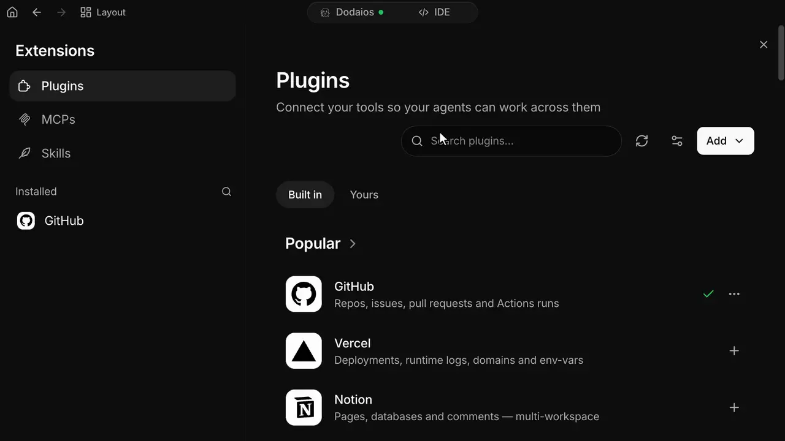
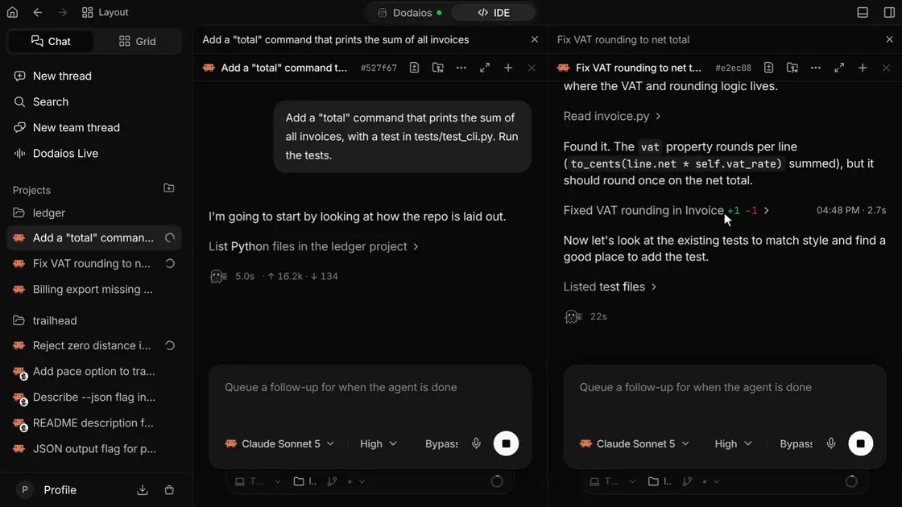
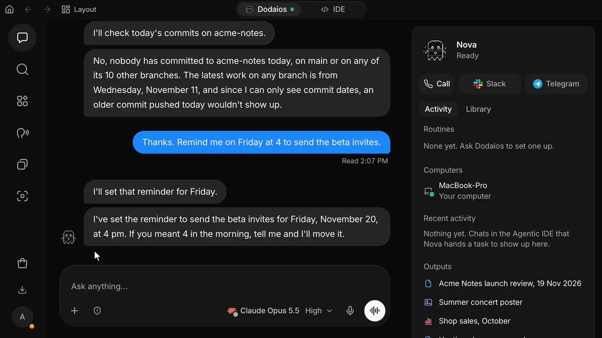
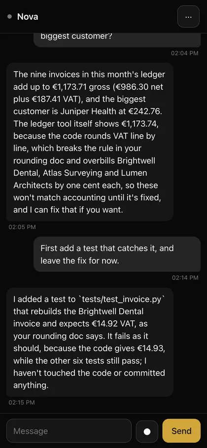

<div align="center">

<a href="https://dodaios.ai">
  <picture>
    <source media="(prefers-color-scheme: dark)" srcset="https://raw.githubusercontent.com/Dodaios/Dodaios/main/assets/brand/dodaios-logo-on-dark.svg" />
    
  </picture>
</a>

<h1>Dodaios</h1>

<!-- the promise and the definition: word for word everywhere (docs/positioning.md) -->
<p><b>Say what you want. Dodaios runs Claude Code, Codex and seven more coding agents on your own plans, checks their work, and tells you what is done.</b></p>

<p>
  Dodaios is an open-source desktop app. You tell its assistant what you need,<br />
  and it does the work itself or hands it to Claude Code, Codex and your other coding agents.
</p>

<p>
  <a href="https://github.com/Dodaios/Dodaios/releases/latest"></a>
  <a href="https://github.com/Dodaios/Dodaios/blob/main/LICENSE"></a>
  <a href="https://github.com/Dodaios/Dodaios/stargazers"></a>
  <a href="https://discord.gg/x7USduHxbc"></a>
</p>

<p>
  <a href="#install">Install</a> ·
  <a href="#why-dodaios">Why Dodaios</a> ·
  <a href="#your-plans-and-keys">Your plans</a> ·
  <a href="#documentation">Documentation</a> ·
  <a href="https://dodaios.ai">Website</a> ·
  <a href="https://discord.gg/x7USduHxbc">Discord</a> ·
  <a href="https://github.com/Dodaios/Dodaios/blob/main/README.zh-CN.md">简体中文</a>
</p>

</div>

<p align="center">
  
</p>

<p align="center">
  <sub>A real recording. The waits for the models are cut out, and the rest plays 1.18 times as fast. The assistant, Nova, runs on Claude Opus 5.5 and starts five Claude Code agents on Sonnet 5.5, signed in to a Claude plan. The pull requests, the reviews and the deck are real. <a href="https://raw.githubusercontent.com/Dodaios/Dodaios/main/assets/demo/readme/dodaios-demo.mp4"><b>Download it as a video</b></a> (MP4, 4 MB)</sub>
</p>

## Install

macOS and Linux:

```bash
curl -fsSL https://raw.githubusercontent.com/Dodaios/Dodaios/main/install/install.sh | bash
```

Windows, in PowerShell:

```powershell
irm https://raw.githubusercontent.com/Dodaios/Dodaios/main/install/install.ps1 | iex
```

The installer sets up its own Python environment, adds a launcher and opens
the app. On the first start you give the assistant a name (it is also the
wake word), connect one model and choose how you want to talk to it. For
coding work, install at least one coding agent, such as Claude Code or Codex,
and sign in to it.

```bash
dodaios            # start the desktop app
dodaios update     # install the newest release
```

<details>
<summary>Desktop installers, pipx and servers</summary>

<br />

Download the installer for your system from the latest release:

| Windows | macOS | Linux |
| --- | --- | --- |
| [Dodaios-Setup-x64.exe](https://github.com/Dodaios/Dodaios/releases/latest/download/Dodaios-Setup-x64.exe) | [Apple Silicon](https://github.com/Dodaios/Dodaios/releases/latest/download/Dodaios-macOS-arm64.dmg) · [Intel](https://github.com/Dodaios/Dodaios/releases/latest/download/Dodaios-macOS-x64.dmg) | [AppImage, x86_64](https://github.com/Dodaios/Dodaios/releases/latest/download/Dodaios-Linux-x86_64.AppImage) |

Each release lists the checksums in `installers-SHA256SUMS.txt`. The
installers are not signed yet: Windows shows a warning, and macOS asks you to
allow the app once in System Settings, under Privacy & Security. The
[code signing policy](https://github.com/Dodaios/Dodaios/blob/main/docs/code-signing-policy.md)
says where that stands.

With pipx you get the smaller server package, without a desktop launcher. On a
Linux server without a screen, the installer takes `--headless`, and
`dodaios serve` starts only the browser interface:

```bash
pipx install dodaios
curl -fsSL https://raw.githubusercontent.com/Dodaios/Dodaios/main/install/install.sh | bash -s -- --headless
dodaios serve      # browser interface only, for a server without a screen
```

Dodaios runs on 64-bit Windows, macOS and glibc-based Linux. The terminal
installer works on x86-64 and Arm64 and needs Python 3.11 to 3.14 and Git; it
fetches a missing Python and offers to install a missing Git. A graphics card
is optional.
[Install guide](https://github.com/Dodaios/Dodaios/blob/main/docs/product/start-here/install-dodaios.md) ·
[Platform support](https://github.com/Dodaios/Dodaios/blob/main/docs/product/reference/platform-support.md) ·
[Running it on a server](https://github.com/Dodaios/Dodaios/blob/main/docs/headless-vps-deployment.md)

</details>

## Why Dodaios

If you work with AI every day, your work is probably spread out. Claude Code
runs in one terminal and Codex in another. The chat assistant is in a browser
tab, dictation is a separate app, and your documents are somewhere else. None
of them knows what the others did. So you keep track yourself: which agent is
done, which one is waiting for an answer, and what to copy where.

Dodaios puts all of it in one app on your computer, and its assistant keeps
track for you.

- **Hand off work, get a result.** Say what you want done. The assistant
  writes the brief for one or more coding agents, answers their questions and
  tells you how it went.
- **Every coding agent in one window.** Claude Code, Codex, Cursor CLI,
  OpenCode, Grok Build, Antigravity, Kimi Code, GLM Coding Plan and DeepSeek
  Harness, as chat threads or in terminals, up to four side by side.
- **No new subscription.** Dodaios sells no model access. Each coding agent
  runs on the plan or key you already have, such as a Claude or ChatGPT plan.
- **Yours.** Apache 2.0, no Dodaios account, no paid tier. Your chats, memory
  and documents are files on your computer.

It also talks and listens, makes docs, decks, sheets and whiteboards, goes
with you to your phone, Telegram and Slack, and runs routines while you are
away. Each has its own section under [What it does](#what-it-does).

## What it does

### The assistant

<p align="center">
  
</p>

You name the assistant, and the name is also its wake word (Nova in these
recordings). It works in your apps through 48 plugins, such as GitHub, Slack,
Notion and Gmail, most of them still marked Preview, or through any MCP
server. It browses in its own browser, uses desktop apps with the mouse and
keyboard, and keeps notes about you and your work that you can read and
correct. It hands coding work to a coding agent, answers the agent's questions
and reads its report.

[Plugins](https://github.com/Dodaios/Dodaios/blob/main/docs/product/extend-and-automate/plugins.md) ·
[Browser](https://github.com/Dodaios/Dodaios/blob/main/docs/browser-use.md) ·
[Computer use](https://github.com/Dodaios/Dodaios/blob/main/docs/product/extend-and-automate/computer-use.md) ·
[Memory](https://github.com/Dodaios/Dodaios/blob/main/docs/product/knowledge-and-sharing/wiki-and-memory.md) ·
[Routines](https://github.com/Dodaios/Dodaios/blob/main/docs/routines.md) ·
[Standing tasks](https://github.com/Dodaios/Dodaios/blob/main/docs/standing-tasks.md)

### Your coding agents

<p align="center">
  
</p>

**Claude Code · Codex · Cursor CLI · OpenCode · Kimi Code · GLM Coding Plan · Grok Build · Antigravity · DeepSeek Harness**

The Agentic IDE shows an agent's tool calls, diffs, plan and questions while it
works. Open up to four threads side by side, put a team of two to eight agents
on one task, or give a thread its own worktree and branch, with an editor, a
Git client and a browser preview next to it. A terminal agent can also run on
your own Linux server over SSH and keep going when you close the laptop.

[Agentic IDE](https://github.com/Dodaios/Dodaios/blob/main/docs/product/extend-and-automate/agentic-ide.md) ·
[Threads](https://github.com/Dodaios/Dodaios/blob/main/docs/agentic-ide-threads.md) ·
[Team threads](https://github.com/Dodaios/Dodaios/blob/main/docs/agentic-ide-team-threads.md)

### Voice

<!-- The recording of this section needs a real voice and microphone; it is made
     with scripts/readme_demo/voice_take.py (assets/demo/readme/README.md) and
     goes here as voice.webp. -->

Say the wake word or press your call shortcut, and talk; the assistant answers
out loud. Hold the dictation key in any app, and what you say is typed there
with punctuation. In English, German, Spanish and Portuguese the "um"s are
left out. The wake word and dictation can run on your computer, with no key
and no account.

[Voice conversations](https://github.com/Dodaios/Dodaios/blob/main/docs/product/everyday-use/voice-conversations.md) ·
[Dictation](https://github.com/Dodaios/Dodaios/blob/main/docs/product/everyday-use/dictation.md) ·
[Wake word](https://github.com/Dodaios/Dodaios/blob/main/docs/product/personalize-and-connect/audio-and-wake-word.md)

### Docs, decks, sheets and whiteboards

<p align="center">
  
</p>

Ask for a doc, a slide deck, a sheet or a whiteboard, and it arrives filled
in. Each has its own editor, so you can change it by hand: type into the text,
edit a cell, drag a box. On a whiteboard you and the assistant draw on the
same canvas. Everything exports as HTML, and as PDF or PNG when a Chromium
browser such as Chrome or Edge is installed.

[Nodes](https://github.com/Dodaios/Dodaios/blob/main/docs/nodes.md)

### Away from your desk



The conversation with the assistant goes with you, and what you said on the
way is in the desktop chat when you come back.

- **Phone app.** A web app that your own computer serves, over your home
  network or HTTPS. Pair it with a code, then type, send voice notes, and
  allow or deny what waits for your yes.
- **Telegram.** Your private chat with your own Telegram bot, from anywhere.
  Text, voice notes and photos work, and requests come with Allow and Deny
  buttons.
- **Slack.** A direct message to your own Slack app, which you create from a
  ready-made manifest in one click. Only you get answers. With your Slack
  sign-in the assistant can also search, read and post in your workspace.

[Phone app](https://github.com/Dodaios/Dodaios/blob/main/docs/mobile-companion.md) ·
[Slack app](https://github.com/Dodaios/Dodaios/blob/main/docs/slack-channel.md)

<br clear="right" />

## Your plans and keys

Dodaios sells no model access and never signs in for you. It starts each
coding agent's official command-line tool, and you sign in to each one
yourself. So the agents run on what you already have:

| You have | It runs |
| --- | --- |
| A paid Claude plan (Pro or higher) | Claude Code |
| A ChatGPT plan | Codex |
| A Cursor account | Cursor CLI |
| SuperGrok or X Premium+ | Grok Build |
| A Google account (the free plan has weekly limits) | Antigravity |
| The providers you set up in OpenCode | OpenCode |
| A Moonshot, Z.ai or DeepSeek key or plan | Kimi Code, GLM Coding Plan (Claude Code against Z.ai), DeepSeek Harness |

The assistant runs on the model you choose. Claude, OpenAI, Google Gemini and
xAI Grok connect with a plan or an API key. OpenRouter, LiteLLM, Google Vertex
AI, NVIDIA NIM and DeepSeek connect with a key. A local model runs through
Ollama, with no account and no key. Your use of each service follows that
service's own terms.
[Providers and API keys](https://github.com/Dodaios/Dodaios/blob/main/docs/product/personalize-and-connect/providers-and-api-keys.md) ·
[Local models](https://github.com/Dodaios/Dodaios/blob/main/docs/product/personalize-and-connect/local-ai-providers.md)

## Questions

**Does my data leave my computer?**
Chats, memory, documents and settings are files on the computer that runs
Dodaios. A model or a connected service gets what it needs for its part of a
request. Signing in to the Google, Slack or Figma plugin, and each later token
refresh, goes through a small token service that the project runs. Dodaios
does not upload its logs on its own.
[Privacy and local data](https://github.com/Dodaios/Dodaios/blob/main/docs/product/privacy-safety-and-support/privacy-and-local-data.md)

**Does it act without asking?**
Each chat has a permission mode. A new chat starts at Bypass permissions,
where nothing asks. In the asking modes, moving money, passwords and keys,
deleting something for good and a first message in your name to someone new
always wait for your yes.
[Safety and approvals](https://github.com/Dodaios/Dodaios/blob/main/docs/product/privacy-safety-and-support/safety-and-approvals.md)

**What does it cost?**
Nothing. There is no Dodaios account and no paid tier. You pay your model
providers as you do today.

**Which systems does it run on?**
Windows, macOS and Linux, with the interface in English, German, Spanish,
Chinese and Portuguese. So far only Windows 11 has a recorded live sign-off.
[Platform support](https://github.com/Dodaios/Dodaios/blob/main/docs/product/reference/platform-support.md)

## Documentation

The [feature tour](https://github.com/Dodaios/Dodaios/blob/main/docs/feature-tour.md)
shows every part on one page, with pictures. The same guides are in the app
under **Docs**, with search.

- [Welcome to Dodaios](https://github.com/Dodaios/Dodaios/blob/main/docs/product/start-here/welcome-to-dodaios.md): what it does and what it does not do
- [First-run setup](https://github.com/Dodaios/Dodaios/blob/main/docs/product/start-here/first-run-setup.md) and [your first chat](https://github.com/Dodaios/Dodaios/blob/main/docs/product/start-here/start-your-first-chat.md)
- [Troubleshooting](https://github.com/Dodaios/Dodaios/blob/main/docs/product/privacy-safety-and-support/troubleshooting.md)
- [Configuration reference](https://github.com/Dodaios/Dodaios/blob/main/docs/product/reference/configuration-reference.md) and [CLI reference](https://github.com/Dodaios/Dodaios/blob/main/docs/dodaios-cli-reference.md)
- [Architecture overview](https://github.com/Dodaios/Dodaios/blob/main/docs/architecture-overview.md), for people who want to change the code

## Contributing

Fixes, tests, accessibility work, platform reports and documentation are
welcome. The
[contributing guide](https://github.com/Dodaios/Dodaios/blob/main/CONTRIBUTING.md#your-first-contribution-in-10-minutes)
gets you from a fork to a passing check in about ten minutes. Good places to
start are the issues labelled
[good first issue](https://github.com/Dodaios/Dodaios/issues?q=is%3Aissue+is%3Aopen+label%3A%22good+first+issue%22)
and
[help wanted](https://github.com/Dodaios/Dodaios/issues?q=is%3Aissue+is%3Aopen+label%3A%22help+wanted%22).
Questions and ideas go to [Discord](https://discord.gg/x7USduHxbc). If
Dodaios is useful to you, a
[star](https://github.com/Dodaios/Dodaios/stargazers) helps other people find
it.

Thanks to everyone who has shipped something here:

<!-- contributors:start -->

<a href="https://github.com/rubenluetke"></a> <a href="https://github.com/dannyward630"></a> <a href="https://github.com/dennisheidederamirez-coder"></a> <a href="https://github.com/ANO3457"></a> <a href="https://github.com/PilarJ"></a> <a href="https://github.com/Idee-Wird-App"></a> <a href="https://github.com/CodeByPeace"></a> <a href="https://github.com/jaydenhawkes123"></a> <a href="https://github.com/alibaba080290"></a> <a href="https://github.com/dovellx"></a> <!-- i18n-allow -->
<a href="https://github.com/eljeffeg"></a> <a href="https://github.com/martiroca06"></a> <a href="https://github.com/morfeus48235-glitch"></a> <a href="https://github.com/Oscar-Williams"></a> <a href="https://github.com/Sgangalossa"></a> <a href="https://github.com/tianxingjian2406"></a> <a href="https://github.com/Uddoo"></a> <a href="https://github.com/Virtuluso-azores"></a> <a href="https://github.com/YannisG23"></a> <!-- i18n-allow -->

<!-- contributors:end -->

## License

Dodaios is licensed under the
[Apache License 2.0](https://github.com/Dodaios/Dodaios/blob/main/LICENSE),
with the attribution in
[NOTICE](https://github.com/Dodaios/Dodaios/blob/main/NOTICE). The name and
the logo are covered by the
[trademark policy](https://github.com/Dodaios/Dodaios/blob/main/TRADEMARK.md),
not by the license.

Dodaios is an independent project. The products it works with, such as the
coding agents above, belong to their makers. That Dodaios supports a tool does
not mean its maker supports or approves of Dodaios.

Dodaios was called Personal Jarvis until October 2026. It is the same project
under the same license
([why the name changed](https://dodaios.ai/blog/personal-jarvis-is-now-dodaios/)).

Sponsors are in [SPONSORS.md](https://github.com/Dodaios/Dodaios/blob/main/SPONSORS.md).
