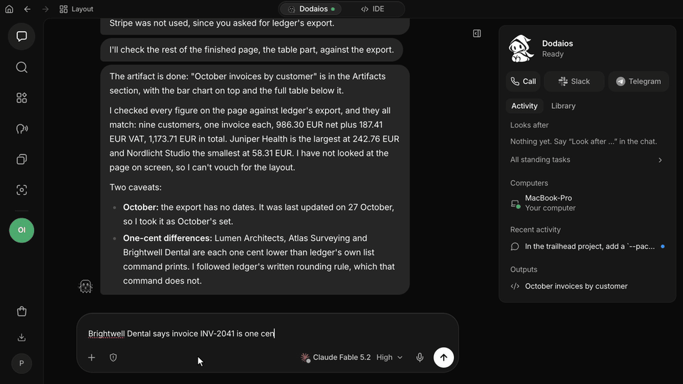
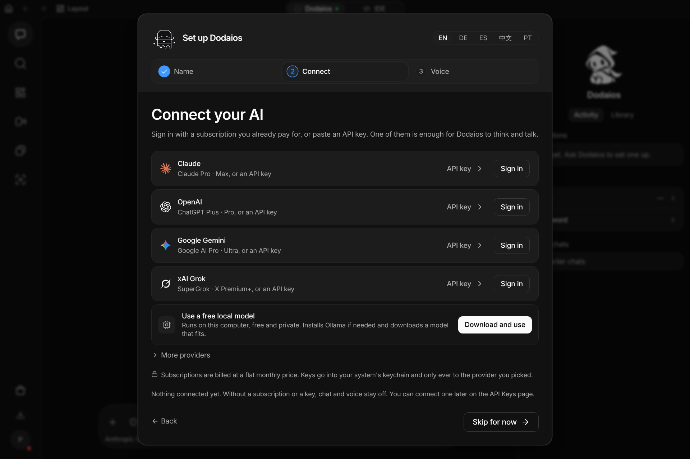
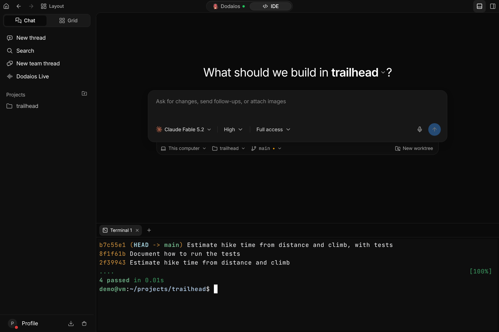
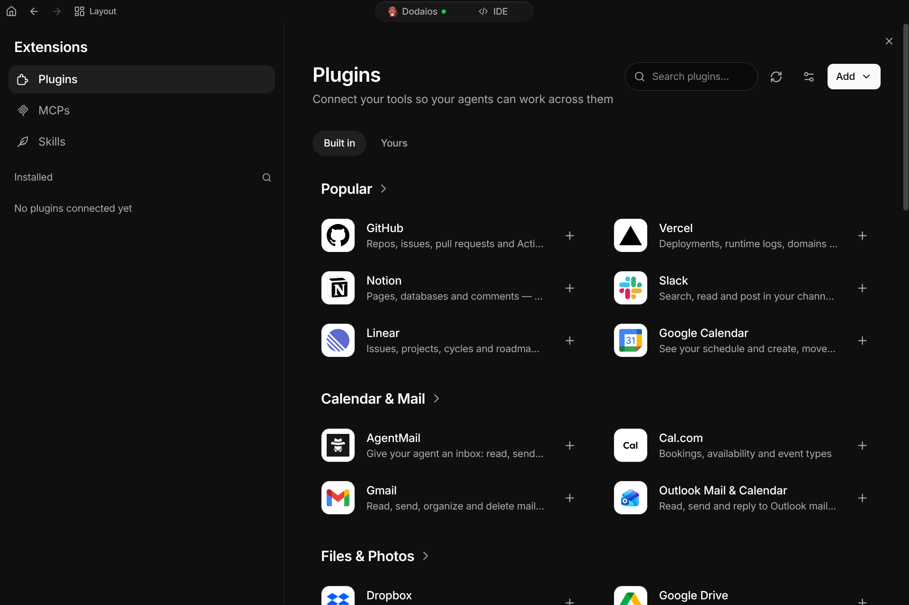
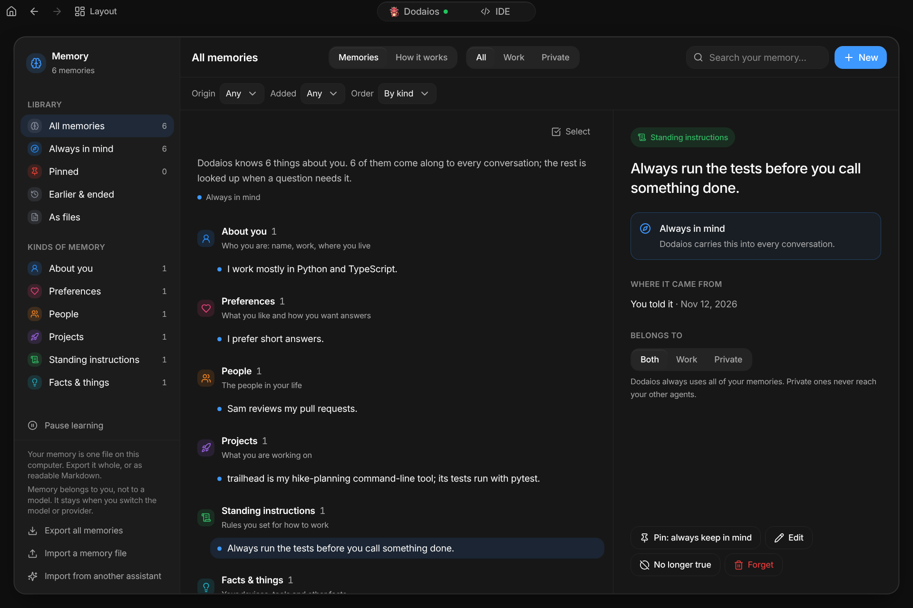
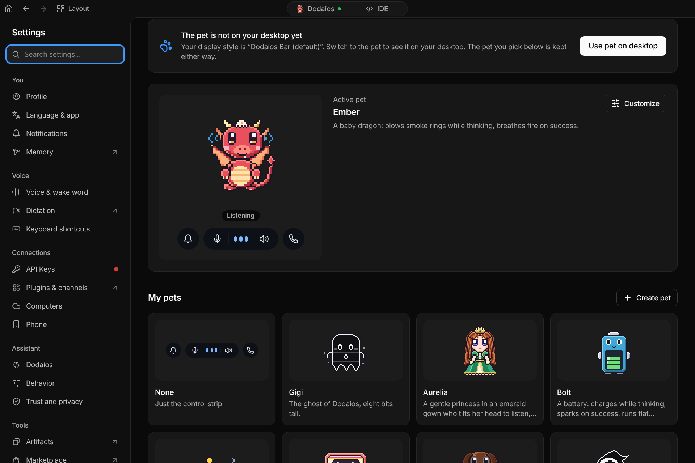
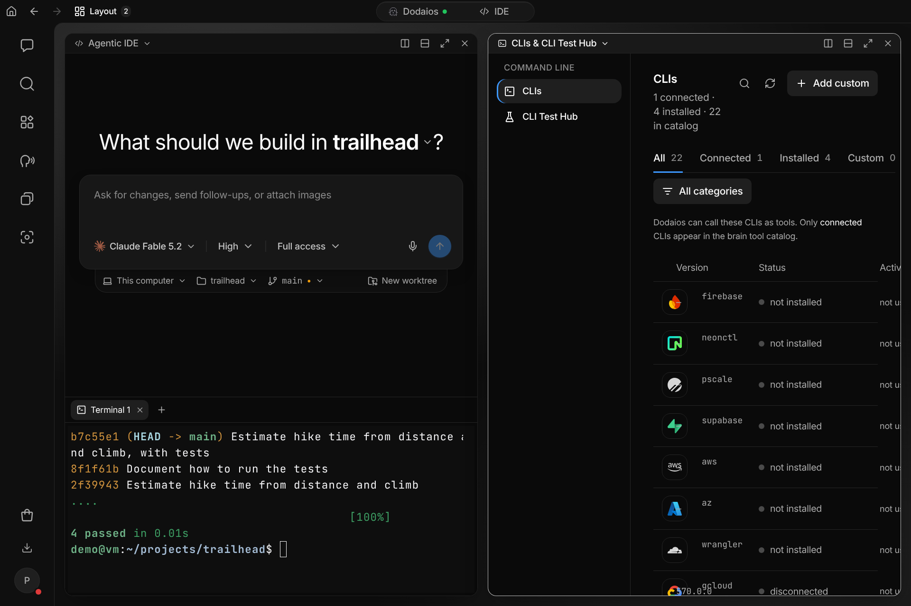
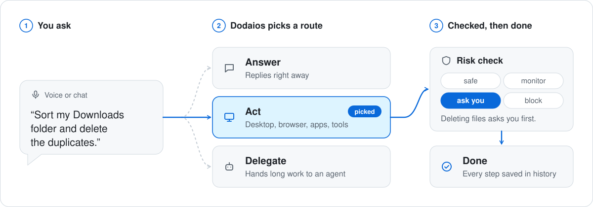

<div align="center">

<a href="https://dodaios.ai">
  <picture>
    <source media="(prefers-color-scheme: dark)" srcset="https://raw.githubusercontent.com/Dodaios/Dodaios/main/assets/brand/dodaios-logo-on-dark.svg" />
    
  </picture>
</a>

<h1>Dodaios</h1>

<p><b>Turn your computer into an AI agent.</b></p>

<p>
  Talk to it or type. It answers, works your desktop and your apps,<br />
  and hands long jobs to agents that run in the background.<br />
  You bring the model, and it asks before anything risky.
</p>

<p>
  <a href="https://github.com/Dodaios/Dodaios/releases/latest"></a>
  <a href="https://github.com/Dodaios/Dodaios/blob/main/LICENSE"></a>
  <a href="https://github.com/Dodaios/Dodaios/stargazers"></a>
  <a href="https://discord.gg/x7USduHxbc"></a>
</p>

<p>
  <a href="https://dodaios.ai">Website</a> ·
  <a href="#install">Install</a> ·
  <a href="#documentation">Documentation</a> ·
  <a href="https://discord.gg/x7USduHxbc">Discord</a> ·
  <a href="https://github.com/Dodaios/Dodaios/blob/main/README.zh-CN.md">简体中文</a>
</p>

</div>

<p align="center">
  <a href="https://github.com/Dodaios/Dodaios/blob/main/assets/demo/readme/dodaios-demo.gif">
    
  </a>
</p>

<p align="center">
  <sub>One take of the real app (version 5.0.0) with Claude Opus 5.5 through a signed-in Claude Code. Every answer and every change is real. Clicks and typing play at 1.4× speed, the waits for the model at 7×.</sub>
</p>

## What it is

Dodaios is a desktop app for Windows, macOS and Linux. On a server without a
screen, the same app runs in a browser. You give it a task in chat or by voice:

- A short question is answered at once.
- A task that needs your computer goes through tools: the desktop, the browser,
  a terminal, the services you connected.
- A long job goes to an agent that works in the background and reports back.

Three things hold everywhere:

- **You bring the model.** Sign in with a subscription you already pay for,
  paste an API key, or run a local model. Chat, speech, computer use and agents
  can each use a different provider.
- **It asks first.** Every tool call a model wants to make gets a risk level.
  Anything that can change your system or one of your accounts waits for your yes.
- **Your data stays with you.** Chats, memory, settings and results are files on
  the computer that runs Dodaios. There is no Dodaios account and no paid tier.
  A model or a connected service receives what it needs for its part of a request.

## Install

**Desktop app.** Download the installer for your system from the latest release:

| Windows | macOS | Linux |
| --- | --- | --- |
| [Dodaios-Setup-x64.exe](https://github.com/Dodaios/Dodaios/releases/latest/download/Dodaios-Setup-x64.exe) | [Apple Silicon](https://github.com/Dodaios/Dodaios/releases/latest/download/Dodaios-macOS-arm64.dmg) · [Intel](https://github.com/Dodaios/Dodaios/releases/latest/download/Dodaios-macOS-x64.dmg) | [AppImage, x86_64](https://github.com/Dodaios/Dodaios/releases/latest/download/Dodaios-Linux-x86_64.AppImage) |

Each release lists the checksums in `installers-SHA256SUMS.txt`. The Windows
installer is not code-signed yet; the
[code signing policy](https://github.com/Dodaios/Dodaios/blob/main/docs/code-signing-policy.md)
says where that stands.

**From a terminal.** The installer sets up its own Python environment, adds a
launcher and opens the app.

```powershell
# Windows (PowerShell)
irm https://raw.githubusercontent.com/Dodaios/Dodaios/main/install/install.ps1 | iex
```

```bash
# macOS and Linux
curl -fsSL https://raw.githubusercontent.com/Dodaios/Dodaios/main/install/install.sh | bash

# A Linux server without a screen
curl -fsSL https://raw.githubusercontent.com/Dodaios/Dodaios/main/install/install.sh | bash -s -- --headless
```

**With pipx.** The smaller server package, without a desktop launcher:

```bash
pipx install dodaios
```

**Then start it:**

```bash
dodaios            # the desktop app: window, voice and the on-screen overlay
dodaios serve      # browser interface only, for a server without a screen
dodaios update     # install the newest published release
```

The first start asks for three things: a name (it is also the wake word), one
model connection, and how you want to talk to it. Installing needs no provider.
Answers do.

It runs on 64-bit Windows, macOS and glibc-based Linux, on x86-64 and Arm64.
The terminal installer needs Python 3.11 to 3.14 and Git and fetches whichever
is missing. A graphics card is optional.
[Install guide](https://github.com/Dodaios/Dodaios/blob/main/docs/product/start-here/install-dodaios.md) ·
[Platform support](https://github.com/Dodaios/Dodaios/blob/main/docs/product/reference/platform-support.md) ·
[Running it on a server](https://github.com/Dodaios/Dodaios/blob/main/docs/headless-vps-deployment.md)

## What you get

### Any model, yours



Claude, OpenAI, Google Gemini and xAI Grok connect with the subscription you
already have or with an API key. OpenRouter, LiteLLM, Google Vertex AI and
NVIDIA NIM are there as well. A local model runs through Ollama or any
OpenAI-compatible server, with no account and no key. Keys go into your
system's keychain.
[Providers and API keys](https://github.com/Dodaios/Dodaios/blob/main/docs/product/personalize-and-connect/providers-and-api-keys.md) ·
[Local AI providers](https://github.com/Dodaios/Dodaios/blob/main/docs/product/personalize-and-connect/local-ai-providers.md)

### Chat and voice

Type, or say the wake word, or press your Call shortcut and talk. Voice runs
in one of two ways. The pipeline chains speech recognition, the model and a
voice, each of them local or hosted. Realtime uses one live model that listens
and speaks. Dictation is separate: it types what you say into the app you are
working in.
[Voice conversations](https://github.com/Dodaios/Dodaios/blob/main/docs/product/everyday-use/voice-conversations.md) ·
[Dictation](https://github.com/Dodaios/Dodaios/blob/main/docs/product/everyday-use/dictation.md)

### Coding agents on your projects



The Agentic IDE runs coding agents in your own project folders: Claude Code,
Codex, OpenCode, Kimi Code, GLM Coding Plan, Grok Build, Antigravity and
DeepSeek Harness, each with the models, effort levels and permission modes it
really has. A thread can get its own worktree on its own branch. Terminals,
changes, Git, files and a browser preview sit beside the conversation.
[Agentic IDE](https://github.com/Dodaios/Dodaios/blob/main/docs/product/extend-and-automate/agentic-ide.md)

### Work that runs without you

Ask for something bigger and Dodaios hands it to a background agent. It works
in an isolated Git worktree, the result is reviewed before it is reported as
finished, and the files it made are kept for you. Ask for something regular
and it becomes an automation that runs on a schedule, on an event or on a
webhook.
[Background agents](https://github.com/Dodaios/Dodaios/blob/main/docs/product/extend-and-automate/dodaios-agents.md) ·
[Routines](https://github.com/Dodaios/Dodaios/blob/main/docs/routines.md) ·
[Standing tasks](https://github.com/Dodaios/Dodaios/blob/main/docs/standing-tasks.md)

### Tools it can use



- **Plugins.** 47 services ship in the catalog, among them GitHub, Slack,
  Notion, Linear, Gmail, Google Calendar, Home Assistant and Spotify.
- **MCP servers and skills.** Add any Model Context Protocol server. A skill is
  a written procedure the assistant follows; you can write one or ask for one.
- **Computer use.** It can read the screen and use the mouse and keyboard, in
  desktop apps and in the browser.
- **The command line.** `dodaios` drives a running instance from a terminal, so
  a script or another coding agent can do everything the window can.

[Plugins](https://github.com/Dodaios/Dodaios/blob/main/docs/product/extend-and-automate/plugins.md) ·
[MCP connections](https://github.com/Dodaios/Dodaios/blob/main/docs/product/extend-and-automate/mcp-connections.md) ·
[Skills](https://github.com/Dodaios/Dodaios/blob/main/docs/product/extend-and-automate/skills.md) ·
[Computer use](https://github.com/Dodaios/Dodaios/blob/main/docs/product/extend-and-automate/computer-use.md) ·
[CLI](https://github.com/Dodaios/Dodaios/blob/main/docs/dodaios-cli.md)

### A memory you can read



Dodaios remembers short sentences about you and your work: how you like
answers, the people you mention, the projects you are on. All of it is one
file on your computer. You can read, correct, pin, export or forget every
entry. A changed fact closes the old one with a date instead of overwriting
it. Passwords and keys are never stored.
[Memory](https://github.com/Dodaios/Dodaios/blob/main/docs/product/knowledge-and-sharing/wiki-and-memory.md)

### The small things

<table>
  <tr>
    <td width="50%"></td>
    <td width="50%"></td>
  </tr>
  <tr>
    <td valign="top"><b>Pets.</b> A pixel companion on your desktop that reacts while Dodaios listens, thinks and talks. Twenty are built in, and you can make your own. <a href="https://github.com/Dodaios/Dodaios/blob/main/docs/pets.md">Pets</a></td>
    <td valign="top"><b>Side by side.</b> Put up to four sections next to each other, for example a project and your command-line tools. The interface comes in English, German, Spanish, Chinese and Portuguese.</td>
  </tr>
</table>

Also in the app: a phone companion that continues the same conversation, tasks
and reminders, a record of every run with its steps and tool calls, and a page
that shows what your usage cost.
[Tour of the app](https://github.com/Dodaios/Dodaios/blob/main/docs/product/start-here/desktop-app-tour.md)

## How a request runs

<picture>
  <source media="(prefers-color-scheme: dark)" srcset="https://raw.githubusercontent.com/Dodaios/Dodaios/main/assets/brand/how-a-request-runs-dark.svg" />
  
</picture>

Every tool call a model proposes goes through one gate before it can touch
your computer or an account:

| Level | What happens |
| --- | --- |
| **Safe** | Runs without asking. |
| **Monitor** | Runs without asking and is marked for review. |
| **Ask** | Waits for your yes. No answer counts as no. |
| **Block** | Is refused. An approval cannot override it. |

One approval covers one call, not the rest of the job. The gate is not a
sandbox and not an undo: it covers the tool calls Dodaios makes, and your
operating system's permissions still apply.
[Safety and approvals](https://github.com/Dodaios/Dodaios/blob/main/docs/product/privacy-safety-and-support/safety-and-approvals.md) ·
[Privacy and local data](https://github.com/Dodaios/Dodaios/blob/main/docs/product/privacy-safety-and-support/privacy-and-local-data.md) ·
[Security policy](https://github.com/Dodaios/Dodaios/blob/main/SECURITY.md)

## What runs where

| | Windows | macOS | Linux desktop | Linux server |
| --- | --- | --- | --- | --- |
| Chat, coding agents, tasks, memory, settings | Yes | Yes | Yes | In the browser |
| Desktop app | Yes | Yes | Yes | No |
| Voice with the computer's microphone | Yes | Needs permission | Needs PortAudio | Through the browser |
| Global shortcuts | Yes | Needs permission | X11 | No |
| Computer use | Yes | Needs permission | X11 | No |

Windows 11 is the system with recorded live checks. The macOS and Linux
desktop paths are built and covered by tests, and their live sign-off is still
open. A feature that cannot run on your system says so and leaves the rest
working.
[Platform support](https://github.com/Dodaios/Dodaios/blob/main/docs/product/reference/platform-support.md)

## Documentation

- [Welcome to Dodaios](https://github.com/Dodaios/Dodaios/blob/main/docs/product/start-here/welcome-to-dodaios.md): what it does and what it does not do
- [First-run setup](https://github.com/Dodaios/Dodaios/blob/main/docs/product/start-here/first-run-setup.md) and [your first chat](https://github.com/Dodaios/Dodaios/blob/main/docs/product/start-here/start-your-first-chat.md)
- [Troubleshooting](https://github.com/Dodaios/Dodaios/blob/main/docs/product/privacy-safety-and-support/troubleshooting.md)
- [Configuration reference](https://github.com/Dodaios/Dodaios/blob/main/docs/product/reference/configuration-reference.md) and [CLI reference](https://github.com/Dodaios/Dodaios/blob/main/docs/dodaios-cli-reference.md)
- [Architecture overview](https://github.com/Dodaios/Dodaios/blob/main/docs/architecture-overview.md), for people who want to change the code

The same guides are inside the app under **Docs**, with search.

## Contributing

Fixes, tests, accessibility work, platform reports and documentation are
welcome. The
[contributing guide](https://github.com/Dodaios/Dodaios/blob/main/CONTRIBUTING.md#your-first-contribution-in-10-minutes)
gets you from a fork to a passing check in about ten minutes. Good places to
start are the issues labelled
[good first issue](https://github.com/Dodaios/Dodaios/issues?q=is%3Aissue+is%3Aopen+label%3A%22good+first+issue%22)
and
[help wanted](https://github.com/Dodaios/Dodaios/issues?q=is%3Aissue+is%3Aopen+label%3A%22help+wanted%22).
Questions and ideas go to [Discord](https://discord.gg/x7USduHxbc).

Thanks to everyone who has shipped something here:

<!-- contributors:start -->

<table>
<tr><td align="center"><a href="https://github.com/rubenluetke"><br><sub><b>rubenluetke</b></sub></a></td><td align="center"><a href="https://github.com/dannyward630"><br><sub><b>dannyward630</b></sub></a></td><td align="center"><a href="https://github.com/dennisheidederamirez-coder"><br><sub><b>dennisheidederamirez-coder</b></sub></a></td><td align="center"><a href="https://github.com/ANO3457"><br><sub><b>ANO3457</b></sub></a></td><td align="center"><a href="https://github.com/PilarJ"><br><sub><b>PilarJ</b></sub></a></td><td align="center"><a href="https://github.com/CodeByPeace"><br><sub><b>CodeByPeace</b></sub></a></td><td align="center"><a href="https://github.com/Idee-Wird-App"><br><sub><b>Idee-Wird-App</b></sub></a></td></tr> <!-- i18n-allow -->
<tr><td align="center"><a href="https://github.com/jaydenhawkes123"><br><sub><b>jaydenhawkes123</b></sub></a></td><td align="center"><a href="https://github.com/alibaba080290"><br><sub><b>alibaba080290</b></sub></a></td><td align="center"><a href="https://github.com/tianxingjian2406"><br><sub><b>tianxingjian2406</b></sub></a></td><td align="center"><a href="https://github.com/Uddoo"><br><sub><b>Uddoo</b></sub></a></td></tr> <!-- i18n-allow -->
</table>

<!-- contributors:end -->

## License

Dodaios is licensed under the
[Apache License 2.0](https://github.com/Dodaios/Dodaios/blob/main/LICENSE),
with the attribution in
[NOTICE](https://github.com/Dodaios/Dodaios/blob/main/NOTICE). The name and
the logo are covered by the
[trademark policy](https://github.com/Dodaios/Dodaios/blob/main/TRADEMARK.md),
not by the license.

Dodaios was called Personal Jarvis until October 2026. It is the same project
under the same license
([why the name changed](https://dodaios.ai/blog/personal-jarvis-is-now-dodaios/)).

Sponsors are in [SPONSORS.md](https://github.com/Dodaios/Dodaios/blob/main/SPONSORS.md).
