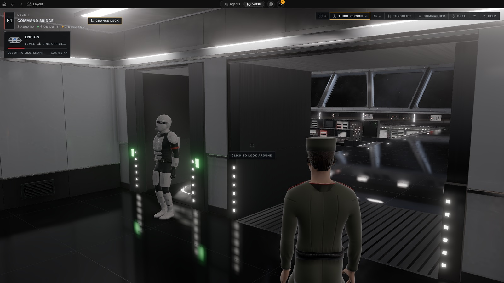

<p align="center">
  <picture>
    <source media="(prefers-color-scheme: dark)" srcset="https://raw.githubusercontent.com/Dodaios/Dodaios/main/assets/brand/dodaios-logo-on-dark.svg" />
    
  </picture>
</p>

<h1 align="center">Dodaios</h1>

<!-- canonical tagline: keep in sync with GitHub description, dodaios.ai and X bio (docs/rename/repo-metadata-proposal.md) -->
<p align="center"><strong>The open-source superagent for your desktop. One agent that runs all your other agents.</strong></p>

<p align="center">
  <a href="#install">install</a> ·
  <a href="https://github.com/Dodaios/Dodaios/blob/main/docs/product/start-here/welcome-to-dodaios.md">docs</a> ·
  <a href="https://dodaios.ai">dodaios.ai</a> ·
  <a href="https://discord.gg/x7USduHxbc">discord</a> ·
  English · <a href="https://github.com/Dodaios/Dodaios/blob/main/README.zh-CN.md">简体中文</a>
</p>

<p align="center">
  <a href="https://github.com/Dodaios/Dodaios/stargazers"></a>
  <a href="https://github.com/Dodaios/Dodaios/releases/latest"></a>
  <a href="https://github.com/Dodaios/Dodaios/blob/main/LICENSE"></a>
  <a href="https://discord.gg/x7USduHxbc"></a>
</p>

https://github.com/user-attachments/assets/1daa832e-a566-4f22-add6-8b21eb8aaaad

You talk to one agent. Dodaios hands the work to Claude Code, Codex, OpenCode
and the specialists you made, watches them work, and tells you when one of
them needs you. Everything runs on your own computer.

- **One boss, many agents.** Say what you want, by voice or chat. Dodaios
  writes a full brief and gives it to the right agent. The work continues after
  you hang up.
- **Every coding agent at once.** Split a project into panes and run a
  different coding agent in each one, on the plans you already pay for. Each
  pane has a call sign: "T1, run the tests. T2, fix what T1 finds."
  [Agentic IDE →](https://github.com/Dodaios/Dodaios/blob/main/docs/product/extend-and-automate/agentic-ide.md)
- **Your own crew.** Make a researcher, a release manager or a writer with one
  click. Each one keeps one endless conversation, learns from its own work and
  runs routines on a schedule.
  [Agents →](https://github.com/Dodaios/Dodaios/blob/main/docs/product/extend-and-automate/dodaios-agents.md)
- **Vibe coding that plays like a game.** Your agents live on a ship. You are
  the commanding officer, they are your crew, and they earn ranks as they work.
  [Verse →](https://github.com/Dodaios/Dodaios/blob/main/docs/verse/README.md)
- **You approve, it acts.** Each action gets a risk level: safe, monitor, ask
  or block. Anything that can change your system waits for your yes.
  [Safety →](https://github.com/Dodaios/Dodaios/blob/main/docs/product/privacy-safety-and-support/safety-and-approvals.md)

## Vibe coding, but it feels like a game

<p align="center">
  
</p>

Walk through the ship and see who is on duty and who needs you. Your coding
panes are the engineers, your agents are the officers, and your pet is your
companion drone. Work earns experience points for the crew and for you, and
everyone rises in rank.

## "So what are you selling?"

Nothing. Dodaios has no account, no paid tier and no cloud of its own. Bring
an API key, your Claude or ChatGPT plan, or a local model through Ollama. The
code is Apache 2.0.

## Install

```powershell
# Windows (PowerShell)
irm https://raw.githubusercontent.com/Dodaios/Dodaios/main/install/install.ps1 | iex
```

```bash
# macOS and Linux
curl -fsSL https://raw.githubusercontent.com/Dodaios/Dodaios/main/install/install.sh | bash
```

You do not need Python, Git or a GPU. The installer opens the app, and you pick
your language, wake phrase and model there. To update, run it again. To start
Dodaios later, use the desktop launcher or a terminal:

```bash
dodaios         # full desktop
```

> [!TIP]
> To code with Dodaios, install and log in to at least one coding agent first,
> for example `claude`, `codex` or `opencode`.

<details>
<summary>Desktop installers and servers</summary>

- [Windows (x64)](https://github.com/Dodaios/Dodaios/releases/latest/download/Dodaios-Setup-x64.exe)
- [macOS (Apple Silicon)](https://github.com/Dodaios/Dodaios/releases/latest/download/Dodaios-macOS-arm64.dmg)
- [macOS (Intel)](https://github.com/Dodaios/Dodaios/releases/latest/download/Dodaios-macOS-x64.dmg)
- [Linux (AppImage, x86_64)](https://github.com/Dodaios/Dodaios/releases/latest/download/Dodaios-Linux-x86_64.AppImage)

The macOS disk image is not notarized yet. On first launch, open **System
Settings > Privacy & Security** and click **Open Anyway**. Windows installers
are signed under our [code signing policy](https://github.com/Dodaios/Dodaios/blob/main/docs/code-signing-policy.md)
once the SignPath Foundation program approves the project. Free code signing
provided by SignPath.io, certificate by SignPath Foundation.

On a server without a screen:

```bash
pip install dodaios
dodaios serve
```

Then open `http://localhost:47821`. See the
[headless deployment guide](https://github.com/Dodaios/Dodaios/blob/main/docs/headless-vps-deployment.md)
and the [native package index](https://github.com/Dodaios/Dodaios/blob/main/docs/product/start-here/install-dodaios.md#install-the-isolated-pypi-package)
for Intel Macs and Windows ARM64.

</details>

## How it fits together

```text
                you  (voice or chat)
                 │
             ┌───▼────┐
             │Dodaios │  the superagent: plans, delegates, approves
             └───┬────┘
     ┌───────────┼──────────────┬───────────────┐
 coding panes  your agents   browser + apps   memory
 T1 T2 T3 …    researcher,   computer use,    a local wiki
 Claude Code,  writer, …     40+ plugins,     your agents
 Codex, …                    MCP              read and cite
```

Dodaios works with Claude Code, Codex, OpenCode, Kimi Code, GLM, Grok Build,
Antigravity, Cursor CLI and DeepSeek Harness. Models can come from OpenAI,
Claude, Gemini, OpenRouter, NVIDIA, Ollama or any OpenAI-compatible server.
Agents can also run on Hermes and OpenClaw. It runs on Windows, macOS, Linux
and servers without a screen.

Also inside:

- **Voice.** Your own wake phrase, live calls and dictation that can run offline.
- **Artifacts.** One wall for every page and report your agents make.
- **Marketplace.** Agents, skills and plugins from the community.

## Docs

[First run](https://github.com/Dodaios/Dodaios/blob/main/docs/product/start-here/first-run-setup.md) ·
[App tour](https://github.com/Dodaios/Dodaios/blob/main/docs/product/start-here/desktop-app-tour.md) ·
[Agentic IDE](https://github.com/Dodaios/Dodaios/blob/main/docs/product/extend-and-automate/agentic-ide.md) ·
[Agents](https://github.com/Dodaios/Dodaios/blob/main/docs/product/extend-and-automate/dodaios-agents.md) ·
[Voice](https://github.com/Dodaios/Dodaios/blob/main/docs/product/everyday-use/voice-conversations.md) ·
[Providers](https://github.com/Dodaios/Dodaios/blob/main/docs/product/personalize-and-connect/providers-and-api-keys.md) ·
[MCP](https://github.com/Dodaios/Dodaios/blob/main/docs/product/extend-and-automate/mcp-connections.md) ·
[CLI](https://github.com/Dodaios/Dodaios/blob/main/docs/dodaios-cli.md) ·
[Architecture](https://github.com/Dodaios/Dodaios/blob/main/docs/architecture-overview.md) ·
[Troubleshooting](https://github.com/Dodaios/Dodaios/blob/main/docs/product/privacy-safety-and-support/troubleshooting.md) ·
[Privacy](https://github.com/Dodaios/Dodaios/blob/main/docs/product/privacy-safety-and-support/privacy-and-local-data.md)

Dodaios was called Personal Jarvis before
([why the new name](https://dodaios.ai/blog/personal-jarvis-is-now-dodaios/)).

## Contribute

Start with a [good first issue](https://github.com/Dodaios/Dodaios/issues?q=is%3Aissue+is%3Aopen+label%3A%22good+first+issue%22)
or an issue labeled [`help wanted`](https://github.com/Dodaios/Dodaios/issues?q=is%3Aissue+is%3Aopen+label%3A%22help+wanted%22).
[Your first contribution in 10 minutes](https://github.com/Dodaios/Dodaios/blob/main/CONTRIBUTING.md#your-first-contribution-in-10-minutes)
shows you how. Security reports follow
[SECURITY.md](https://github.com/Dodaios/Dodaios/blob/main/SECURITY.md).
Sponsors are in [SPONSORS.md](https://github.com/Dodaios/Dodaios/blob/main/SPONSORS.md).

If Dodaios is useful to you, a star helps other people find it.

### Contributors

Thanks to everyone who has shipped something here.

<!-- contributors:start -->

<table>
<tr><td align="center"><a href="https://github.com/rubenluetke10-beep"><br><sub><b>rubenluetke10-beep</b></sub></a></td><td align="center"><a href="https://github.com/dannyward630"><br><sub><b>dannyward630</b></sub></a></td><td align="center"><a href="https://github.com/dennisheidederamirez-coder"><br><sub><b>dennisheidederamirez-coder</b></sub></a></td><td align="center"><a href="https://github.com/ANO3457"><br><sub><b>ANO3457</b></sub></a></td><td align="center"><a href="https://github.com/PilarJ"><br><sub><b>PilarJ</b></sub></a></td><td align="center"><a href="https://github.com/CodeByPeace"><br><sub><b>CodeByPeace</b></sub></a></td><td align="center"><a href="https://github.com/Idee-Wird-App"><br><sub><b>Idee-Wird-App</b></sub></a></td></tr> <!-- i18n-allow -->
<tr><td align="center"><a href="https://github.com/jaydenhawkes123"><br><sub><b>jaydenhawkes123</b></sub></a></td><td align="center"><a href="https://github.com/alibaba080290"><br><sub><b>alibaba080290</b></sub></a></td><td align="center"><a href="https://github.com/tianxingjian2406"><br><sub><b>tianxingjian2406</b></sub></a></td><td align="center"><a href="https://github.com/Uddoo"><br><sub><b>Uddoo</b></sub></a></td></tr> <!-- i18n-allow -->
</table>

<!-- contributors:end -->

## License

[Apache 2.0](https://github.com/Dodaios/Dodaios/blob/main/LICENSE). Releases up to and including 1.6.0 keep their original MIT license. See [NOTICE](https://github.com/Dodaios/Dodaios/blob/main/NOTICE) and the [trademark guidance](https://github.com/Dodaios/Dodaios/blob/main/TRADEMARK.md).
