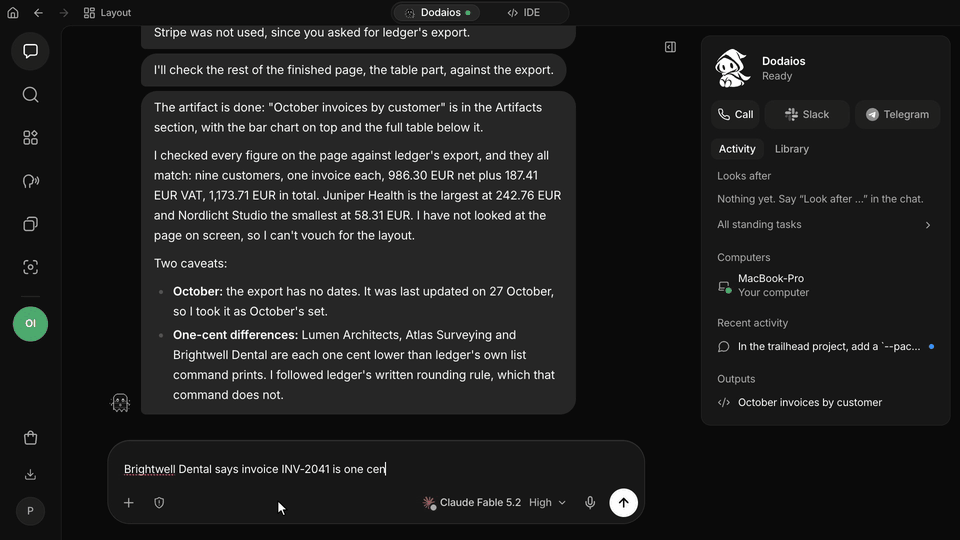
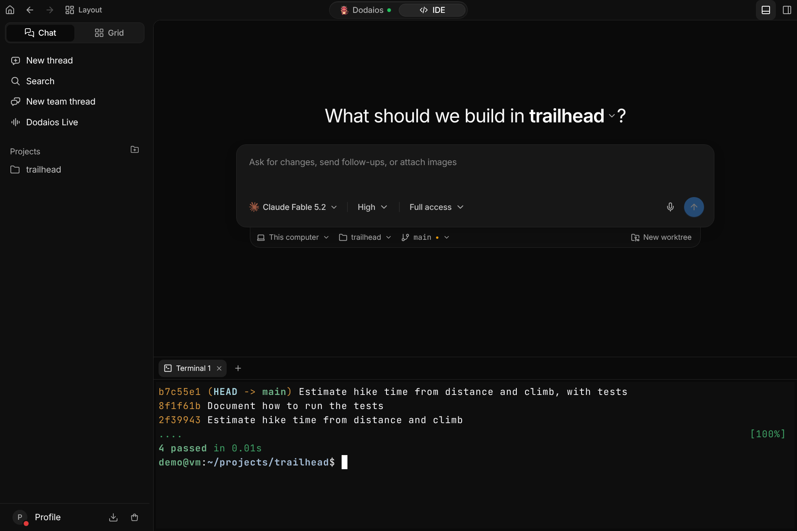
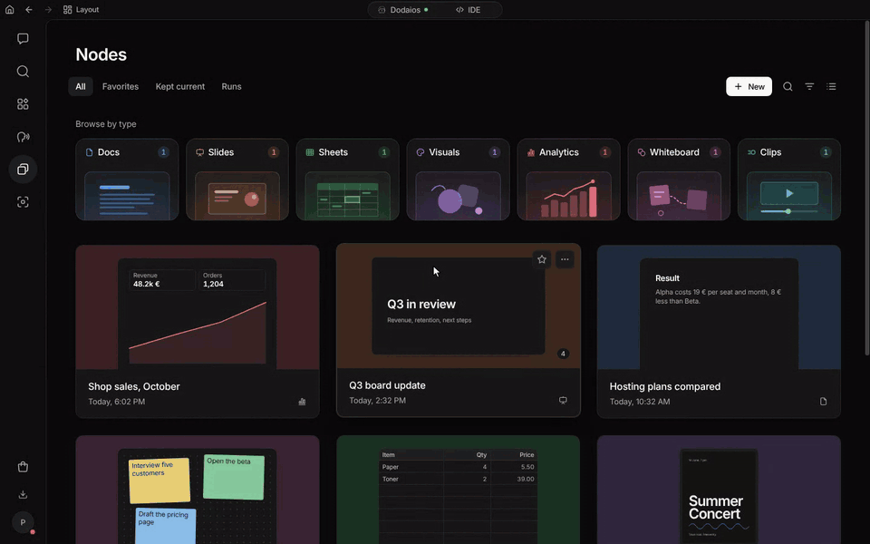
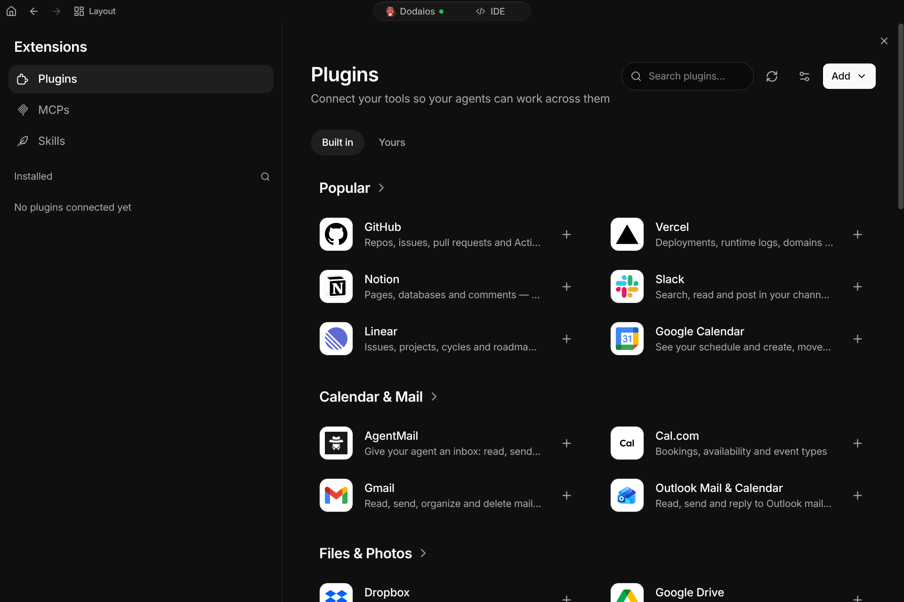
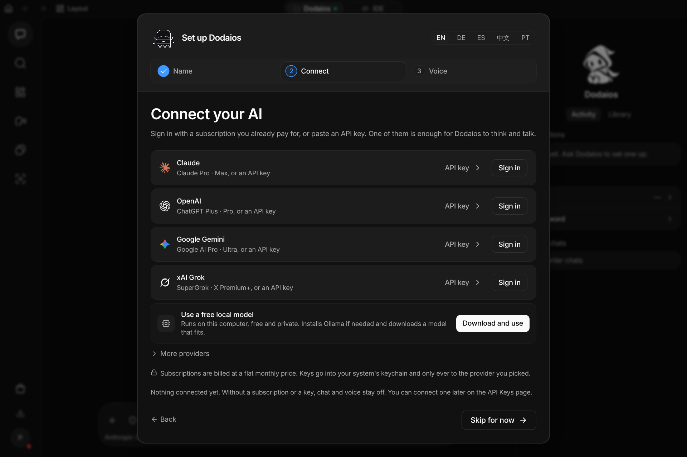
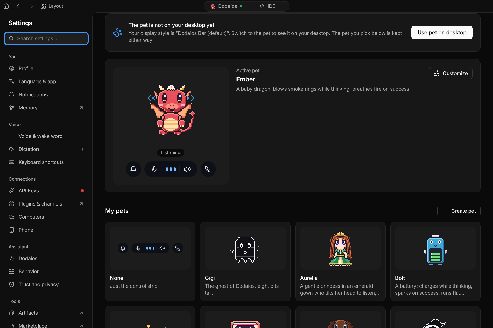
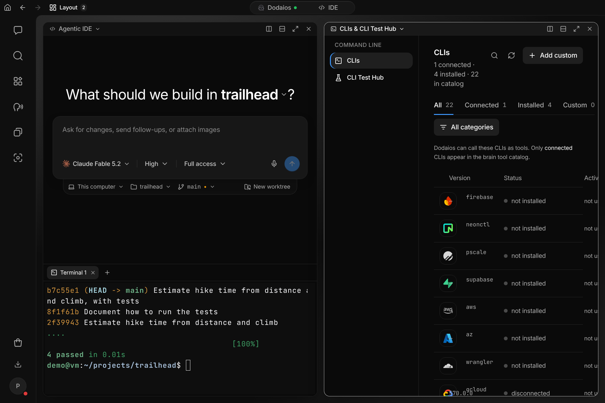
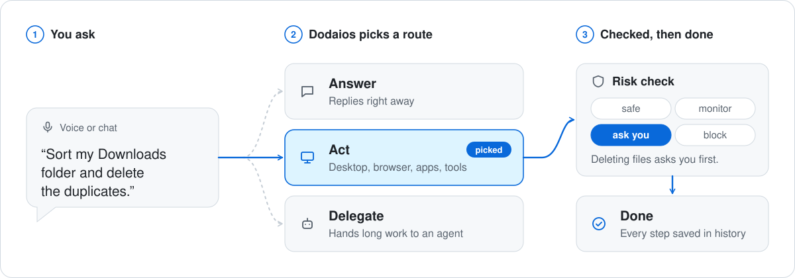

<div align="center">

<a href="https://dodaios.ai">
  <picture>
    <source media="(prefers-color-scheme: dark)" srcset="https://raw.githubusercontent.com/Dodaios/Dodaios/main/assets/brand/dodaios-logo-on-dark.svg" />
    
  </picture>
</a>

<h1>Dodaios</h1>

<!-- canonical tagline, translated (English word for word in README.md; docs/rename/repo-metadata-proposal.md) -->
<p><b>为你的桌面打造的开源超级智能体。一个智能体，调度你所有其他的智能体。</b></p>

<p>
  用消息或直接说出你想要什么。Dodaios 在你的电脑上把事情做完，<br />
  给你的编程智能体写好任务说明并检查它们的成果，照看你交给它的事，<br />
  然后带着结果回来，或者带着只有你才能回答的那一个问题回来。
</p>

<p>
  <a href="https://github.com/Dodaios/Dodaios/releases/latest"></a>
  <a href="https://github.com/Dodaios/Dodaios/blob/main/LICENSE"></a>
  <a href="https://github.com/Dodaios/Dodaios/stargazers"></a>
  <a href="https://discord.gg/x7USduHxbc"></a>
</p>

<p>
  <a href="https://dodaios.ai">官网</a> ·
  <a href="#安装">安装</a> ·
  <a href="#文档">文档</a> ·
  <a href="https://discord.gg/x7USduHxbc">Discord</a> ·
  <a href="https://github.com/Dodaios/Dodaios/blob/main/README.md">English</a>
</p>

</div>

<p align="center">
  <a href="https://github.com/Dodaios/Dodaios/blob/main/assets/demo/readme/dodaios-demo.mp4">
    
  </a>
</p>

<p align="center">
  <sub>真实应用的录屏，模型是通过已登录的 Claude Code 使用的 Claude Fable 5.2：所有回答和改动都是真实的。输入过程加快播放，等待模型的时间被剪掉。<a href="https://github.com/Dodaios/Dodaios/blob/main/assets/demo/readme/dodaios-demo.mp4"><b>带声音观看</b></a>（55 秒）。音乐：Lee Rosevere 的 <a href="https://archive.org/details/leerosevere_musicforpodcasts_6">“Making It Look Easy”</a>，<a href="https://creativecommons.org/licenses/by/4.0/">CC BY 4.0</a>。</sub>
</p>

## 聊天机器人回答问题。智能体动手做事。超级智能体调度你的智能体。

Dodaios 是你对话的那一个，其余的都由它来调度：

- **你的电脑。** 它使用桌面、它自己的浏览器、终端，以及你连接的服务。
- **你的编程智能体。** 它在你的项目里给 Claude Code、Codex、Cursor CLI 等九个编程智能体写好任务说明，跟进它们的工作，并在汇报之前亲自检查结果。
- **它自己的智能体。** 耗时的工作、常设任务和例行任务在后台运行，最后带回一个结果、一个可以打开的节点，或者一个需要你回答的问题。

它用简短的消息回答，把每个问题放在一张卡片上，只在真正需要你的时候才来找你：在应用里、通过语音，或者在你的手机上。

有三点在任何地方都成立：

- **你的模型，你的账号。** 通过提供商自己的命令行工具使用你已经在付费的套餐，粘贴一个 API 密钥，或者运行本地模型。聊天、语音、电脑操作和智能体可以各用不同的提供商。
- **重大决定始终由你来做。** Dodaios 不会每一步都打断你，但转账付款、密码和密钥、永久删除，以及以你的名义第一次给某个新联系人发消息，永远要等你决定。它独自完成的工作只能改动可以撤回的东西，除非你保存的规则允许更多。
- **你的文件，留在你的电脑上。** 聊天记录、记忆、节点、设置和结果都是运行 Dodaios 的那台电脑上的文件。没有 Dodaios 账号，也没有付费版。模型或已连接的服务只会收到完成它那部分工作所需的内容。

## 安装

**桌面应用。** 从最新版本下载适合你系统的安装包：

| Windows | macOS | Linux |
| --- | --- | --- |
| [Dodaios-Setup-x64.exe](https://github.com/Dodaios/Dodaios/releases/latest/download/Dodaios-Setup-x64.exe) | [Apple 芯片](https://github.com/Dodaios/Dodaios/releases/latest/download/Dodaios-macOS-arm64.dmg) · [Intel](https://github.com/Dodaios/Dodaios/releases/latest/download/Dodaios-macOS-x64.dmg) | [AppImage，x86_64](https://github.com/Dodaios/Dodaios/releases/latest/download/Dodaios-Linux-x86_64.AppImage) |

每个版本都在 `installers-SHA256SUMS.txt` 中列出校验和。Windows 安装包目前还没有代码签名，进展见[代码签名政策](https://github.com/Dodaios/Dodaios/blob/main/docs/code-signing-policy.md)。

**通过终端。** 安装脚本会创建自己的 Python 环境，添加启动器并打开应用。

```powershell
# Windows（PowerShell）
irm https://raw.githubusercontent.com/Dodaios/Dodaios/main/install/install.ps1 | iex
```

```bash
# macOS 和 Linux
curl -fsSL https://raw.githubusercontent.com/Dodaios/Dodaios/main/install/install.sh | bash

# 没有屏幕的 Linux 服务器
curl -fsSL https://raw.githubusercontent.com/Dodaios/Dodaios/main/install/install.sh | bash -s -- --headless
```

**使用 pipx。** 体积更小的服务端软件包，不带桌面启动器：

```bash
pipx install dodaios
```

**然后启动：**

```bash
dodaios            # 桌面应用：窗口、语音和屏幕上的悬浮层
dodaios serve      # 仅浏览器界面，适合没有屏幕的服务器
dodaios update     # 安装最新发布的版本
```

首次启动会问三件事：一个名字（它同时也是唤醒词）、一个模型连接，以及你想用什么方式和它交流。安装不需要任何提供商，得到回答才需要。

它运行在 64 位的 Windows、macOS 和基于 glibc 的 Linux 上，支持 x86-64 和 Arm64。终端安装脚本需要 Python 3.11 到 3.14 和 Git，缺哪个就自动获取哪个。显卡不是必需的。
[安装指南](https://github.com/Dodaios/Dodaios/blob/main/docs/product/start-here/install-dodaios.md) ·
[平台支持](https://github.com/Dodaios/Dodaios/blob/main/docs/product/reference/platform-support.md) ·
[在服务器上运行](https://github.com/Dodaios/Dodaios/blob/main/docs/headless-vps-deployment.md)

## 你会得到什么

### 编程智能体：写好说明，检查成果



让它改动你的某个项目，Dodaios 就会把任务交给一个编程智能体：Claude Code、Codex、Cursor CLI、OpenCode、Kimi Code、GLM Coding Plan、Grok Build、Antigravity 或 DeepSeek Harness，都是你自己安装并登录的命令行工具，每一个都带着它真正支持的模型、推理强度和权限模式。Dodaios 写好任务说明，在 IDE 里打开该智能体的线程，跟进工作，并在告诉你完成之前亲自检查结果。一个线程可以拥有自己的工作树和自己的分支；团队线程能让两到八个使用不同模型的智能体共同完成一项任务。终端、改动、Git、文件和浏览器预览就在每个线程旁边。
[Agentic IDE](https://github.com/Dodaios/Dodaios/blob/main/docs/product/extend-and-automate/agentic-ide.md) ·
[团队线程](https://github.com/Dodaios/Dodaios/blob/main/docs/agentic-ide-team-threads.md)

### 节点：它做出来的东西，并保持最新



让它做一份报告、一套幻灯片、一份预算或一个仪表盘，Dodaios 会把它做成一个节点：一个你可以打开、演示和分享的页面，之后它也可以继续修改。节点有七种类型：Docs、Slides、Sheets、Visuals、Analytics、Whiteboard 和 Clips。告诉它某个节点应该跟踪什么，它就会按计划用你的应用中的数据让节点保持最新。在节点的任何位置钉上一条评论，Dodaios 就会据此修改节点。每个节点都是一个在沙箱中运行、不联网的页面，最近十二个版本都可以撤回。
[节点](https://github.com/Dodaios/Dodaios/blob/main/docs/nodes.md)

### 不用你盯着也会继续的工作

交给 Dodaios 一件需要长期照看、没有截止日期的事：一个项目的测试、一个收件箱、一次广告投放、一台服务器。它按自己定的节奏去查看，记下工作笔记，只在有了变化、有东西准备好了、或者需要你的时候才来告诉你。固定的工作会成为例行任务，按计划、按事件或通过 webhook 运行；晨间简报可以汇总你的邮件、日历、智能体和截止日期。更大的工作交给后台智能体，在隔离的 Git 工作树里完成，结果经过审查后才算完成。这一切都在 Dodaios 运行期间进行。
[常设任务](https://github.com/Dodaios/Dodaios/blob/main/docs/standing-tasks.md) ·
[例行任务](https://github.com/Dodaios/Dodaios/blob/main/docs/routines.md) ·
[后台智能体](https://github.com/Dodaios/Dodaios/blob/main/docs/product/extend-and-automate/dodaios-agents.md)

### 你的电脑，你的应用



- **它自己的浏览器。** 它浏览网页时，聊天旁边会出现实时画面：你可以看着它工作，随时接手。它还可以把你正在用的浏览器里的网站登录状态带过来。
- **电脑操作。** 它能读取屏幕，并在桌面应用里使用鼠标和键盘。
- **插件。** 目录里自带 47 个服务，包括 GitHub、Slack、Notion、Linear、Gmail、Google Calendar、Home Assistant 和 Spotify。
- **MCP 服务器和技能。** 可以添加任何 Model Context Protocol 服务器，也可以让另一个 MCP 客户端把工作交给 Dodaios。技能是一份写下来的、助手会照着执行的流程，你可以自己写，也可以让它替你写。
- **命令行。** `dodaios` 可以从终端驱动一个正在运行的实例，所以脚本或另一个编程智能体能做到窗口里能做的一切。

[浏览器](https://github.com/Dodaios/Dodaios/blob/main/docs/browser-use.md) ·
[电脑操作](https://github.com/Dodaios/Dodaios/blob/main/docs/product/extend-and-automate/computer-use.md) ·
[插件](https://github.com/Dodaios/Dodaios/blob/main/docs/product/extend-and-automate/plugins.md) ·
[MCP 连接](https://github.com/Dodaios/Dodaios/blob/main/docs/product/extend-and-automate/mcp-connections.md) ·
[技能](https://github.com/Dodaios/Dodaios/blob/main/docs/product/extend-and-automate/skills.md) ·
[CLI](https://github.com/Dodaios/Dodaios/blob/main/docs/dodaios-cli.md)

### 任意模型，由你做主



Claude、OpenAI、Google Gemini 和 xAI Grok 可以用 API 密钥连接，也可以用你已经在付费的套餐连接：由提供商自己的命令行工具为你登录。OpenRouter、LiteLLM、Google Vertex AI 和 NVIDIA NIM 同样可用。本地模型通过 Ollama 或任何兼容 OpenAI 的服务器运行，不需要账号，也不需要密钥。密钥保存在系统的钥匙串里。
[提供商与 API 密钥](https://github.com/Dodaios/Dodaios/blob/main/docs/product/personalize-and-connect/providers-and-api-keys.md) ·
[本地 AI 提供商](https://github.com/Dodaios/Dodaios/blob/main/docs/product/personalize-and-connect/local-ai-providers.md)

### 无论你在哪里

打字，或者说出唤醒词，或者按下通话快捷键直接说。语音有两种运行方式：把语音识别、模型和语音合成串起来的管线，每一环都可以是本地的或云端的；或者一个能边听边说的实时模型。听写会把你说的话输入到你正在使用的应用里。离开电脑时，手机应用会延续同一条对话：它显示等你同意的事项，接收语音消息，并在需要你的时候推送通知。你自己的 Telegram 私聊和 Discord 私信也能延续这条对话。
[语音对话](https://github.com/Dodaios/Dodaios/blob/main/docs/product/everyday-use/voice-conversations.md) ·
[听写](https://github.com/Dodaios/Dodaios/blob/main/docs/product/everyday-use/dictation.md) ·
[手机应用](https://github.com/Dodaios/Dodaios/blob/main/docs/mobile-companion.md)

### 看得见的记忆

Dodaios 会记住关于你和你工作的简短句子：你喜欢怎样的回答、你提到的人、你正在做的项目。所有这些都保存在你电脑上的一个文件里。每一条你都可以查看、更正、固定、导出或让它遗忘。事实变了，旧的那条会带着日期被结束，而不是被覆盖。密码和密钥永远不会被保存。
[记忆](https://github.com/Dodaios/Dodaios/blob/main/docs/product/knowledge-and-sharing/wiki-and-memory.md)

### 一些小细节

<table>
  <tr>
    <td width="50%"></td>
    <td width="50%"></td>
  </tr>
  <tr>
    <td valign="top"><b>宠物。</b>桌面上的一个像素小伙伴，会随着 Dodaios 聆听、思考和说话做出反应。内置二十个，你也可以自己做。<a href="https://github.com/Dodaios/Dodaios/blob/main/docs/pets.md">宠物</a></td>
    <td valign="top"><b>并排显示。</b>最多可以把四个区域放在一起，比如一个项目和你的命令行工具。界面提供英语、德语、西班牙语、中文和葡萄牙语。</td>
  </tr>
</table>

应用里还有：任务和提醒、每次运行的步骤与工具调用记录，以及一个显示用量花费的页面。
[应用导览](https://github.com/Dodaios/Dodaios/blob/main/docs/product/start-here/desktop-app-tour.md)

## 一次请求的经过

<picture>
  <source media="(prefers-color-scheme: dark)" srcset="https://raw.githubusercontent.com/Dodaios/Dodaios/main/assets/brand/how-a-request-runs-dark.svg" />
  
</picture>

模型提出的每一次工具调用，在能碰到你的电脑或账号之前，都要先过同一道关卡：

| 等级 | 会发生什么 |
| --- | --- |
| **安全（Safe）** | 不询问，直接运行。 |
| **监控（Monitor）** | 不询问，直接运行，并标记为待查看。 |
| **询问（Ask）** | 等待同意。没有回应就当作拒绝。 |
| **阻止（Block）** | 被拒绝。批准也无法推翻。 |

默认情况下，在你交代的工作中，询问级别的调用由权限模式直接放行，所以 Dodaios 不会每一步都打断你。把权限模式设为询问，这些调用就会逐个等你同意。有两类调用无论在哪种模式下都会等你：

- **四条硬性界限。** 转账付款、密码和密钥、永久删除，以及以你的名义第一次给某个新联系人发消息。任何保存的规则或智能体都不能替你做这些决定。
- **无人看着的工作。** 例行任务、事件或智能体自己发起的步骤，只能执行可以撤回的操作。发送、发布、付款或无法从回收站找回的删除都要等你同意，除非你保存的规则涵盖了它。

一次批准只对应一次调用，不包括这项工作余下的部分。这道关卡不是沙箱，也不是撤销功能：它管的是 Dodaios 发起的工具调用，操作系统自身的权限仍然有效。
[安全与批准](https://github.com/Dodaios/Dodaios/blob/main/docs/product/privacy-safety-and-support/safety-and-approvals.md) ·
[隐私与本地数据](https://github.com/Dodaios/Dodaios/blob/main/docs/product/privacy-safety-and-support/privacy-and-local-data.md) ·
[安全政策](https://github.com/Dodaios/Dodaios/blob/main/SECURITY.md)

## 哪些功能在哪里可用

| | Windows | macOS | Linux 桌面 | Linux 服务器 |
| --- | --- | --- | --- | --- |
| 聊天、编程智能体、节点、任务、记忆、设置 | 支持 | 支持 | 支持 | 在浏览器中 |
| 桌面应用 | 支持 | 支持 | 支持 | 不支持 |
| 使用电脑麦克风的语音 | 支持 | 需要授权 | 需要 PortAudio | 通过浏览器 |
| 全局快捷键 | 支持 | 需要授权 | X11 | 不支持 |
| 电脑操作 | 支持 | 需要授权 | X11 | 不支持 |

Windows 11 是有实机检查记录的系统。macOS 和 Linux 桌面的实现已经完成并有测试覆盖，实机验收尚未完成。某项功能在你的系统上无法运行时，它会明确告诉你，其余部分照常工作。
[平台支持](https://github.com/Dodaios/Dodaios/blob/main/docs/product/reference/platform-support.md)

## 文档

以下文档为英文。

- [欢迎使用 Dodaios](https://github.com/Dodaios/Dodaios/blob/main/docs/product/start-here/welcome-to-dodaios.md)：它做什么，不做什么
- [首次运行设置](https://github.com/Dodaios/Dodaios/blob/main/docs/product/start-here/first-run-setup.md)和[你的第一次聊天](https://github.com/Dodaios/Dodaios/blob/main/docs/product/start-here/start-your-first-chat.md)
- [故障排查](https://github.com/Dodaios/Dodaios/blob/main/docs/product/privacy-safety-and-support/troubleshooting.md)
- [配置参考](https://github.com/Dodaios/Dodaios/blob/main/docs/product/reference/configuration-reference.md)和 [CLI 参考](https://github.com/Dodaios/Dodaios/blob/main/docs/dodaios-cli-reference.md)
- [架构概览](https://github.com/Dodaios/Dodaios/blob/main/docs/architecture-overview.md)，写给想改代码的人

同样的指南也在应用内的 **Docs** 页面里，并且可以搜索。

## 参与贡献

欢迎修复问题、补充测试、改进无障碍、提交平台报告和完善文档。[贡献指南](https://github.com/Dodaios/Dodaios/blob/main/CONTRIBUTING.md#your-first-contribution-in-10-minutes)能让你在大约十分钟内从 fork 走到一次通过的检查。适合入手的是带有 [good first issue](https://github.com/Dodaios/Dodaios/issues?q=is%3Aissue+is%3Aopen+label%3A%22good+first+issue%22) 和 [help wanted](https://github.com/Dodaios/Dodaios/issues?q=is%3Aissue+is%3Aopen+label%3A%22help+wanted%22) 标签的 issue。问题和想法请到 [Discord](https://discord.gg/x7USduHxbc)。

感谢每一位在这里交付过成果的人，名单见[英文 README 的贡献者墙](https://github.com/Dodaios/Dodaios/blob/main/README.md#contributing)。

## 许可证

Dodaios 采用 [Apache License 2.0](https://github.com/Dodaios/Dodaios/blob/main/LICENSE) 许可，署名信息见 [NOTICE](https://github.com/Dodaios/Dodaios/blob/main/NOTICE)。名称和标志受[商标政策](https://github.com/Dodaios/Dodaios/blob/main/TRADEMARK.md)约束，不在许可证的授权范围内。

Dodaios 是一个独立项目。它所配合使用的产品（例如上面提到的编程智能体）归其各自的开发者所有；Dodaios 支持某个工具，并不意味着该工具的开发者支持或认可 Dodaios。

Dodaios 在 2026 年 10 月之前叫 Personal Jarvis。同一个项目，同一个许可证（[为什么改名](https://dodaios.ai/blog/personal-jarvis-is-now-dodaios/)）。

赞助者见 [SPONSORS.md](https://github.com/Dodaios/Dodaios/blob/main/SPONSORS.md)。
