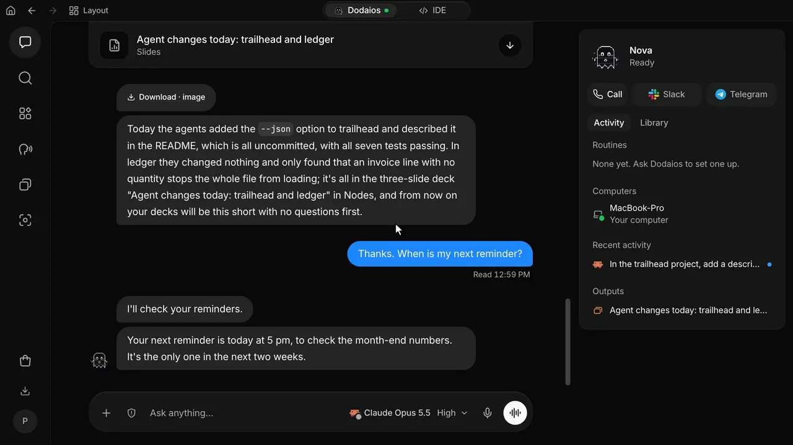
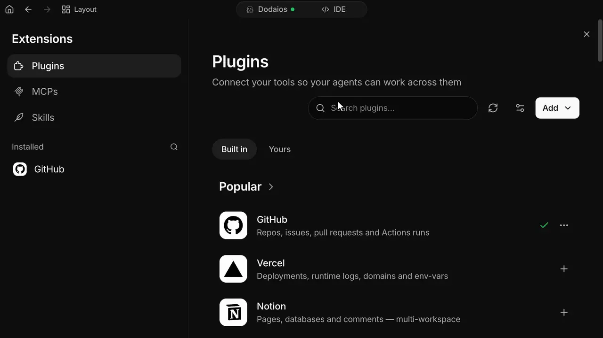
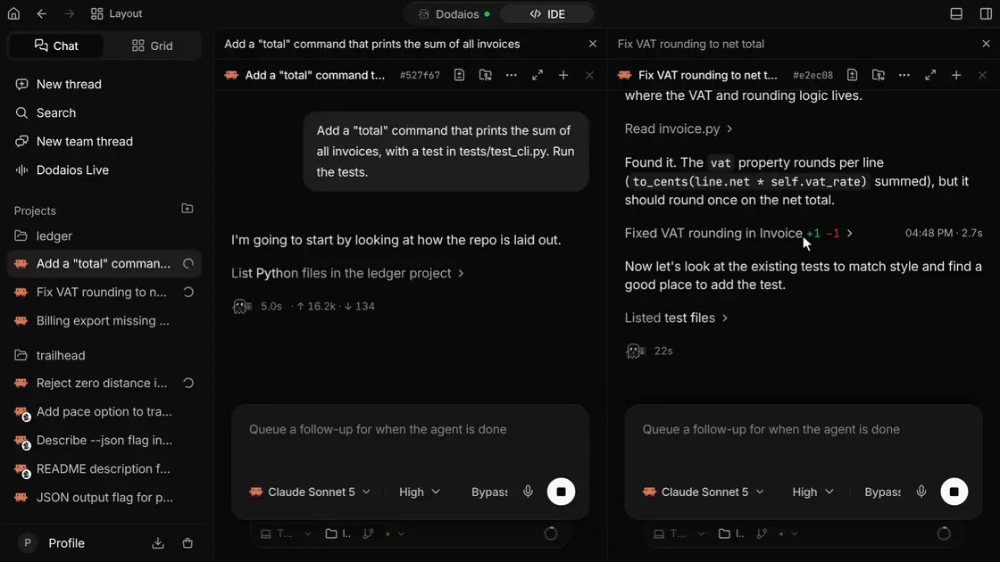
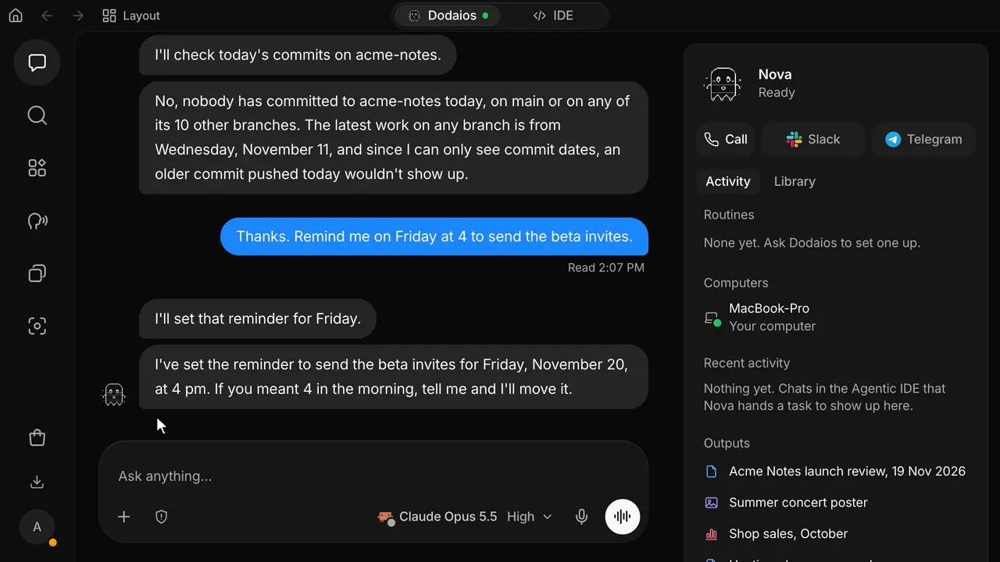
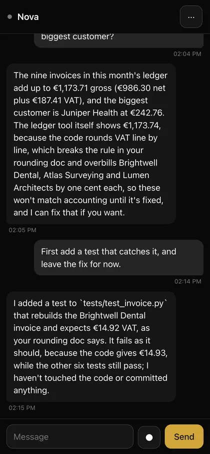

<div align="center">

<a href="https://dodaios.ai">
  <picture>
    <source media="(prefers-color-scheme: dark)" srcset="https://raw.githubusercontent.com/Dodaios/Dodaios/main/assets/brand/dodaios-logo-on-dark.svg" />
    
  </picture>
</a>

<h1>Dodaios</h1>

<!-- the promise, translated (English word for word in README.md; docs/positioning.md) -->
<p><b>One workspace for everything you do with AI.</b><br />
一个工作区，容纳你用 AI 做的一切。</p>

<p>
  Claude Code、Codex、Cursor CLI 和另外六个编程智能体并排运行，<br />
  一个助手调度它们，还有语音和听写，以及文档、幻灯片和表格。<br />
  开源，在你的电脑上运行，用你已有的套餐和密钥。
</p>

<p>
  <a href="https://github.com/Dodaios/Dodaios/releases/latest"></a>
  <a href="https://github.com/Dodaios/Dodaios/blob/main/LICENSE"></a>
  <a href="https://github.com/Dodaios/Dodaios/stargazers"></a>
  <a href="https://discord.gg/x7USduHxbc"></a>
</p>

<p>
  <a href="#安装">安装</a> ·
  <a href="#它是什么">里面有什么</a> ·
  <a href="#用你自己的套餐和密钥">你的套餐</a> ·
  <a href="#文档">文档</a> ·
  <a href="https://dodaios.ai">官网</a> ·
  <a href="https://discord.gg/x7USduHxbc">Discord</a> ·
  <a href="https://github.com/Dodaios/Dodaios/blob/main/README.md">English</a>
</p>

</div>

<p align="center">
  
</p>

<p align="center">
  <sub>真实应用的录屏，剪自一段约三分钟的录制：等待模型的时间被剪掉，其余部分以 1.18 倍速播放。Nova 使用 Claude Opus 5.5，并通过已登录 Claude 套餐的 Claude Code 启动五个 Claude Sonnet 5.5 智能体。拉取请求、审阅和幻灯片都是真实的。<a href="https://raw.githubusercontent.com/Dodaios/Dodaios/main/assets/demo/readme/dodaios-demo.mp4"><b>下载视频</b></a>（MP4，1920 x 1080，4 MB）</sub>
</p>

## 安装

macOS 和 Linux：

```bash
curl -fsSL https://raw.githubusercontent.com/Dodaios/Dodaios/main/install/install.sh | bash
```

Windows，在 PowerShell 中：

```powershell
irm https://raw.githubusercontent.com/Dodaios/Dodaios/main/install/install.ps1 | iex
```

安装脚本会创建自己的 Python 环境，添加启动器并打开应用。首次启动会问三件事：给你的助手起的名字（它同时也是唤醒词）、一个模型连接，以及你想用什么方式和它交流。要把编程工作交出去，请至少安装一个编程智能体并登录，例如 Claude Code 或 Codex。

```bash
dodaios            # 桌面应用：窗口、语音和屏幕上的悬浮层
dodaios update     # 安装最新发布的版本
```

<details>
<summary>桌面安装包、pipx 和服务器</summary>

<br />

从最新版本下载适合你系统的安装包：

| Windows | macOS | Linux |
| --- | --- | --- |
| [Dodaios-Setup-x64.exe](https://github.com/Dodaios/Dodaios/releases/latest/download/Dodaios-Setup-x64.exe) | [Apple 芯片](https://github.com/Dodaios/Dodaios/releases/latest/download/Dodaios-macOS-arm64.dmg) · [Intel](https://github.com/Dodaios/Dodaios/releases/latest/download/Dodaios-macOS-x64.dmg) | [AppImage，x86_64](https://github.com/Dodaios/Dodaios/releases/latest/download/Dodaios-Linux-x86_64.AppImage) |

每个版本都在 `installers-SHA256SUMS.txt` 中列出校验和。安装包目前还没有签名：Windows 会显示警告，macOS 会要求你在“系统设置”的“隐私与安全性”中允许这个应用一次。[代码签名政策](https://github.com/Dodaios/Dodaios/blob/main/docs/code-signing-policy.md)说明了目前的进展。

用 pipx 可以得到体积更小的服务端软件包，不带桌面启动器。在没有屏幕的 Linux 服务器上，安装脚本接受 `--headless`，`dodaios serve` 只启动浏览器界面：

```bash
pipx install dodaios
curl -fsSL https://raw.githubusercontent.com/Dodaios/Dodaios/main/install/install.sh | bash -s -- --headless
dodaios serve      # 仅浏览器界面，适合没有屏幕的服务器
```

它运行在 64 位的 Windows、macOS 和基于 glibc 的 Linux 上。终端安装脚本支持 x86-64 和 Arm64，需要 Python 3.11 到 3.14 和 Git。它会获取缺少的 Python，缺少 Git 时会提出帮你安装。显卡不是必需的。安装不需要任何提供商，得到回答才需要。
[安装指南](https://github.com/Dodaios/Dodaios/blob/main/docs/product/start-here/install-dodaios.md) ·
[平台支持](https://github.com/Dodaios/Dodaios/blob/main/docs/product/reference/platform-support.md) ·
[在服务器上运行](https://github.com/Dodaios/Dodaios/blob/main/docs/headless-vps-deployment.md)

</details>

<p align="center">
  <a href="https://github.com/Dodaios/Dodaios"></a>
  <br />
  <sub>如果 Dodaios 对你有用，请给仓库点一个 Star。其他人就是这样找到它的。</sub>
</p>

## 它是什么

如今，每家大型 AI 公司都在做自己的全能应用，围绕自家的模型和自家的账号。如果你给其中两三家付费，你就在两三个地方工作，而每一个都不知道你在其他几个里做了什么。

Dodaios 是容纳这一切的一个工作区。它不出售模型访问权限。你的编程智能体在它里面运行，就在你的电脑上，用的是你选择的模型和套餐。一个助手把这一切连在一起。你可以跟它说话，它也能查到每个智能体做了什么。

<table>
  <tr>
    <td width="36%"><a href="#替你做事的助手"><b>替你做事的助手</b></a></td>
    <td>你给它起名字，打字或说话，它就会使用你的应用、浏览器和你的编程智能体。</td>
  </tr>
  <tr>
    <td><a href="#你的编程智能体并排运行"><b>你的编程智能体，并排运行</b></a></td>
    <td>Claude Code、Codex、Cursor CLI 和另外六个，以聊天线程和终端的形式运行。</td>
  </tr>
  <tr>
    <td><a href="#你的声音在每个应用里都能用"><b>你的声音，在每个应用里都能用</b></a></td>
    <td>唤醒词、语音对话，以及听写：你在哪里工作，文字就打在哪里。</td>
  </tr>
  <tr>
    <td><a href="#文档幻灯片表格和白板"><b>文档、幻灯片、表格和白板</b></a></td>
    <td>助手根据一句话把它们做出来，你再手动编辑。</td>
  </tr>
  <tr>
    <td><a href="#离开电脑时它也跟着你"><b>离开电脑时，它也跟着你</b></a></td>
    <td>在你的手机上、在 Telegram 和 Discord 里，都是同一场对话。</td>
  </tr>
</table>

它运行在你的电脑上，用的是你已有的模型套餐和密钥。没有 Dodaios 账号，也没有付费版。

### 替你做事的助手

<p align="center">
  
</p>

你给它起一个名字，这个名字也是唤醒词。在这些录屏里，它叫 Nova。你打字或说话，Nova 会自己把工作做完，或者把它转交出去：

- **你的应用。** 插件目录里有 48 个插件，其中包括 GitHub、Slack、Notion、Linear、Gmail 和 Google Calendar。有两个已通过完整的端到端检查，其余的都标为“Preview”（预览版）。你自己的 MCP 服务器可以通过它的 URL 或启动命令连接。
- **浏览器和你的桌面。** 它在自己的浏览器里浏览，你可以在一旁看着；它也会在桌面应用里使用鼠标和键盘。
- **看得见的记忆。** 关于你和你工作的简短句子，保存在你电脑上的一个文件里。每一条你都可以更正、置顶、导出或让它忘掉。
- **你不在时也会继续的工作。** Dodaios 运行时，例行任务会按时间表、按事件或由 webhook 触发而启动。长期任务会一直照看某件事：项目的测试、收件箱、服务器。
- **编程工作交给编程智能体。** Nova 写好任务说明，跟进每个智能体，并阅读它的报告。对于这台电脑上的终端智能体，它还会检查 diff 和该智能体记录的测试。

[插件](https://github.com/Dodaios/Dodaios/blob/main/docs/product/extend-and-automate/plugins.md) ·
[浏览器](https://github.com/Dodaios/Dodaios/blob/main/docs/browser-use.md) ·
[电脑操作](https://github.com/Dodaios/Dodaios/blob/main/docs/product/extend-and-automate/computer-use.md) ·
[记忆](https://github.com/Dodaios/Dodaios/blob/main/docs/product/knowledge-and-sharing/wiki-and-memory.md) ·
[例行任务](https://github.com/Dodaios/Dodaios/blob/main/docs/routines.md) ·
[长期任务](https://github.com/Dodaios/Dodaios/blob/main/docs/standing-tasks.md)

### 你的编程智能体，并排运行

<p align="center">
  
</p>

**Claude Code · Codex · Cursor CLI · OpenCode · Kimi Code · GLM Coding Plan · Grok Build · Antigravity · DeepSeek Harness**

Agentic IDE 在一个窗口里运行九个编程智能体，每个都可以作为聊天线程，或者在终端里运行：

- **并排。** 最多四个线程挨着排开，每个都有自己的工具调用、diff、计划和提问。（DeepSeek Harness 在线程里只显示它的最终回答。）
- **团队。** 团队线程让二到八个使用不同模型的智能体共同处理同一项任务。
- **自己的空间。** 线程可以在自己的 worktree 里、自己的分支上工作。编辑器、Git 客户端和浏览器预览就在线程旁边。
- **在其他电脑上。** 终端智能体可以通过 SSH 在你自己的 Linux 服务器上运行。它在服务器上的 tmux 里运行，所以你合上笔记本电脑后，它还会继续工作。

[Agentic IDE](https://github.com/Dodaios/Dodaios/blob/main/docs/product/extend-and-automate/agentic-ide.md) ·
[线程](https://github.com/Dodaios/Dodaios/blob/main/docs/agentic-ide-threads.md) ·
[团队线程](https://github.com/Dodaios/Dodaios/blob/main/docs/agentic-ide-team-threads.md)

### 你的声音，在每个应用里都能用

<!-- The recording of this pillar needs a real voice and microphone; it is made
     with scripts/readme_demo/voice_take.py (assets/demo/readme/README.md) and
     goes here as voice.webp. -->

- **和它对话。** 说出唤醒词或按下你的通话快捷键，然后说话，助手会开口回答。
- **随处听写。** 在任何应用里按住听写键，你说的话就会连同标点一起粘贴到那里。英语、德语、西班牙语和葡萄牙语的语气词会被去掉。
- **愿意的话，就在你的电脑上。** 唤醒词在你的电脑上识别，听写也可以在本机运行，不需要密钥，也不需要账号。

[语音对话](https://github.com/Dodaios/Dodaios/blob/main/docs/product/everyday-use/voice-conversations.md) ·
[听写](https://github.com/Dodaios/Dodaios/blob/main/docs/product/everyday-use/dictation.md) ·
[唤醒词](https://github.com/Dodaios/Dodaios/blob/main/docs/product/personalize-and-connect/audio-and-wake-word.md)

### 文档、幻灯片、表格和白板

<p align="center">
  
</p>

助手为你做出的东西是节点，而节点是一份你可以在里面工作的文档。节点有七种，每种都有自己的编辑器：文档、幻灯片、表格、白板、视觉稿、仪表盘和短片。

- **一句话生成。** 要一份幻灯片、一张表格或一块白板，它就出现了，内容也已填好。
- **手动编辑。** 直接在文字里打字，修改单元格，移动方框。在白板上，你和助手在同一块画布上画。
- **保持最新。** 仪表盘可以按时间表从它的数据源刷新。每个节点都可以导出为 HTML；电脑上装有 Chrome、Edge 或其他 Chromium 浏览器时，还可以导出为 PDF 或 PNG。

[节点](https://github.com/Dodaios/Dodaios/blob/main/docs/nodes.md)

### 离开电脑时，它也跟着你



你和助手的对话会跟着你走：

- **手机应用。** 一个由你自己的电脑提供的网页应用。你用配对码把它配对好，它就会显示同一场对话：你可以打字、发语音消息，也可以允许或拒绝正在等你同意的事。通过 HTTPS 访问时，你可以安装它并接收推送通知。
- **Telegram 和 Discord。** 你和自己的机器人之间的私聊，也会延续这场对话。
- **同一场对话。** 你在手机上说过的话，等你回来时就在桌面端的聊天里。

默认情况下，只有这台电脑能连接。要用手机，请在启动 Dodaios 时让它在你的家庭网络上监听（这需要一个控制密钥），或者通过 HTTPS 提供服务。[手机指南](https://github.com/Dodaios/Dodaios/blob/main/docs/mobile-companion.md)里有这两种方法。

<br clear="right" />

## 用你自己的套餐和密钥

Dodaios 不出售模型访问权限，也不会替你登录。它会启动每个智能体的官方命令行工具，每一个都由你自己登录。所以，编程智能体用的是你已有的套餐或密钥：

| 你有 | 就能运行 |
| --- | --- |
| 付费的 Claude 套餐（Pro 或更高） | Claude Code |
| ChatGPT 套餐 | Codex |
| Cursor 账号 | Cursor CLI |
| SuperGrok 或 X Premium+ | Grok Build |
| Google 账号（免费套餐有每周限额） | Antigravity |
| 你在 OpenCode 里设置的提供商 | OpenCode |
| Moonshot、Z.ai 或 DeepSeek 的密钥或套餐 | Kimi Code、GLM Coding Plan（对接 Z.ai 的 Claude Code）、DeepSeek Harness |

助手运行在你选择的模型上。Claude、OpenAI、Google Gemini 和 xAI Grok 可以用套餐或 API 密钥连接。OpenRouter、LiteLLM、Google Vertex AI、NVIDIA NIM 和 DeepSeek 用密钥连接。本地模型通过 Ollama 运行，不需要账号，也不需要密钥。你对每项服务的使用都遵循该服务自己的条款。
[提供商与 API 密钥](https://github.com/Dodaios/Dodaios/blob/main/docs/product/personalize-and-connect/providers-and-api-keys.md) ·
[本地模型](https://github.com/Dodaios/Dodaios/blob/main/docs/product/personalize-and-connect/local-ai-providers.md)

## 属于你

- **开源。** Apache 2.0。没有 Dodaios 账号，也没有付费版。
- **在你的电脑上。** 聊天记录、记忆、节点和设置都是运行 Dodaios 的那台电脑上的文件。模型或已连接的服务，会得到它完成请求中自己那一部分所需的内容。登录 Google、Slack 或 Figma 插件，以及之后的每一次令牌刷新，都会经过本项目运行的一个小型令牌服务。Dodaios 不会自行上传它的日志。
- **它能独自做多少，由你决定。** 每个聊天都有一个权限模式。新聊天从“Bypass permissions”（跳过权限确认）开始，在这个模式下什么都不会询问。在会询问的模式下，转账、密码和密钥、永久删除某样东西，以及以你的名义给第一次联系的人发消息，总是要等你同意。
- **Windows、macOS 和 Linux。** 界面有英语、德语、西班牙语、中文和葡萄牙语版本。目前只有 Windows 11 有记录在案的实机验收。

[隐私与本地数据](https://github.com/Dodaios/Dodaios/blob/main/docs/product/privacy-safety-and-support/privacy-and-local-data.md) ·
[安全与审批](https://github.com/Dodaios/Dodaios/blob/main/docs/product/privacy-safety-and-support/safety-and-approvals.md) ·
[平台支持](https://github.com/Dodaios/Dodaios/blob/main/docs/product/reference/platform-support.md)

## 文档

[功能导览](https://github.com/Dodaios/Dodaios/blob/main/docs/feature-tour.md)（英文）在一个页面上配图介绍了全部内容：每个部分做什么、一次工具调用在执行前如何被检查，以及哪些功能在哪个系统上运行。

- [欢迎使用 Dodaios](https://github.com/Dodaios/Dodaios/blob/main/docs/product/start-here/welcome-to-dodaios.md)：它做什么，不做什么
- [首次运行设置](https://github.com/Dodaios/Dodaios/blob/main/docs/product/start-here/first-run-setup.md)和[你的第一次聊天](https://github.com/Dodaios/Dodaios/blob/main/docs/product/start-here/start-your-first-chat.md)
- [故障排查](https://github.com/Dodaios/Dodaios/blob/main/docs/product/privacy-safety-and-support/troubleshooting.md)
- [配置参考](https://github.com/Dodaios/Dodaios/blob/main/docs/product/reference/configuration-reference.md)和 [CLI 参考](https://github.com/Dodaios/Dodaios/blob/main/docs/dodaios-cli-reference.md)
- [架构概览](https://github.com/Dodaios/Dodaios/blob/main/docs/architecture-overview.md)，写给想改代码的人

同样的指南也在应用内的 **Docs** 页面里，并且可以搜索。

## 参与贡献

欢迎修复问题、补充测试、改进无障碍、提交平台报告和完善文档。[贡献指南](https://github.com/Dodaios/Dodaios/blob/main/CONTRIBUTING.md#your-first-contribution-in-10-minutes)能让你在大约十分钟内从 fork 走到一次通过的检查。适合入手的是带有 [good first issue](https://github.com/Dodaios/Dodaios/issues?q=is%3Aissue+is%3Aopen+label%3A%22good+first+issue%22) 和 [help wanted](https://github.com/Dodaios/Dodaios/issues?q=is%3Aissue+is%3Aopen+label%3A%22help+wanted%22) 标签的 issue。问题和想法请到 [Discord](https://discord.gg/x7USduHxbc)。

感谢每一位在这里交付过成果的人，名单见[英文 README 的贡献者墙](https://github.com/Dodaios/Dodaios/blob/main/README.md#contributing)。

## 许可证

Dodaios 采用 [Apache License 2.0](https://github.com/Dodaios/Dodaios/blob/main/LICENSE) 许可，署名信息见 [NOTICE](https://github.com/Dodaios/Dodaios/blob/main/NOTICE)。名称和标志受[商标政策](https://github.com/Dodaios/Dodaios/blob/main/TRADEMARK.md)约束，不在许可证的授权范围内。

Dodaios 是一个独立项目。它所配合使用的产品（例如上面提到的编程智能体）归其各自的开发者所有。Dodaios 支持某个工具，并不意味着该工具的开发者支持或认可 Dodaios。

Dodaios 在 2026 年 10 月之前叫 Personal Jarvis。同一个项目，同一个许可证（[为什么改名](https://dodaios.ai/blog/personal-jarvis-is-now-dodaios/)）。

赞助者见 [SPONSORS.md](https://github.com/Dodaios/Dodaios/blob/main/SPONSORS.md)。
