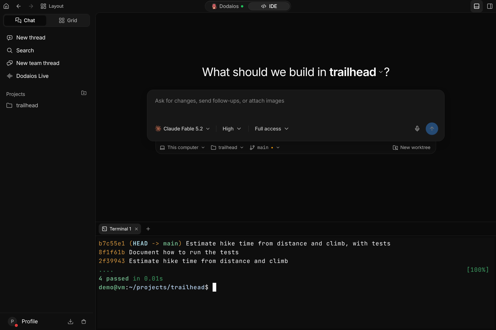
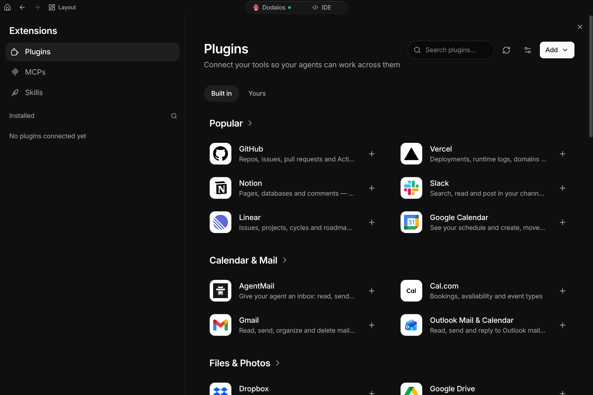
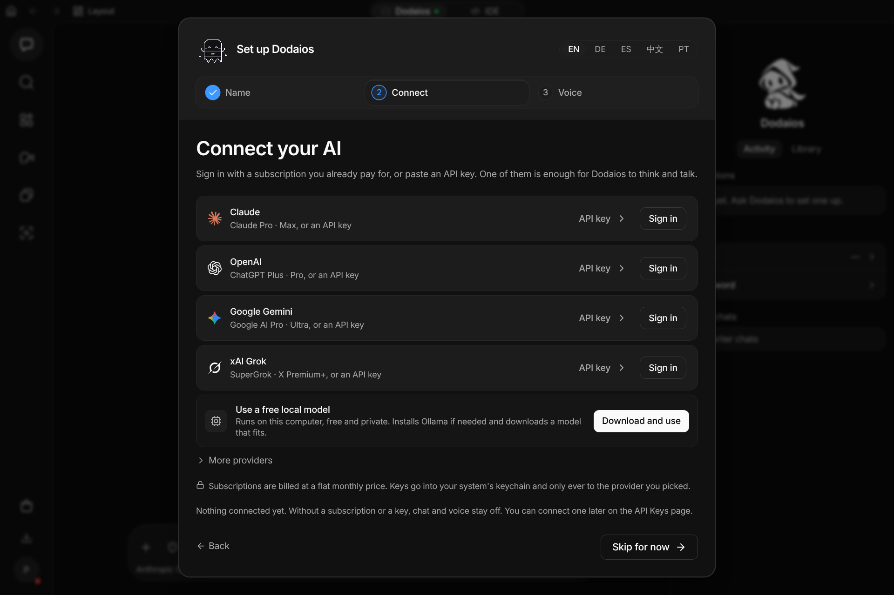
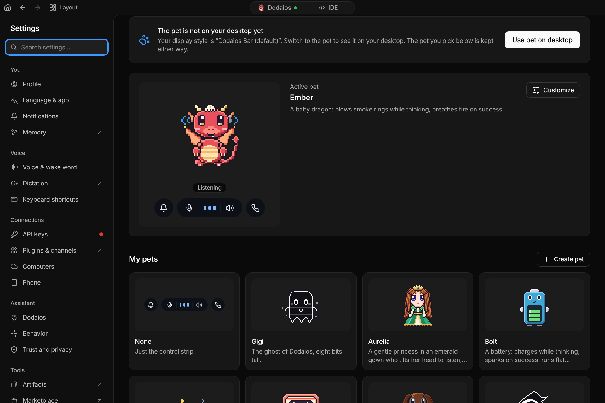
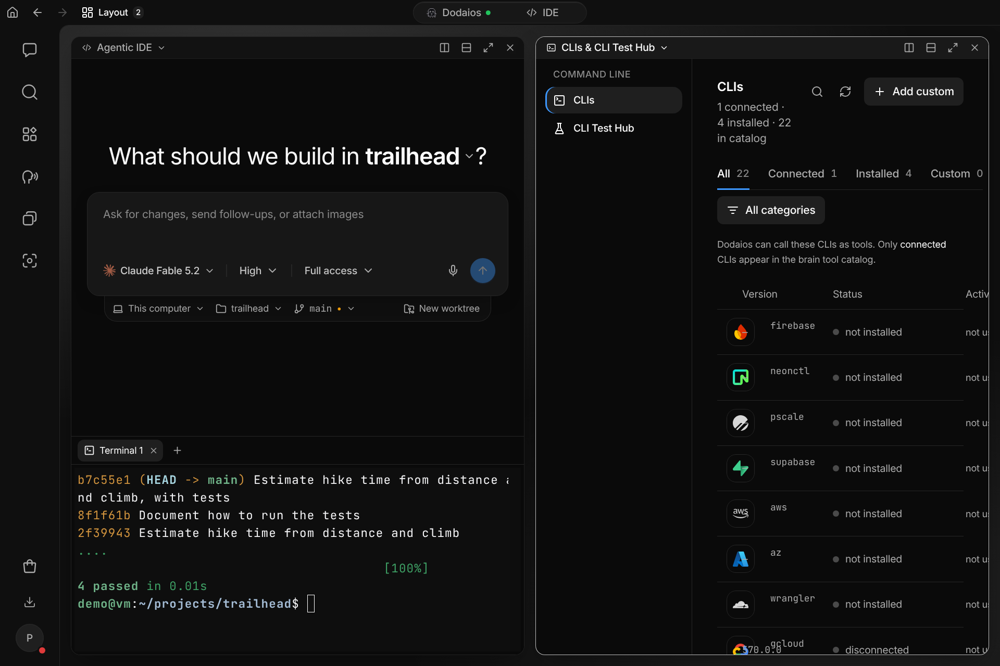
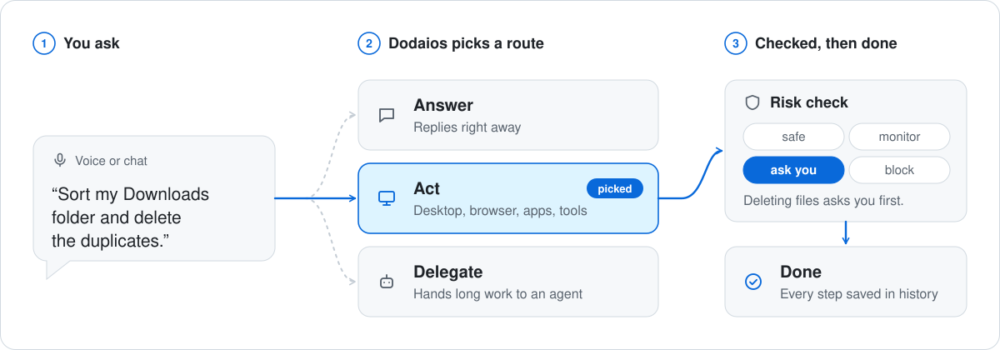

# Feature tour

Everything Dodaios does, in one page. The [README](../README.md) shows the
short version: one request, the coding agents at work, and the report that
comes back. This page has the rest: what it can use on your computer, what it
makes, how it keeps working without you, and what a tool call must pass before
it runs.

An [earlier recording of 55 seconds](https://github.com/Dodaios/Dodaios/blob/8c0d31b3c096561b2770fcbaf4f34f5270abb4b6/assets/demo/readme/dodaios-demo.mp4)
shows four everyday requests in a row: a question answered from a file, a
page made from the answer, a standing task, and a fault handed to a coding
agent. Its music is
["Making It Look Easy"](https://archive.org/details/leerosevere_musicforpodcasts_6)
by Lee Rosevere, [CC BY 4.0](https://creativecommons.org/licenses/by/4.0/).

## One agent that runs the others

Dodaios is the one you talk to, and it runs the rest:

- **Your computer.** It uses the desktop, its own browser, a terminal and the
  services you connected.
- **Your coding agents.** It briefs Claude Code, Codex, Cursor CLI and six more
  in your projects, follows their work and checks the result before it
  reports.
- **Its own agents.** Long jobs, standing tasks and routines run in the
  background and come back as a result, a node you can open, or a question for
  you.

It answers in short messages, puts each question on a card, and gets in touch
only when something needs you: in the app, by voice, or on your phone.

Three things hold everywhere:

- **Your models, your accounts.** Use a plan you already pay for through the
  provider's own command-line tool, paste an API key, or run a local model.
  Chat, voice, computer use and agents can each use a different provider.
- **You set how much it does alone.** Each chat has a permission mode. A new
  chat starts at Bypass permissions: nothing asks, and only a blocked call is
  refused. In the asking modes, moving money, passwords and keys, deleting
  something for good and a first message in your name to someone new always
  wait for your yes. A routine that runs without you may only do what can be
  taken back, unless a rule you saved allows more.
- **Your files, on your computer.** Chats, memory, nodes, settings and results
  are files on the computer that runs Dodaios. There is no Dodaios account and
  no paid tier. A model or a connected service receives what it needs for its
  part of a request.

## What you get

### Coding agents, briefed and checked

Ask for a change in one of your projects and Dodaios hands it to a coding
agent: Claude Code, Codex, Cursor CLI, OpenCode, Kimi Code, GLM Coding Plan,
Grok Build, Antigravity or DeepSeek Harness, the command-line tools you
install and sign in to yourself, each with the models, effort levels and
permission modes it really has. Dodaios writes the brief, opens the agent's
thread in the IDE, follows the work and checks the result before it tells you
it is done. A thread can get its own worktree on its own branch, and a team
thread puts two to eight agents on different models onto one task. Terminals,
changes, Git, files and a browser preview sit beside every thread.
[Agentic IDE](product/extend-and-automate/agentic-ide.md) ·
[Team threads](agentic-ide-team-threads.md)

### Nodes: what it makes, kept current

Ask for a report, a deck, a budget or a dashboard, and Dodaios makes it as a
node: a page you can open, present and share, and that it can change again
later. There are seven types: Docs, Slides, Sheets, Visuals, Analytics,
Whiteboard and Clips. Tell it what a node should follow, and it keeps the node
current from your apps on a schedule. Pin comments anywhere on a node (type
them or dictate them) and send them together, and Dodaios revises it; or click Edit and change a text
yourself. Each node is one page that runs in a sandbox with the network off,
and the last twelve versions can be taken back.
[Nodes](nodes.md)

### Work that keeps going without you

Hand Dodaios something to look after, with no end date: a project's tests, an
inbox, an ads campaign, a server. It checks on it at a pace it sets itself,
keeps working notes, and writes only when something changed, something is
ready, or something needs you. A fixed job becomes a routine that runs on a
schedule, on an event or on a webhook, and a morning brief can gather your
mail, calendar, agents and deadlines. Bigger work goes to background agents
in isolated Git worktrees, and a result is reviewed before it counts as done.
All of it runs while Dodaios is running.
[Standing tasks](standing-tasks.md) ·
[Routines](routines.md) ·
[Background agents](product/extend-and-automate/dodaios-agents.md)

### Your computer, your apps

- **Its own browser.** When it browses, a live view sits beside the chat: you
  watch it work and can take over at any moment. It can bring over the website
  logins of a browser you already use.
- **Computer use.** It reads the screen and uses the mouse and keyboard in
  desktop apps.
- **Plugins.** 47 services ship in the catalog, among them GitHub, Slack,
  Notion, Linear, Gmail, Google Calendar, Home Assistant and Spotify.
- **MCP servers and skills.** Add any Model Context Protocol server, or let
  another MCP client hand work to Dodaios. A skill is a written procedure the
  assistant follows; you can write one or ask for one.
- **The command line.** `dodaios` drives a running instance from a terminal, so
  a script or another coding agent can do everything the window can.

[Browser](browser-use.md) ·
[Computer use](product/extend-and-automate/computer-use.md) ·
[Plugins](product/extend-and-automate/plugins.md) ·
[MCP connections](product/extend-and-automate/mcp-connections.md) ·
[Skills](product/extend-and-automate/skills.md) ·
[CLI](dodaios-cli.md)

### Any model, yours

Claude, OpenAI, Google Gemini and xAI Grok connect with an API key or with a
plan you already pay for, through the provider's own command-line tool, which
signs you in. OpenRouter, LiteLLM, Google Vertex AI and NVIDIA NIM are there
as well. A local model runs through Ollama or any OpenAI-compatible server,
with no account and no key. Keys go into your system's keychain.
[Providers and API keys](product/personalize-and-connect/providers-and-api-keys.md) ·
[Local AI providers](product/personalize-and-connect/local-ai-providers.md)

### Wherever you are

Type, or say the wake word, or press your Call shortcut and talk. Voice runs
in one of two ways: a pipeline of speech recognition, the model and a voice,
each of them local or hosted, or one live model that listens and speaks.
Dictation types what you say into the app you are working in. Away from the
desk, the phone app continues the same conversation: it shows what waits for
your yes, takes voice notes and sends a push when something needs you. Your
private Telegram chat and Discord direct messages continue it too.
[Voice conversations](product/everyday-use/voice-conversations.md) ·
[Dictation](product/everyday-use/dictation.md) ·
[Phone app](mobile-companion.md)

### A memory you can read

Dodaios remembers short sentences about you and your work: how you like
answers, the people you mention, the projects you are on. All of it is one
file on your computer. You can read, correct, pin, export or forget every
entry. A changed fact closes the old one with a date instead of overwriting
it. Passwords and keys are never stored.
[Memory](product/knowledge-and-sharing/wiki-and-memory.md)

### The small things

<table>
  <tr>
    <td width="50%"></td>
    <td width="50%"></td>
  </tr>
  <tr>
    <td valign="top"><b>Pets.</b> A pixel companion that the app draws for the assistant, and that an agent can wear. Twenty are built in, and you can make your own. <a href="pets.md">Pets</a></td>
    <td valign="top"><b>Side by side.</b> Put up to four sections next to each other, for example a project and your command-line tools. The interface comes in English, German, Spanish, Chinese and Portuguese.</td>
  </tr>
</table>

Also in the app: tasks and reminders, a record of every run with its steps and
tool calls, and a page that shows what your usage cost.
[Tour of the app](product/start-here/desktop-app-tour.md)

## How a request runs

<picture>
  <source media="(prefers-color-scheme: dark)" srcset="../assets/brand/how-a-request-runs-dark.svg" />
  
</picture>

Every tool call a model proposes goes through one gate before it can touch
your computer or an account:

| Level | What happens |
| --- | --- |
| **Safe** | Runs without asking. |
| **Monitor** | Runs without asking and is marked for review. |
| **Ask** | Waits for a yes. No answer counts as no. |
| **Block** | Is refused. An approval cannot override it. |

How much runs without a question is set per chat, by its permission mode:

- **Bypass permissions**, where a new chat starts: nothing asks. Every call
  runs; only a block is refused, and so is an email that seems to carry a
  secret.
- **Ask before acting, Auto-accept edits, Always ask:** a consequential call
  shows a card with the app, the action and exactly what will be sent, and
  waits for Allow once, Always allow or Deny. Moving money, passwords and
  keys, deleting something for good and a first message in your name to
  someone new always ask here.

A routine or an event that runs without you may only do what can be taken
back. A send, a post, a payment or a delete without a trash waits for your
yes, unless a rule you saved covers it.

One approval covers one call, not the rest of the job. The gate is not a
sandbox and not an undo: it covers the tool calls Dodaios makes, and your
operating system's permissions still apply.
[Safety and approvals](product/privacy-safety-and-support/safety-and-approvals.md) ·
[Privacy and local data](product/privacy-safety-and-support/privacy-and-local-data.md) ·
[Security policy](../SECURITY.md)

## What runs where

| | Windows | macOS | Linux desktop | Linux server |
| --- | --- | --- | --- | --- |
| Chat, coding agents, nodes, tasks, memory, settings | Yes | Yes | Yes | In the browser |
| Desktop app | Yes | Yes | Yes | No |
| Voice with the computer's microphone | Yes | Needs permission | Needs PortAudio | Through the browser |
| Global shortcuts | Yes | Needs permission | X11 | No |
| Computer use | Yes | Needs permission | X11 | No |

Windows 11 is the system with recorded live checks. The macOS and Linux
desktop paths are built and covered by tests, and their live sign-off is still
open. A feature that cannot run on your system says so and leaves the rest
working.
[Platform support](product/reference/platform-support.md)
