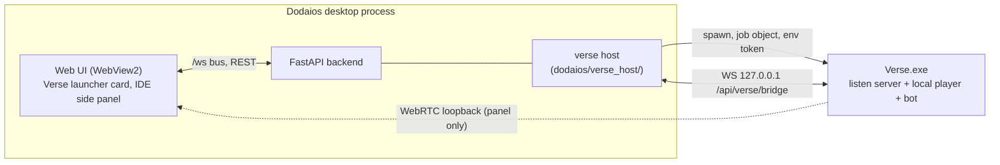
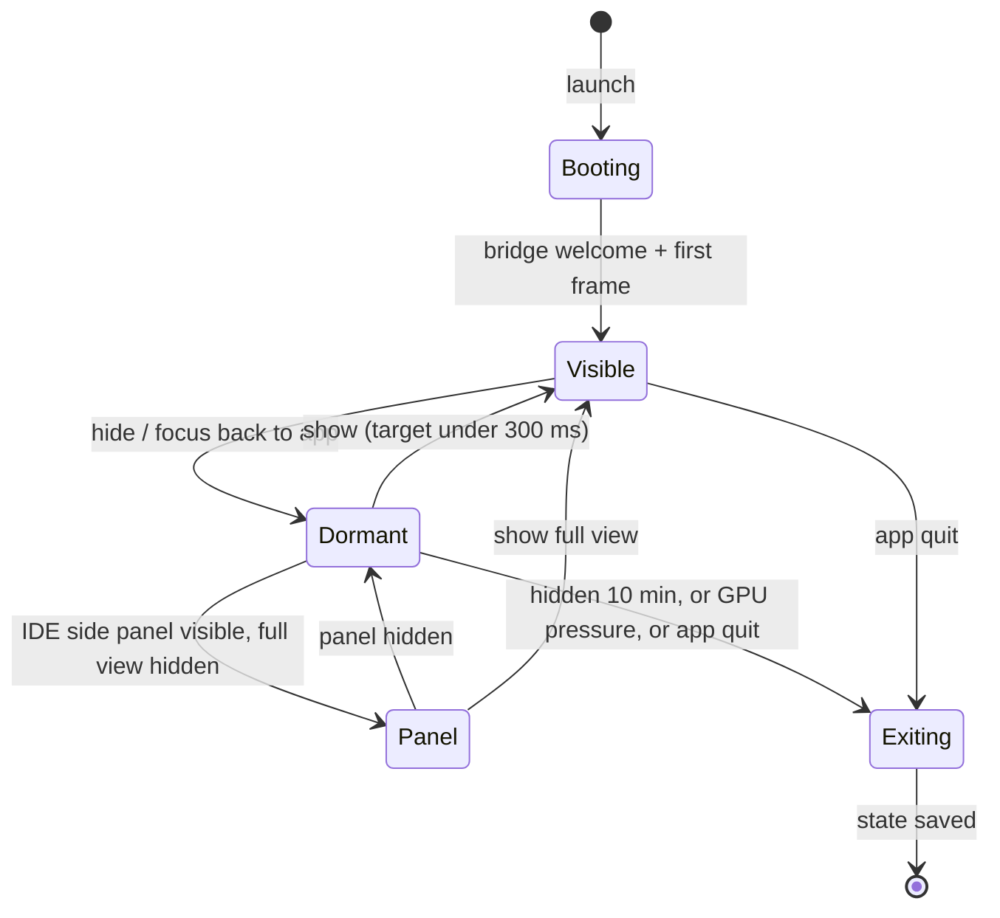
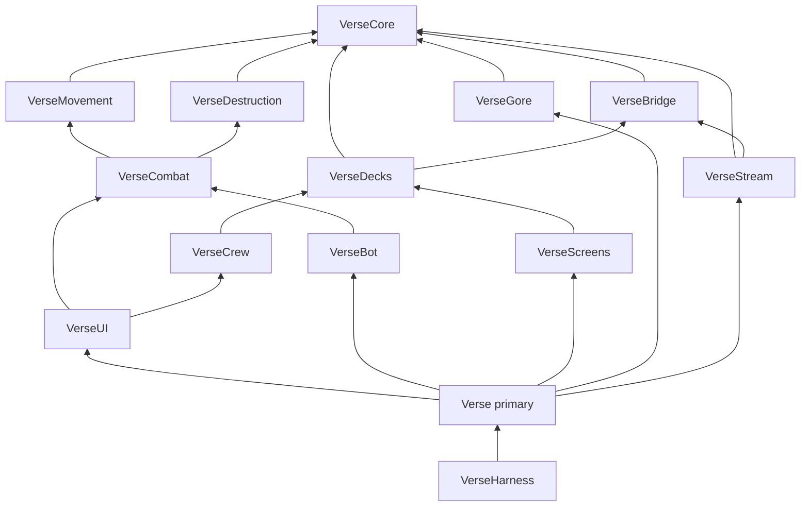
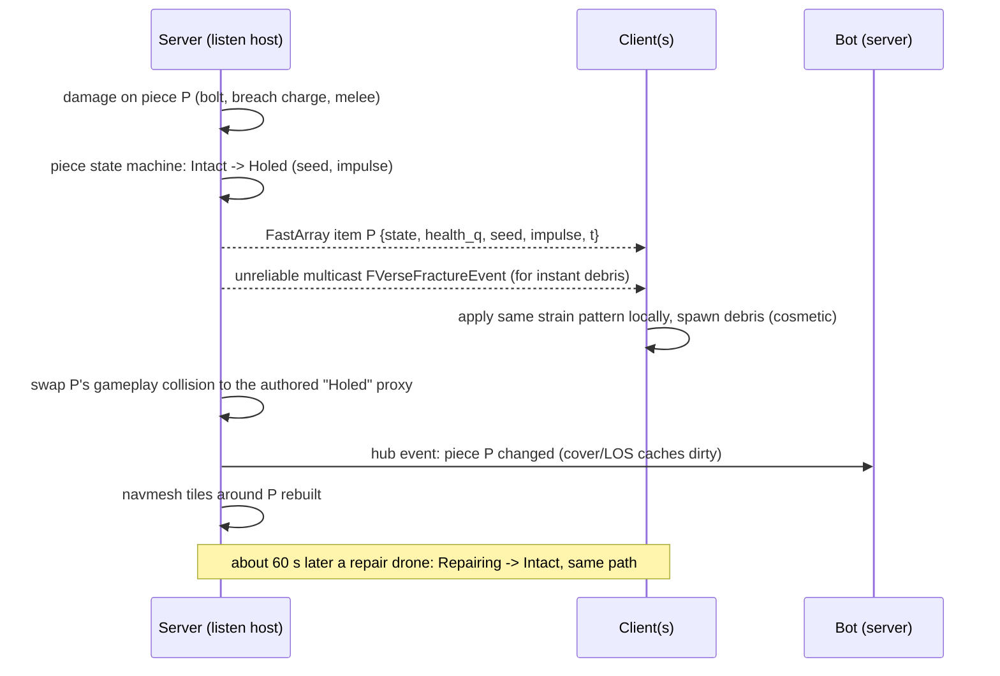
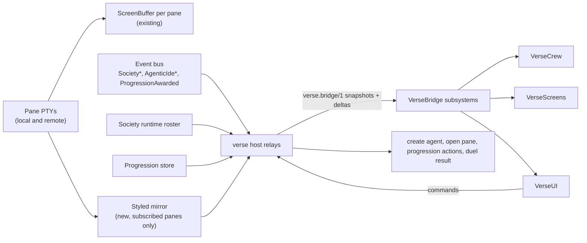

# Verse on Unreal: architecture

Target: Unreal Engine 5.7.1 (binary install, `C:/Program Files/Epic Games/UE_5.7`).
Project: `unreal/Verse/Verse.uproject`. Decisions it builds on are in
`README.md`; frozen interfaces go in `contracts/`. Facts about today's code
carry a file reference; everything else here is a design decision and says so.

## 1. Process model

Three parties, each its own process. The Dodaios desktop process (pywebview +
FastAPI backend in one process) owns everything; `Verse.exe` is a supervised
child that can die without taking the app down.

### 1.1 The verse host (new backend package)

| Piece | Path (planned) | Job |
|---|---|---|
| Supervisor | `dodaios/verse_host/supervisor.py` | Spawn, watch, restart, stop `Verse.exe` |
| Bridge server | `dodaios/verse_host/bridge.py` | The one WebSocket `Verse.exe` talks to |
| Relays | `dodaios/verse_host/relays/*.py` | Turn backend state and bus events into bridge topics |
| Capability probe | `dodaios/verse_host/probe.py` | GPU check, install check, "can this machine run the Verse" |
| Routes | `dodaios/ui/web/verse_routes.py` | `GET /api/verse/status`, `POST /api/verse/{launch,show,hide,stop}`, `POST /api/verse/settings/import` (one-time import of browser-stored settings, `contracts/bridge-protocol.md` §14), `WS /api/verse/bridge`, `WS /api/verse/signal` |

Supervisor rules:

| Rule | Value |
|---|---|
| Launch | Lazily, on the first `show` (Verse view opened, the launcher card's quick-start duel, IDE panel becomes visible). Never at app start |
| Containment | Windows job object with `KILL_ON_JOB_CLOSE`, so an app crash or quit kills `Verse.exe`. Linux: `prctl(PR_SET_PDEATHSIG)` plus process group. Never kill by parent PID (memory: `feedback_never_kill_process_tree_by_parent_pid_windows`) |
| Token | 256-bit, minted per launch, passed in the environment (`DODAIOS_VERSE_TOKEN`), never on the command line (command lines are readable by every process of the user and land in crash reports) |
| Liveness | Bridge heartbeat every 1 s; 5 s of silence = hung. Hung or exited: restart with backoff 1 s, 4 s, 15 s; after 3 crashes in 5 min stop: status `crashed`, the launcher card shows "Verse stopped, open the crash report" |
| Crash data | `<DATA_DIR>/verse/crashes/` (minidump + last log). Never uploaded automatically |
| Single instance | A named mutex in `Verse.exe`; a second launch hands its arguments to the first and exits |
| No GPU | Probe fails (no D3D12 SM6 adapter or under 6 GB dedicated VRAM; on Linux no Vulkan 1.3 device): status `unsupported`, the launcher card says so, the rest of the app is untouched |

`GET /api/verse/status` returns `{status, state, pid, vram_mb, fps, crash_report}`. `status` is one of `not_installed`, `unsupported`, `stopped` (not running, may launch), `running`, `crashed` (crash loop, needs a manual launch); `state` is the lifecycle state of section 1.3 while `running`, else `null`. The launcher card (WP17) and the parity checks (A-08, A-09) read these values.

### 1.2 Window and focus

| Topic | Decision |
|---|---|
| Window | Own top-level window, borderless windowed fullscreen (`r.FullScreenMode=1`) on the monitor the app window is on. No owner window, never `SetParent` / `WS_CHILD` (README Hosting) |
| Exclusive fullscreen | Not offered. Borderless keeps alt-tab instant and lets app popups and toasts stay visible |
| Show | Backend sends `lifecycle.show {monitor, reason}` (`contracts/bridge-protocol.md` §12); the desktop process, which holds the foreground, calls `AllowSetForegroundWindow(verse_pid)` first so Verse can take focus (Windows foreground lock) |
| Back to the app | One key inside the Verse (default `F10`, rebindable; `Esc` stays the in-game menu). Verse calls `AllowSetForegroundWindow(app_pid)`, sends `focus.return_to_app`, hides its window. The desktop process raises the app window. No global keyboard hook |
| Hidden means paused | On hide, minimize or focus loss to the app: the match pauses (design decision that keeps today's behaviour, `VerseStage.tsx:795`), rendering stops, audio mutes |
| Desk takeover | Verse sends `ide.focus_terminal {pane_id}`, hides itself; the backend publishes a bus event the web UI handles by opening the IDE on that pane, the desktop process raises the window |
| Linux | X11: `_NET_ACTIVE_WINDOW`. Wayland: an `xdg-activation` token handed over the bridge. See risk RK7 |

### 1.3 Lifecycle states of `Verse.exe`

| State | Rendering | Simulation | VRAM target |
|---|---|---|---|
| Visible | Full window | Full | at most 6 GB |
| Panel | Offscreen at panel size, streamed (section 6) | Decks only, no match | at most 3 GB |
| Dormant | Off (`bDisableWorldRendering`, viewport hidden, `t.MaxFPS 2`) | Paused; bridge ticks at 2 Hz | at most 2 GB (streaming pools trimmed) |
| Exiting | Off | Save match-free state (deck, position, settings), quit | 0 |

GPU pressure: the backend already knows when a Blender cook, local STT or a
local model wants the GPU (memory: dictation slow on a busy GPU). The verse
host sends `gpu.yield`; a Dormant Verse exits at once, a Visible one drops to
the Low scalability tier until the pressure ends.

## 2. Module map

C++ first, Blueprints only as thin data and presentation (design decision). One primary
game module, `Verse`, wires the others and is the only module allowed to
depend on everything; it holds the game instance, default classes and the
settings object. It is added to the planned list because a primary module is
required and keeping it thin stops any feature module from becoming the hub.

| Module | Type | Owns | May depend on (besides engine) |
|---|---|---|---|
| `VerseCore` | Runtime | Coordinate conversion (three.js y-up metres, yaw 0 = +Z, to Unreal Z-up centimetres), gameplay tags, log categories, seeded RNG, shared event structs (`FVerseHitEvent`, `FVerseFractureEvent`, `FVerseNoiseEvent`, `FVerseGadgetEvent`, `FVerseArenaSwitchEvent`, `FVerseSetSummary`), `FVerseInputFrame`, DataAsset schemas (tiers, weapons, gadgets, melee, penetration table, audibility), the event hub subsystem | nothing |
| `VerseBridge` | Runtime | WS client, `verse.bridge/1` codec, token hello, reconnect, topic subscriptions, typed feed subsystems (roster, panes, screens, progression), command sender | Core |
| `VerseMovement` | Runtime | Character class, custom movement modes, lean, prone, mantle, slide, per-bone hit zones on the physics asset | Core |
| `VerseDestruction` | Runtime | Destructible piece actors, piece state machine, server fracture authority, client debris, repair drones, penetration queries, navmesh updates | Core |
| `VerseCombat` | Runtime | Weapons, magazines, recoil, projectile sim, lag compensation, damage, melee and finisher, gadgets (Bulwark, breach charge) as abilities, game mode and rules (swappable `UVerseRuleset`) | Core, Movement, Destruction |
| `VerseGore` | Runtime (client cosmetic) | Blood decals, spatter, pools, wound masks, finisher gore, the reduced setting | Core (listens to `FVerseHitEvent` on the hub; never includes Combat) |
| `VerseDecks` | Runtime | Deck loading via World Partition and data layers, stations, the hangar day/arena switch, deck manifest import | Core, Bridge |
| `VerseCrew` | Runtime | Officers and technicians as pawns from roster and pane data, duty status, ranks, crew life loops | Core, Bridge, Decks |
| `VerseScreens` | Runtime | Desk monitors: terminal cell grids into render targets, chat tails, takeover trigger | Core, Bridge, Decks |
| `VerseBot` | Runtime (server only code paths) | `AVerseBotController` (an `AAIController`), fair perception, belief map, utility brain with hysteresis, StateTree tactics, aim model, tiers, in-match learning | Core, Movement, Combat, Destruction |
| `VerseUI` | Runtime (client) | HUD, menus, Verse bar, kill cam, service record, settings (gore, keys, `F10`) | Core, Bridge, Combat, Crew, Decks |
| `VerseStream` | Runtime | Pixel Streaming 2 session for the IDE side panel, panel camera, input mapping | Core, Bridge |
| `VerseHarness` | DeveloperTool (not in Shipping) | Automation tests, Gauntlet controllers, bot-vs-bot runs, screenshot and perf capture, balance gates | every runtime module |
| `Verse` | Runtime, primary | Game instance, default pawn/controller/mode classes, module startup | every runtime module except Harness |

DAG rules, enforced by a CI script that parses every `*.Build.cs`:

1. No edge that is not in the table. A new edge is a `contracts/` change.
2. Cross-module talk that goes "up" (Combat telling Gore about a hit,
   Destruction telling the Bot a wall broke) goes through Core event structs
   on the hub subsystem, never through an include.
3. `VerseBot` sees the world only through Combat's perception events and
   Destruction's piece-state queries; it never reads the opponent pawn's
   transform directly (fair perception contract, `combat/observe.ts`,
   `bot.test.ts:32-46`).
4. Plugins used: Chaos (Geometry Collection), GameplayAbilities, StateTree,
   EnhancedInput, PixelStreaming2, Iris, WebSockets. Mover and
   NetworkPrediction stay disabled (section 3.3).

## 3. Networking

### 3.1 Topology

Server-authoritative from day one (README). One code path, three ways to run it:

| Run | How | Used for |
|---|---|---|
| Local duel (shipped) | `Verse.exe` as a listen server; the person is the host's local player; the bot is a second pawn possessed by `AVerseBotController` on the server | Every normal session |
| Netcode test | `UnrealEditor-Cmd.exe Verse.uproject -server` plus two `-game` clients with `PktLag=60 PktLagVariance=10 PktLoss=1` | CI, so the person's pawn really runs as an autonomous proxy with prediction and correction |
| Online PvP (later) | A `VerseServer` target | Needs a source-built engine on the runner (binary installs cannot build Server targets); out of scope until PvP |

The listen-server host predicts nothing for itself, so the netcode test is
the only proof that prediction works; it is a required CI gate from the
first playable build (section 8).

Every gameplay mutation is behind `HasAuthority()`. Clients send input
(movement through the movement component, fire/ability through server RPCs
with a client timestamp), the server simulates and replicates state.

### 3.2 Replication

| Topic | Decision |
|---|---|
| System | Iris (`bUseIris = true` in `Verse.Target.cs`, `net.Iris.UseIrisReplication 1`) |
| Property style | Push model everywhere (`MARK_PROPERTY_DIRTY_FROM_NAME`); the same code then also runs on the generic system if Iris has to be switched off (risk RK2) |
| Server tick | `NetServerMaxTickRate=60`; pawns replicate at 60 Hz, pieces and pickups on change |
| Client frame rate | Uncapped up to the display (120+ target) |
| Collections | `FFastArraySerializer` for piece states, magazines in the world, match score |
| Projectiles | Not actors. The server runs a projectile manager that steps bolt segments (300 m/s, no drop) each tick. A fire event (shooter, weapon, seed, origin, direction, server time) goes out as an unreliable multicast; clients draw the bolt from it. The firing client draws its own bolt at once (predicted) and reconciles on the server's hit result |
| Hit validation | Server rewinds per-bone hit boxes to the shooter's view time (ring buffer, 1 s, every server tick), caps rewind at 250 ms |
| Abilities | GAS for health/armor attributes, damage effects, gadgets and the finisher; local prediction keys for gadgets. Weapon fire stays custom C++ (cheaper and deterministic per seed) |

### 3.3 Movement: CharacterMovementComponent, not Mover

Choice: `UVerseCharacterMovement` (a `UCharacterMovementComponent` subclass)
with custom modes. Mover 2.0 is not used in 5.7.

| Criterion | CMC with custom modes | Mover 2.0 |
|---|---|---|
| Networked prediction maturity | Production-proven saved moves, corrections, smoothing | Built on NetworkPrediction, both still marked experimental/beta in 5.7 |
| Iris | Supported path | NetworkPrediction's Iris path is newer and thinly documented |
| Root-motion sources (mantle) | `FRootMotionSource_MoveToForce` is predicted and replicated | Layered moves exist but less exercised over the network |
| Extra input (lean, prone) | `FCharacterNetworkMoveData` subclass via `FCharacterNetworkMoveDataContainer` | Native input structs (cleaner) |
| Capsule changes (prone) | Crouch path generalised to a second half-height | Free-form shapes (cleaner) |
| Risk if wrong | Contained: `VerseMovement` exposes `IVerseMovementQuery`; nothing else touches CMC | A plugin-level bug would block the whole duel |

Per move:

| Move | Implementation | Networked as |
|---|---|---|
| Walk, sprint, crouch, jump | Stock CMC; sprint as a compressed flag | Saved-move flags |
| Slide | `MOVE_Custom` + `CMOVE_Slide`: entered from sprint + crouch above a speed floor, low friction, decays to crouch | Custom mode in saved move |
| Mantle | Server and client both detect the ledge from the same trace at the same move time; a predicted root-motion source moves the capsule | Root-motion source id in move data |
| Prone | Capsule half height reduced like crouch, plus a horizontal "prone body" box for hits; turn rate and speed capped; prone needs floor clearance checks | Flag + capsule state |
| Lean | Not a movement mode: a quantised lean value (-1..1, 8 bits) in custom move data; drives the spine and camera offset, and the server uses the same value when it rewinds hit boxes | Move data field |

Hit zones are physics-asset bodies on the skeleton (head, neck, upper/lower
torso, arms, legs), so lean and prone change them automatically.

### 3.4 The bot as a player

`AVerseBotController` possesses an ordinary `AVerseCharacter`; it produces the
same input the local player produces (movement vector, look, fire, ability)
through a virtual input device on the server. No shortcuts: the bot moves,
reloads and mantles through the same code. The bot exists only on the server;
clients see a normal simulated proxy.

## 4. Destruction networking

| Topic | Decision |
|---|---|
| Authority | Only the server applies damage to pieces and decides a state change |
| Piece | One `AVerseDestructible` per breakable thing (wall panel, container wall, glass pane, catwalk segment, ceiling panel); stable id from One File Per Actor GUID |
| Gameplay state | Discrete enum per piece: `Intact, Damaged, Holed, Breached, Destroyed, Repairing`, plus quantised health (8 bit) and the last impact seed. Replicated in one `FFastArraySerializer`; only changed pieces cost bandwidth; late joiners get the array and spawn the broken look without debris |
| Gameplay collision | Comes from authored per-state proxy meshes, never from simulated debris. Server and clients then agree on line of sight, penetration and nav, and the bot's cover logic stays deterministic |
| Debris | Chaos Geometry Collection simulated on each client only. GC replication off. Debris ignores the pawn and weapon trace channels, sleeps after 3 s, despawns after 10 s, capped (section 7) |
| Determinism | Not required for debris. The seed and impulse make the break look the same on all clients most of the time; a different crack pattern is cosmetic and allowed |
| Penetration | A material table in Core (`DA_PenetrationTable`: material, thickness, damage falloff); the server traces through pieces using the proxy geometry |
| Bot | Hears breaks as noise events with position error; updates cover and belief map from piece states it can perceive; may shoot through a piece only at a heard or believed position |
| Repair | Server timer per piece; drone flight is cosmetic, the state change is authoritative |
| Never breaks | The hall floor (README) |

## 5. The bridge

### 5.1 Transport

| Topic | Decision |
|---|---|
| Endpoint | `ws://127.0.0.1:<backend port>/api/verse/bridge`, served by the existing FastAPI app. No second port: the backend port is already passed around and guarded |
| Peer check | Loopback peers only, even when the backend is bound wider for remote mode |
| Auth | First frame `hello {token, protocol: "verse.bridge/1", build}`; token checked against the launch token (same hello pattern as the mission socket, `missions_ws_routes.py:223-259`); wrong or late (5 s): close 4401 / 4400 |
| One client | A second authenticated connection replaces the first (Verse restarted) |
| Frames | JSON text frames for control and feeds; binary frames for terminal cell deltas |
| Ordering | Every server frame carries `seq`; on reconnect Verse sends `last_seq` and gets a fresh snapshot per topic (no replay log) |
| Back pressure | Bounded queue per topic; screens drop to the newest frame, events never drop (they are small) |
| Spec | `contracts/bridge-protocol.md` (frozen before fan-out) |

### 5.2 Topics: what the backend has today and what is missing

| Topic | Backend source today | Today's delivery | Must add |
|---|---|---|---|
| `roster` | `GET /api/society/agents` (`society_routes.py:378`): rows with `run_state` paused/waiting/working/idle and `waiting_reason` | Poll (web Verse: 30 s plus invalidation 5-6.5 s) | Relay that snapshots on subscribe and re-reads on `SocietyRoomChanged`, `SocietyMessageSent`, `SocietyResultPosted`, `SocietyTeamChanged` (`core/events.py:2514-2616`), 30 s safety re-read |
| `panes` | `GET /api/agentic-ide/panes`; `AgenticIdePaneActivity` already carries the row's activity half (`core/events.py:984`); `AgenticIdeTerminalsAdded/Closed`, `AgenticIdeWorkspaceChanged` | Push on `/ws` (bus `subscribe_all`, `server.py:1832-1859`) plus 4 s poll | Relay that forwards these events as-is plus a snapshot |
| `screens` | `GET /api/agentic-ide/screens` (`agentic_ide_routes.py:4518`) reads `screen_feed.collect_screens`: plain text rows, cursor, `at`; caps 8 panes, 60 rows, 240 cols (`agentic_ide/screen_feed.py:28-35`) | Poll, about 450 ms | See 5.3 |
| `chat_tails` | The desk chat tail the web Verse polls (2.5 s, at most 6 agents) | Poll | Relay on `SocietyMessageSent` instead of polling |
| `meetings`, `groups` | Existing meeting and group reads | Leased poller plus socket events | Relay, same events |
| `progression` | `GET /api/progression` (`progression_routes.py:73`), `ProgressionAwarded` event | Read plus event | Relay; plus duel stats (below) |
| `locale` | Frontend i18n chunk `ship`, 5 locales | Bundled in the web app | Sent in `welcome` from the same JSON files, so a string change needs no Unreal rebuild |
| `companion` | Active pet id and look (`companionPetStore` source today) | Read by the web Verse | Relay `companion.snapshot` / `companion.update` (`contracts/bridge-protocol.md` §14) |

Commands Verse sends (all mapped onto existing backend calls, executed by the
relay in-process, not via HTTP):

| Command | Backend action |
|---|---|
| `agent.create` | Same code as `POST /api/society/agents` (`society_routes.py:434`) |
| `pane.open`, `agent.open`, `ide.focus_terminal` | New bus event the web UI handles (open view, focus pane); desktop process raises the window |
| `launcher.start` | Same code the web launcher uses (opens panes, sends briefs) |
| `progression.action` | `POST /api/progression/actions` (`progression_routes.py:100`): `daily_visit`, `deck_discovered`, `inspection`, `walk_together`, `team_briefing`, `simulator_round`, `simulator_record` |
| `duel.result` | New: one result per finished set (plus one `unfinished` result when the person leaves mid-set), server-paid `duel_won` / `duel_lost` rules and a duel stats store (wins, K/D, headshots, finishers) for the service record. Today no XP rule mentions a duel (`dodaios/progression/rules.py:131-146`) |
| `agents.open_list`, `group.open`, `simulator.open`, `ide.open`, `launcher.cancel`, `settings.set`, `progression.told` | `contracts/bridge-protocol.md` §14 |
| `lifecycle.state`, `lifecycle.ready`, `lifecycle.bye`, `window.state`, `focus.return_to_app`, `panel.stream_state` | verse host (`contracts/bridge-protocol.md` §12) |

### 5.3 Terminal cells across the process boundary

Today's in-world screens paint the IDE's in-page xterm buffers
(`lib/liveTerminals.ts`); that memory lives in WebView2 and cannot reach
`Verse.exe`. The backend already keeps its own replayed screen per pane:
`ScreenBuffer` (`agentic_ide/screen.py:52`) is fed by every PTY's output,
also for remote panes, and is what `/screens` reads. What it lacks:

| Gap | Why it matters | Addition |
|---|---|---|
| No colour or style: SGR is parsed and dropped (`screen.py` docstring) | Monitors would show grey text, unlike the IDE | A styled mirror: a second, attribute-keeping buffer (fg/bg as 256-colour or RGB, bold, dim, inverse, underline) created only for panes the Verse subscribes to, seeded from the pane's replay bytes and fed from the same output callback as a non-claiming viewer (the PTY socket already has a `claim=0` bystander mode, `agentic_ide_routes.py:5567+`). The base buffer stays dependency-free and untouched |
| Poll only | 450 ms latency, full rows every time | Push: per pane, dirty rows only, coalesced to at most 10 Hz, as a binary frame (pane id, row index, run-length cells) |
| Cap of 8 panes | Fine for now | Verse subscribes only to desks within view distance and changes the set as the camera moves; cap stays 8 |
| No geometry events | Monitor needs cols/rows | Size sent with each snapshot and on resize |

Takeover stays out of process: Unreal never hosts a live terminal. Taking over
a desk brings the app to the front on that pane (README).

Rendering on the Unreal side: one glyph atlas (the IDE's font, licence
checked, 13 px reference size) and one render target per monitor; dirty rows
are drawn with a canvas or a material quad; a monitor far from the camera
updates at 2 Hz.

### 5.4 Data flow

## 6. Pixel Streaming for the IDE side panel

The compact Verse in the IDE side panel (`OfficeTab.tsx:57`, engineering
deck) becomes a Pixel Streaming 2 view of `Verse.exe`.

| Topic | Decision |
|---|---|
| Process | The same `Verse.exe`, no second instance. In the Panel state it renders offscreen at the panel's size with the panel camera |
| Both visible at once | The full window wins. The panel shows the last streamed frame with "Verse is open" and stops the stream, so the GPU never renders two views |
| When | Stream starts when the panel becomes visible and stops within 1 s of it being hidden, scrolled away or the app minimised (`IntersectionObserver` + page visibility). A stopped stream plus a hidden full view lets the Verse go Dormant |
| Signalling | Served by the backend (`WS /api/verse/signal`, same token rules), so no extra Node process ships. Loopback ICE host candidates only, no STUN/TURN |
| Codec | Hardware encoder, H.264 (AV1 when the encoder offers it), 30 fps, bitrate cap 8 Mbit/s |
| Frontend | The Pixel Streaming frontend library (MIT) inside the panel component |
| Input | Mouse and keys over the data channel; panel is overview and walking only. The duel never runs in the panel (design decision: the stream adds latency that twitch input cannot hide) |
| Fallback | Stream fails or Verse unsupported: the panel shows the plain card it would show without a GPU |

## 7. Performance budgets

Reference box: RTX 5070 Ti 16 GB, Ryzen 7 7800X3D (8 cores, 16 threads), 32 GB RAM, monitors 2560x1440
(primary) and 3840x2160 (`reference_hardware.md`). The GPU is shared with
local STT, local models, Blender cooks and WebView2, so VRAM is the hard limit,
not frame time.

| Budget | Target on the reference box | Measured by |
|---|---|---|
| Frame rate, 1440p native (TSR at 100 %), "High" scalability preset with Lumen and Nanite | 120 fps average, p99 frame at most 11 ms in the duel | Harness perf capture, fixed bot-vs-bot replay |
| Frame rate, 4K output (TSR from about 1440p) | 90 fps average, p99 at most 14 ms | same |
| GPU frame split at 1440p (8.3 ms) | Nanite + base pass 2.0, Lumen GI + reflections 2.5, virtual shadow maps 1.2, translucency/VFX/decals 0.8, post + TSR 1.0, headroom 0.8 | `stat gpu` / Insights |
| Game thread | at most 4 ms (bot at most 0.5 ms per server tick) | Insights |
| Physics | at most 2 ms with the debris cap hit | Insights |
| VRAM, Visible | at most 6 GB (`r.Streaming.PoolSize` and Nanite pool capped) | `stat rhi`, NVML via harness |
| VRAM, Panel / Dormant | at most 3 GB / 2 GB | same |
| System RAM | at most 4 GB working set Visible, 1.5 GB Dormant | Harness |
| Dormant CPU | under 1 % of one core, zero GPU frames | Harness |
| Cold start to first frame | at most 8 s (PSO precache plus a shipped PSO cache) | Harness timer |
| Dormant to Visible | at most 300 ms | Harness timer |
| Panel stream | at most 1.5 ms GPU per frame at 960x600, glass-to-glass under 80 ms | Harness |
| Bridge | screens at most 200 KB/s total; Unreal monitor updates at most 0.3 ms game thread per frame | Bridge counters |
| Destruction | at most 400 active debris bodies, at most 64 fracture events/s, about 64 bytes per event | Counters |
| Network (future online) | server to client at most 128 kbit/s steady, bursts on destruction | Netcode test |
| Size | Verse payload at most 2 GB compressed at parity; a typical update delta at most 300 MB (IoStore chunking by deck) | Package step |
| Floor | D3D12 SM6 or Vulkan 1.3, 6 GB VRAM: Low preset 60 fps at 1080p | Probe + manual |

A budget breach fails the nightly perf job; the PR lanes only check what they
can (size, memory under `-nullrhi`).

## 8. Build and CI

### 8.1 Toolchain

| Item | Decision |
|---|---|
| Engine | Binary 5.7.1 install, never in the repo (engine EULA). Version pinned in `Verse.uproject` and checked by CI |
| Windows compiler | Visual Studio 2022 Build Tools with the MSVC and Windows SDK versions 5.7 requires; not installed on the dev box on 2026-11-02, first setup step |
| Linux | The engine's clang cross-compile toolchain for 5.7, installed on the dev box, `LINUX_MULTIARCH_ROOT` set; version pinned in `unreal/Toolchain/toolchains.json`. Linux Game target built from Windows; tests run in a Linux container or VM on the same box |
| DDC | Local Zen DDC on `C:` capped at 40 GB (106 GB free on 2026-11-02, `orchestration.md` §4); `-ddc=` policy in `unreal/Toolchain/ddc.json`. No shared cloud DDC |
| Repo | `unreal/` with a nested `unreal/Verse/.gitattributes` routing `*.uasset`, `*.umap` and the few other allowed binaries to LFS; One File Per Actor; a nested `unreal/Verse/.gitignore` ignores `Binaries/`, `Intermediate/`, `Saved/`, `DerivedDataCache/`. All repo gate rules are in section 8.4 |
| Targets | `Verse.Target.cs` (Game) and `VerseEditor.Target.cs` only. `VerseHarness` is listed only in the Editor target; the `VerseServer.Target.cs` that exists today is deleted in G0 (binary installs cannot build Server targets, section 3.1) |

### 8.2 Runner and lock

| Item | Decision |
|---|---|
| Runner | One self-hosted GitHub Actions runner on the dev box, labels `self-hosted, windows, unreal`, running as a dedicated low-privilege user |
| Public repo safety | Self-hosted jobs never run for pull requests from forks. They run on `merge_group`, pushes to `main`, nightly, and same-repo PRs that touch `unreal/**` (checked by `github.event.pull_request.head.repo.full_name`) |
| Workflow policy | Every `unreal-*.yml` declares `permissions:` (least privilege) and pins each action to a 40-character commit SHA (`scripts/ci/check_workflow_policy.py`). A lane that must block merges is wired into the one required check, `CI gate`: it becomes a job in `ci.yml` listed under `gate.needs` that reports success without work when the change touches no `unreal/**`, `art/verse/**` or `docs/verse/unreal/**` path. A separate path-filtered workflow is never made a required check (it would block every PR that does not trigger it) |
| Concurrency | Workflow `concurrency: unreal-build` plus a machine-wide lock file (`C:/demo/.locks/gpu-heavy.lock`) taken by `scripts/unreal/with_lock.py`. The same lock wraps local agent builds, cooks and `scripts/verse/cook.py` Blender cooks, so at most one compile/cook/bake uses the box at a time. Waiters queue, they do not fail |
| Quiet hours | GPU perf captures run only in the nightly window and skip when the person is active (input in the last 5 min) |
| Agents | Parallel work-package agents never invoke UBT/UAT directly; they call `scripts/unreal/build.py`, which takes the lock |

### 8.3 Lanes

| Lane | Where | Runs |
|---|---|---|
| `unreal-static` | GitHub-hosted, every PR touching `unreal/**`, `art/verse/**` or `docs/verse/unreal/**` | `Build.cs` DAG check (section 2), forbidden-name scan (README Legal, hashed list, section 8.4), LFS pointer check, per-file size gate, forbidden folder names (section 8.4), clang-format, asset licence ledger check |
| `unreal-build` | Self-hosted, PR + merge queue | Win64 Development Editor + Game, Linux Game (cross), automation tests under `-nullrhi`, netcode test (dedicated + 2 lagged clients, 2 min smoke) |
| `unreal-gauntlet` | Self-hosted, merge queue (short) + nightly (long) | Headless bot-vs-bot balance runs and gates (no trick beats hard, skilled model about 40 % vs elite) |
| `unreal-perf` | Self-hosted, nightly | Fixed replay on the GPU, screenshots, the budgets in section 7 |
| `unreal-package` | Self-hosted, release tags | BuildCookRun for Win64 and Linux, IoStore + delta packaging, hand-off of unsigned binaries to the existing signing workflow |

Done gate for Unreal work: the lane that covers the change is green, and for a
visible change a harness screenshot of the running build is attached to the
PR (the Unreal counterpart of "visible in the running app").

### 8.4 Repo gates the Unreal work must pass

The repo's commit hooks (`.githooks/*`, calling `scripts/ci/*`) and the CI
gates in `scripts/ci/run_gates.py` apply to every Unreal change. These rules
keep the first and every later Unreal PR green. G0.12 (`work-packages.md`)
lands the repo changes in one PR by the integration owner.

| Topic | Rule |
|---|---|
| Git LFS upload | `core.hooksPath` points at a shared `.githooks/`, so `git lfs install` cannot add its own pre-push hook and a plain `git push` uploads pointers without objects. G0.12 adds `git lfs pre-push "$remote_name" "$remote_url" < "$refs_file"` to `.githooks/pre-push`, guarded by `command -v git-lfs`; `scripts/agent_land.py` also runs `git lfs push origin <branch>` before `git push` when the diff holds an LFS path. The `unreal-static` LFS pointer check fails a PR whose objects are missing on the remote |
| LFS for users | A committed `.lfsconfig` with `[lfs] fetchexclude = unreal/**` keeps installs and updates from downloading Unreal binaries (installer `git clone --depth 1`, updater fetches in `dodaios/core/main_follow.py` and `dodaios/ui/web/update_routes.py`). The dev box, agent worktrees and the self-hosted runner override it with `git config lfs.fetchexclude ""`. WP22 also sets `GIT_LFS_SKIP_SMUDGE=1` in those git calls |
| Release source archive | The root `.gitattributes` gets `unreal/** export-ignore`, so the `git archive` source tarball (`scripts/ci/release_assets.py`) never carries the Unreal tree; the Verse ships as its own package (README Delivery) |
| Ignored folders | The root `.gitignore` ignores the folder names `build/`, `models/`, `env/`, `logs/`, `dist/`, `secrets/`, `credentials/`, `traces/`, `blobs/` and file names `Screenshot *`; Windows matches them case-insensitively, Linux CI does not. Rule: no folder under `unreal/` or `art/verse/` carries one of these names, in any case. The only exception is the engine-required `unreal/Verse/Build/` (platform icons and resources), which the nested `unreal/Verse/.gitignore` re-includes with `!Build/`. Toolchain pins live in `unreal/Toolchain/`, not `unreal/Build/` |
| Nested ignore | `unreal/Verse/.gitignore`: `Binaries/`, `Intermediate/`, `Saved/`, `DerivedDataCache/`, `**/Binaries/`, `**/Intermediate/`, `*.sln`, `*.VC.db`, `.vs/`, then `!Build/` |
| Junk gate | `scripts/ci/check_repo_junk.py` blocks `.mp4 .mov .webm .mkv .avi .gif .wav .flac .aif .aiff .blend .psd .kra .xcf .exr .fbx .zip .7z .rar .tar .gz .bak .orig` anywhere, any path segment named `video`, `videos`, `film`, `films`, `renders`, `evidence`, `recordings` or `screenshots` (any case), and any file over 5 MB that is not an LFS pointer. Rule: source `.fbx`, `.wav`, `.exr` and recordings are never committed, only the imported `.uasset`; no folder carries one of those names (evidence goes to `Saved/Harness/proof/`, screenshot ground truth to `unreal/Verse/Tests/GroundTruth/`). The 5 MB cap stays as the backstop for a binary committed without LFS. A true exception goes into `scripts/ci/repo-junk-allowlist.txt` with a reason, in the same PR |
| Language | `scripts/ci/check_no_new_german.py` scans added lines of `.md`, `.json`, `.ini`, `.py`, `.ts` and other text files: English only. `.cpp`, `.h`, `.cs`, `.uproject` and `.uplugin` are not scanned, so reviewers check them |
| Design references | `scripts/ci/check_design_references.py` fails a design verb ("inspired by", "modelled on", "adapted from", "borrowed from", "copied from") within 60 characters of a software product name, and "<Product>-style" or "<Product>-like". Never put those verbs near a capitalised product word (the skin name "Arc Storm" counts) |
| Docs privacy | `scripts/ci/docs_privacy_scan.py` scans every tracked `docs/` file: no user-profile paths (Windows `Users` folders, including short 8.3 temp paths, POSIX home folders), no consumer email addresses, no account SIDs, no maintainer name. The engine install path under `Program Files` is fine |
| Doc location | Unreal docs stay under `docs/verse/unreal/`. `docs/plans/**`, `docs/superpowers/**`, `docs/qa/**`, `docs/handoffs/**` and `docs/diagnostics/**` are withheld from the public tree; `docs/product/**` needs a front-matter manifest |
| Agent files | No `CLAUDE.md` or `CLAUDE.local.md` anywhere under `unreal/`, `art/` or `docs/` (`scripts/ci/check_agents_md.py`) |
| Keys | No `*.key`, `*.key.enc` or PEM blocks; no secrets in `Config/*.ini` (`check_no_private_keys.py`, `privacy_pre_push.py`) |
| Shell scripts | Every tracked `*.sh` must parse under bash 3.2 |
| Persona words | `tests/unit/brain/test_persona_no_trademark.py` scans `dodaios/**` and `art/**`, so art builders under `art/verse/` follow it |
| Forbidden names | No gate in the repo scans for names of games, studios, franchises or firearm makes and models, and `.cpp`, `.h`, `.cs` and `.uasset` metadata are not text-scanned. `scripts/unreal/check_forbidden_names.py` (WP10) closes that gap in `unreal-static` and the pre-commit run of `build.py`. Its list is stored only as SHA-256 hashes of normalised single words and two- and three-word sequences (`scripts/unreal/forbidden_names.sha256`), so the repo never contains the names it forbids; the integration owner maintains the list outside the repo |
| PR titles | Conventional Commits, `type(verse): subject`, lower case, imperative (`feat(verse): …`, `docs(verse): …`). On a branch with several commits `gh pr create --fill` uses the branch name, so run `gh pr edit <n> --title "…"` straight after landing |

## 9. Open technical risks

| # | Risk | Why | Mitigation / decision point |
|---|---|---|---|
| RK1 | Balance net lost | The TS harness ran 16,800 duels in 1.5 min; Unreal headless is far slower | Gauntlet runner in the first phase; run at `-nullrhi`, fixed 60 Hz, several processes in parallel under the lock; decide the run count per gate from measured speed |
| RK2 | Iris maturity in 5.7 | Some engine features and plugins still assume the generic replication system | Push model only, so switching Iris off is one setting; netcode test runs on both nightly |
| RK3 | CMC custom moves desync | Mantle and prone are the classic correction sources | Correction counters in the netcode test with a gate (corrections per minute); revisit Mover at the next engine upgrade behind `IVerseMovementQuery` |
| RK4 | Listen server hides prediction bugs | The host never predicts | Netcode test is a required gate, not optional |
| RK5 | Destruction vs bot and nav | Holes change cover, LOS and paths | Per-state proxy collision, nav tile rebuild per state change, bot belief map; harness scenario "wall opened mid-fight" |
| RK6 | VRAM contention | 16 GB shared with STT, models, Blender | Hard pool caps, Dormant/exit policy, `gpu.yield`; measure with real dictation running |
| RK7 | Foreground and focus | Windows foreground lock, Linux Wayland activation | `AllowSetForegroundWindow` hand-off both ways; manual test matrix; Wayland via `xdg-activation` token |
| RK8 | Linux build untested | Cross-compile with a binary engine, Vulkan drivers, Wayland | Linux Game target in `unreal-build` from the first commit; a Linux VM smoke run nightly |
| RK9 | Pixel Streaming protocol drift | Frontend library and backend signalling must match PS2 in 5.7 | Pin library version; signalling contract test against the plugin |
| RK10 | Styled mirror cost | A second parser per subscribed pane on the event loop | Only for subscribed panes, at most 8; measure loop time with 8 busy panes |
| RK11 | Token and loopback | Any local process of the user can connect to loopback | Per-launch token, loopback-only peer check, one client; no secrets ever cross the bridge (no API keys, no credentials) |
| RK12 | Self-hosted runner on a public repo | Untrusted code on the person's own machine | Fork PRs never reach it; dedicated user; no signing keys on the runner |
| RK13 | Disk | 106 GB free (2026-11-02); engine, DDC, LFS, two platform builds | DDC cap, `Intermediate` pruning in `build.py`, alert below 40 GB free |
| RK14 | Binary asset merges | `.uasset` cannot merge across parallel agents | One File Per Actor, zone ownership in `work-packages.md`, C++ and DataAssets as text-like surfaces, LFS locking for shared maps |
| RK15 | Install size vs updater | 1.5 GB cap today (`installer_update.py:106`) | IoStore chunk per deck, delta packages, raise the cap (README) |
| RK16 | Gore and paired finisher animation | No rig with weapon/IK bones today, no clips with root motion | New rig early in the art track; finisher gated on motion warping working over the network |
