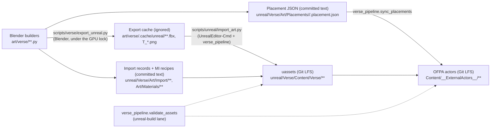

# Contract: art pipeline (Blender art-as-code to Unreal)

Status: draft for freeze before fan-out. Target: Unreal Engine 5.7.1, project
`unreal/Verse/Verse.uproject`. Builds on `../README.md` (decisions) and
`../architecture.md` (modules, OFPA, LFS, budgets). Facts about today's code
carry a file reference; everything else is a design decision of this contract.

Owner: the integration owner (orchestration.md). Consumers: every package
that adds meshes, textures, materials, characters, weapons, destructible
pieces or deck content (VerseDecks, VerseCrew, VerseScreens, VerseCombat,
VerseDestruction, VerseGore, VerseUI).

## 1. What carries over and what does not

| Today (fact) | In Unreal |
|---|---|
| Blender 5.0.1 Python builders under `art/verse/` are the source of truth; `.blend` is derived and git-ignored (`art/verse/kit/README.md`, `.gitignore:130,531`) | Unchanged. Builders stay the source; `.blend` stays ignored |
| Kit: pieces on a 1.2 m module, placed as collection instances (`lib/kit.py`, `kit/README.md`) | Each kit master exports once as its own mesh; every placement becomes one OFPA actor |
| Names `SM_ SK_ A_ M_ MI_ T_*_BC/_N/_ORM/_E/_M`, `UCX_`, `SOCKET_`, `ROOM_`, `LV_`, `BP_` (`lib/naming.py`) | Kept and extended (section 3). `UCX_` and `SOCKET_` change meaning on the Unreal side and are remapped |
| ~50 procedural Cycles materials, no UVs (object/world coordinates, `kit/README.md` "lib/materials.py") | Rebuilt as instances of a few master materials, triplanar where a piece has no UVs (section 7) |
| Baked lighting: rgbm2 lightmaps, probes, plates, `nav.png`, `realtime/scene.glb` | **Never imported.** Lumen, Recast and Unreal collision replace them |
| Character skeleton: 25 bones, one bone for four fingers, no IK or weapon bones (`characters/README.md`, "Skeleton") | Replaced by a new original FPS rig (section 12) |
| Provenance ledger `art/verse/LICENSES.md`, append-only | Stays the one ledger (any licence, one row per third-party file); Unreal imports cite its rows (section 11) |

## 2. Flow



| Step | Command (planned) | Runs where | Lock |
|---|---|---|---|
| Export | `python scripts/verse/export_unreal.py {piece <SM_Name> \| deck <deck> [--zone <zone>] \| characters \| weapons \| textures}` | Blender via `scripts/verse/blender.py` | `scripts/unreal/with_lock.py` (the machine-wide `gpu-heavy.lock`, architecture 8.2) |
| Import | `python scripts/unreal/import_art.py {assets \| placements} [--deck D --zone Z] [--only NAME,...]` | `UnrealEditor-Cmd.exe unreal/Verse/Verse.uproject -ExecutePythonScript=<Content/Python/verse_pipeline/cli.py> -unattended -nosplash -nullrhi` (a headless editor, not the `pythonscript` commandlet: asset import tasks need the Slate application, which a commandlet does not create) | same lock |
| Validate | `python scripts/unreal/import_art.py validate` | same headless editor; also in `unreal-build` | same lock |
| Calibrate | `python scripts/unreal/import_art.py calib [--export]` | export, then the same headless editor (6.1) | same lock |
| Masters, MIs (WP14) | `python scripts/unreal/import_art.py {masters \| materials} [--only NAME,...] [--no-save]` | same headless editor; master graphs from WP14's `art/verse/weapons/editor/masters.py`, MIs from the recipes of section 7 (`verse_pipeline.materials`) | same lock |
| Look evidence (WP14) | `python scripts/unreal/import_art.py lookdev`, `python scripts/unreal/import_art.py wp14 [--no-lookdev]` (`wp14`: LUT, masters, MIs, WP14 meshes, validate and lookdev in one editor session) | headless editor with the D3D12 RHI offscreen | same lock |
| Static check (no engine) | `python scripts/unreal/check_art_text.py` | `unreal-static` lane, GitHub-hosted, LFS not fetched | none |

Parallel agents call only these scripts, never Blender or UnrealEditor
directly (architecture 8.2). If an importer turns out to need a GPU device,
`import_art.py` drops `-nullrhi`; it still runs under the lock.
Commands that place actors or render frames (`placements`, `lookdev`,
`wp14`) run with `-d3d12 -RenderOffscreen` instead of `-nullrhi`: without an
explicit `-d3d12`, UE 5.7.1 can pick an RHI that cannot render post-process
captures. Every other command keeps `-nullrhi`.

`assets` imports records of kind `static_mesh`, `proxy_mesh`,
`skeletal_mesh` and `texture` (through `verse_pipeline.import_textures`); a
`skeleton` record is created together with its skeletal mesh, and records of
kind `material` or `material_function` are built in the editor by their
owner's builder, never imported. WP14's editor code lives in
`art/verse/weapons/editor/` (owned by WP14); `verse_pipeline.art_on_path()`
puts `art/verse` on `sys.path` so the pipeline can call it. Once that code is
present, its import finish (`weapons.editor.rig.finish_import`: slots,
skeleton and socket names, auto box, auto LOD) runs on WP14 records after
import, and `validate` adds its checks (section 14, "Asset settings").

## 3. Naming

Names are ASCII, `PascalCase` segments joined by `_`, at most 64 characters;
a full object path stays under 180 characters (Windows path limit with the
`__ExternalActors__` hash folders on top). Dimensions in names are
centimetres (`SM_Wall_480_H540`), as today.

| Prefix / suffix | Asset | Notes |
|---|---|---|
| `SM_` | Static mesh | One kit master or prop per asset |
| `SM_<Piece>_Proxy_<State>` | Collision-only static mesh for a destructible state | Never rendered; section 5 |
| `SM_<Piece>_Frac` | Fracture chunk set exported for a geometry collection | Import input only |
| `GC_` | Chaos geometry collection | Built by the import script |
| `SK_` | Skeletal mesh | Characters, weapons with moving parts |
| `SKEL_` | Skeleton | `SKEL_Verse_Human`, `SKEL_Weapon_<Class>` |
| `PHYS_` | Physics asset | Hit-zone bodies (architecture 3.3) |
| `IKRig_`, `RTG_` | IK rig, retargeter | Rig package only |
| `A_` | Animation sequence | Kept from `lib/naming.py`: `A_` is animation, not audio |
| `AM_`, `BS_`, `ABP_` | Montage, blend space, animation blueprint | |
| `M_` | Master material | Only the masters in section 7 |
| `MF_` | Material function | |
| `MI_` | Material instance | One per Blender material name it replaces |
| `T_<Set>_BC` | Base colour, sRGB | |
| `T_<Set>_N` | Normal, authored OpenGL (+Y), flipped on import | Section 6 |
| `T_<Set>_ORM` | Packed R = AO, G = roughness, B = metallic, linear | |
| `T_<Set>_E` | Emissive, sRGB | |
| `T_<Set>_M` | Mask, linear | |
| `SW_`, `MS_` | Sound wave, MetaSound source | Audio is outside this contract except the LFS and licence rules |
| `NS_` | Niagara system | |
| `DA_` | Data asset | e.g. `DA_PenetrationTable` (architecture 4) |
| `PM_` | Physical material | `PM_Verse_<Surface>` on world geometry selects a penetration row (section 5.1) |
| `LV_<Deck>` | Deck level (World Partition map) | Kept from `lib/naming.py` |
| `DL_<Deck>_<Layer>` | Data layer | `DL_Hangar_Day`, `DL_Hangar_Arena` |
| `BP_` | Blueprint | Thin data and presentation only (architecture 2) |

### 3.1 The `UCX_` and `SOCKET_` conflict

In Blender these prefixes mean something else than in the Unreal mesh importer.

| Blender name today | Blender meaning (fact) | Unreal importer meaning | Rule |
|---|---|---|---|
| `UCX_<name>` | Depth proxy that hides characters in the 60° plate (`kit.occluder`, `naming.OCCLUDER`) | Custom convex collision of the mesh it is named after | **Never exported.** The export drops every object in the `Occluders` collection and every `UCX_*` object. Plates do not exist in Unreal |
| `SOCKET_<kind>_<id>` | World-space empty for seats, screens, spawns, stations (`naming.SOCKET_KINDS`) | Static mesh socket | **Never exported inside a mesh.** World sockets go to the placement JSON `sockets[]` (section 4) |
| (new) `UECOL_<Box\|Sphere\|Capsule\|Convex>_<nn>` | Unreal collision primitive authored in a piece builder | | Renamed at export to `UBX_/USP_/UCP_/UCX_<SM_Name>_<nn>` |
| (new) `UESOCKET_<name>` | Mesh-local socket an asset needs at runtime (muzzle, grip, sight) | | Renamed at export to `SOCKET_<name>` |

The exporter fails (exit 1) if any `UCX_`, `UBX_`, `USP_`, `UCP_` or `SOCKET_`
name reaches an FBX file by any other route.

## 4. Placement JSON: `verse.placement/1`

One file per deck zone: `unreal/Verse/Art/Placements/<deck>/<zone>.placement.json`.
Committed text, LF, sorted keys, 2-space indent, arrays in stable order (by
`id`), so diffs are minimal and reviewable. JSON Schema:
`art/verse/schema/placement.schema.json` (next to `deck.schema.json`).

### 4.1 Space

All transforms are already in **Unreal space**: Z up, X forward, Y right
(left-handed), centimetres. Blender space is Z up, X = bow, metres,
right-handed (`kit/README.md`, "Axes").

| Quantity | Blender to Unreal |
|---|---|
| Location | `(x, y, z) m` to `(100 x, -100 y, 100 z) cm` |
| Rotation (quaternion w, x, y, z) | to `[x, y, z, w] = [-x, y, -z, w]` (mirror across the XZ plane) |
| Yaw about Z | `ue_yaw = -blender_rot_z` |
| Scale | unchanged |
| three.js `(x, y, z) m`, y up (VerseCore's input) | `(100 x, 100 z, 100 y) cm`; consistent with the row above because three.js `z = -blender y` |

One Python function does this (`art/verse/lib/ue_space.py`), twin of the
VerseCore C++ conversion. Both are tested against the same vector file,
`unreal/Verse/Art/space_vectors.json` (pytest and a UE automation test).

### 4.2 Fields

Top level:

| Field | Type | Required | Meaning |
|---|---|---|---|
| `schema` | `"verse.placement/1"` | yes | |
| `deck` | string, `^[a-z][a-z0-9_]*$` | yes | Deck id from `DECK_IDS` (`decks.ts:7`) |
| `zone` | string, `^[a-z][a-z0-9_]*$` | yes | Zone id, unique per deck; list and owners in `work-packages.md` |
| `bounds_cm` | `{min:[x,y,z], max:[x,y,z]}` | yes | Zone box; every placement origin lies inside |
| `level` | string | yes | `/Game/Verse/Decks/<Deck>/LV_<Deck>` |
| `source` | `{builder: path, sha256: hex}` | yes | Builder file and hash of the builder plus its imported `art/verse/lib` and `kit` modules |
| `generator` | `{script, version, blender}` | yes | e.g. `export_unreal.py`, `1`, `5.0.1` |
| `placements` | array | yes | Below |
| `sockets` | array | yes (may be empty) | Below |
| `rooms` | array | yes (may be empty) | Below |

`placements[]`:

| Field | Type | Required | Meaning |
|---|---|---|---|
| `id` | string `^[a-z0-9_]+$` | yes | Stable within the zone. Builder `id=` wins; otherwise `<piece lower>_<x>_<y>_<z>_<yaw>` from the transform snapped to 15 cm and 1°; duplicates get `_2`, `_3`. Moving an unnamed piece makes a new id (new actor file); name pieces that move often |
| `piece` | string | yes | Asset name, e.g. `SM_Wall_480` or `GC_ContainerWall_240` |
| `asset` | string | yes | Object path, e.g. `/Game/Verse/Kit/Architecture/SM_Wall_480.SM_Wall_480` |
| `location` | `[x, y, z]` cm | yes | Unreal space |
| `rotation` | `[x, y, z, w]` | yes | Unit quaternion, Unreal space |
| `scale` | `[x, y, z]` | yes | Non-uniform only for pieces whose record allows it |
| `room` | string or null | yes | `ROOM_` id this placement belongs to |
| `nav` | `"walk" \| "block" \| "none"` | yes | From the `nav` property (`naming.NAV_VALUES`); drives the nav modifier and the `CanEverAffectNavigation` flag |
| `mobility` | `"static" \| "movable"` | yes | `movable` for destructibles, doors, anything that moves |
| `data_layer` | string | yes | `DL_<Deck>_Base`, or `DL_Hangar_Day` / `DL_Hangar_Arena` for the hangar switch (VerseDecks) |
| `collision` | string | yes | Profile name from section 5 |
| `material_overrides` | `{slot: MI object path}` | no | Slot names as in the import record |
| `destructible` | object or null | yes | `{actor_class, penetration_material, health, states:[...], proxies:{State: SM path}, repair_s}`; `null` for static pieces. `actor_class` is an `AVerseDestructible` subclass (architecture 4); `penetration_material` is a key of `DA_PenetrationTable` |
| `station` | `{id, kind}` or null | yes | Kept from the builder's `station` / `station_kind` |
| `owner` | string | yes | Work package id that owns this zone (e.g. `WP11` for `arena_canyon`) |
| `tags` | string array | no | Extra gameplay tags, `Verse.*` namespace only |

`sockets[]` (world sockets, from today's `SOCKET_<kind>_<id>`):

| Field | Type | Required | Meaning |
|---|---|---|---|
| `id` | string | yes | `<placement id>__<local id>` as today (`kit/README.md`, "Socket ids") |
| `kind` | enum | yes | `naming.SOCKET_KINDS`: screen, seat, stand, bunk, holo, light, door, spawn, lift, station, waypoint |
| `location`, `rotation` | as placements | yes | A character standing on it faces the socket's local +X in Unreal |
| `room`, `station` | as placements | yes | |
| `size_cm` | `[w, h]` | screen only | Screen plane size |
| `light` | object | light only | `{type: "spot"\|"rect"\|"point", kelvin, intensity_lm, attenuation_cm, cone_deg?, source_size_cm?, shadows: true}`; Movable always |
| `spawn` | object | spawn only | `{team: "any"\|"a"\|"b", duel: bool}` |
| `props` | object | no | Free key/value strings for the consuming package |

`rooms[]`: `{id, name, polygon_cm: [[x, y], ...], z_cm, main: bool}`; same
meaning as `ROOM_` polygons today (`kit.room`).

### 4.3 Sync rules

`verse_pipeline.sync_placements` makes the level match the JSON:

1. An actor belongs to a placement by its tags `verse.zone:<zone>` and
   `verse.pid:<id>`. Its label is `<zone>.<id>`.
2. Existing actor: transform, mesh, overrides and flags are updated in place,
   so its OFPA file keeps its name (no churn).
3. Placement gone: the actor is deleted. New placement: an actor is created.
4. The sync touches only actors tagged with the zone it was given, and saves
   only their external actor files. It never saves the `.umap`.
5. Hand-placed actors are allowed only with the tag `verse.manual`; sync
   ignores them. They count against the owning zone like any other.

## 5. Collision

Gameplay collision is always simple collision (authored primitives or proxy
meshes). Never "use complex as simple" for pawn or weapon traces: the server
traces bolts and penetration through proxies (architecture 4), so thickness
must be well defined. Channel names are owned by VerseCore; this contract
fixes only the profiles.

| Profile | Used by | Collision source | Pawn | Weapon trace | Notes |
|---|---|---|---|---|---|
| `Verse_Architecture` | Walls, floors, stairs, catwalks, columns | `UECOL_` primitives; else an auto box per piece if the record says `auto_box` | block | block | Floors: one box per walkable slab. Stairs: a ramp box plus step boxes for feet IK |
| `Verse_Destructible` | Breakable walls, container walls, catwalk segments, ceiling panels | `SM_<Piece>_Proxy_<State>` per state; swapped by the server | block | block (penetrable per table) | Required states: `Intact`, `Holed`, `Breached`, `Destroyed`; `Damaged` reuses `Intact` |
| `Verse_Glass` | Glazing, booth windows | one box, at least 2 cm thick | block | block, breaks | |
| `Verse_Prop` | Props over 30 cm | `UECOL_` or auto box | block | block | |
| `Verse_PropSmall` | Props under 30 cm in every axis | none for pawns | ignore | block | Clutter does not snag movement |
| `Verse_Debris` | Geometry collection chunks | GC convex | ignore | ignore | Architecture 4: debris never affects gameplay |
| `Verse_ProxyOnly` | Proxy meshes themselves | the mesh | per state | per state | Hidden in game |
| `Verse_NoCollision` | Decals, cables, light cards | none | ignore | ignore | |

Per piece limits: at most 16 primitives, convex hulls at most 32 vertices
each. A piece with `nav: "walk"` must have a top surface in collision. Walls
that a person can stand behind are solid and at least 20 cm thick in
collision even where the visual is thinner.

### 5.1 Physical materials on non-destructible world geometry

Destructibles name their `penetration_material` (section 4.2). Every other
piece of world geometry gets its penetration row, and with it the impact
`MaterialWireId` that VFX and audio key on, from the **simple physical
material** of its collision body, by name (WP03.7):

| Surface | Physical material | Penetration row |
|---|---|---|
| Hall floor | `/Game/Verse/Destruction/_Holes/PhysicalMaterials/PM_Verse_HallFloor` | `concrete` |
| Structural wall | `/Game/Verse/Destruction/_Holes/PhysicalMaterials/PM_Verse_StructuralWall` | `concrete` |
| Structural beam | `/Game/Verse/Destruction/_Holes/PhysicalMaterials/PM_Verse_StructuralBeam` | `armor_steel` |

| Rule | Detail |
|---|---|
| Name rule | A physical material named `PM_Verse_<Surface>` or `PM_Verse_<Surface>_<anything>` maps to that surface's row. Any other physical material, or none, reads as `concrete` |
| Who assigns | Zone owners (WP12 and the deck zones) set the physical material on the collision of the architecture they place: hall floors, structural walls and structural beams use the assets above. A beam without `PM_Verse_StructuralBeam` still stops bolts but reports the wrong wire id (dust instead of sparks) |
| Who owns the assets | WP03 (`/Game/Verse/Destruction/_Holes/`, section 9). A new surface is a change to this table and to WP03's mapping together |
| Consumers | Penetration in VerseCombat (WP03), impact VFX by wire id (WP02), impact audio by material (WP19) |

## 6. Mesh, Nanite, LOD, lightmaps, textures

### 6.1 Export format

Decision: **FBX binary (7.4) for every mesh, skeleton and animation.** glTF
stays the three.js path. Reason: the Unreal importer's name-prefix rules for
collision and sockets and its skeletal and animation import are the most
exercised on FBX; one format means one calibration.

| Rule | Value |
|---|---|
| Scope | One FBX per asset (one kit master, prop, character, weapon or clip set); piece space as authored (origin on the floor, centred, `kit/README.md`) |
| Export settings | One frozen settings set, id `fbx-ue/1`, in `art/verse/lib/unreal_export.py` (unit scale, axes, smoothing by face, tangent space, no leaf bones, no embedded textures, deform bones only). It is frozen when the calibration test passes |
| Calibration | `SM_Calib_Axes` (an asymmetric arrow: long +X, short +Y, tall +Z, one chamfer) and `SK_Calib_Rig` (`art/verse/kit/calib.py`); `verse_pipeline.calib` imports both headless and checks bounds, the chamfer, tip normals, triangle winding against the engine cube, bone positions and the first bone's rest rotation and scale against `space_vectors.json`. Any change to `fbx-ue/1` reruns it |
| Calibrated facts (G0.7) | Data is exported in centimetres with a scene unit scale of 0.01 (in metres the armature node carries a scale of 100 into the first bone); the importer is the engine default (Interchange) with `convert_scene=True`, `force_front_x_axis=False`, `convert_scene_unit=False`; a rig's `Root` bone points along Blender +Y with roll 0, so its rest rotation is identity in Unreal. The export pins the FBX header time and object ids, so the same scene gives the same bytes and `export.sha256` changes only with the art |
| Mesh hygiene | Manifold where the piece is destructible, no zero-area faces, no doubled faces, normals out, bevels as real geometry (style bible §3 "bevel everything"), no single-sided planes in architecture |
| UV0 | Box-projected in real metres by the builder (1 UV unit = 1 m) when the piece has no authored UVs; authored UVs for characters, weapons, hero props |
| UV1 | Not exported (no lightmaps) |
| Vertex colour | Optional; channel meanings per master material (section 7) |

### 6.2 Nanite and LOD

| Asset class | Nanite | LOD | Triangle cap (source) |
|---|---|---|---|
| Architecture kit masters | on | none (Nanite) | 500 k per piece |
| Props, opaque | on above 300 triangles, off below | none / LOD0 only | 200 k |
| Geometry collections (`GC_`) | on (rendering) | none | 300 k across chunks |
| Glass, translucent | off | LOD0 + auto 50 % | 5 k |
| Proxy meshes | n/a (never rendered) | none | 2 k |
| Third-person characters `SK_` | off | LOD0 + auto 50 / 25 / 12.5 %, screen sizes 1.0 / 0.5 / 0.25 / 0.12 | 80 k LOD0 |
| First-person body and arms (same `SK_`, section 12) | off | LOD0 only in first person | counted in the character |
| First-person weapons `SK_Weapon_*` | off | LOD0 only | 60 k |
| World weapons (pickups, racks) `SM_Weapon_*` | on | none | 150 k |

Nanite fallback: engine default relative error, except architecture pieces
that are seen at grazing angles on the Low preset, where the record may set
a tighter value. Masked and world-position-offset materials stay off Nanite
meshes unless the record justifies them (cost).

### 6.3 Lightmaps and lighting: none

| Item | Rule |
|---|---|
| Static lighting | Off project-wide (`r.AllowStaticLighting=0`); Lumen GI and reflections (architecture 7) |
| Lightmap UVs | Not generated, not exported; import sets "Generate Lightmap UVs" off |
| Light actors | All Movable, from `light` sockets (section 4.2) or hand-placed with `verse.manual` |
| Distance fields | Generated for all static meshes (software Lumen fallback on the 6 GB floor, architecture 7) |
| Wall thickness | At least 10 cm visual for anything that separates a lit and an unlit space (thin walls leak Lumen light) |
| Emissive | Emissive fixtures stay emissive meshes; a fixture that must light the room also gets a light actor. No emissive-only lighting of play spaces |
| Today's bakes | rgbm2 lightmaps, probes, env HDRs and plates are not imported |

### 6.4 Textures

| Rule | Value |
|---|---|
| Source | PNG 8-bit (16-bit for `_N` and height bakes), from builders' bakes (`characters/paint.py`) or CC0 scans fetched by `lookdev/fetch_textures.py` into `art/verse/.cache/`; sources are not committed |
| Size | at most 2048 on any side; 4096 only for first-person weapon and first-person arms sets, named in the record |
| Power of two | required |
| `_BC` | sRGB on, compression Default (BC7 for first-person sets) |
| `_N` | Normal map compression, sRGB off, **flip green on import** (`flip_green_channel = True`): sources are OpenGL convention (Blender bakes, CC0 `nor_gl` files in the ledger) and Unreal expects DirectX. Pixels are never edited |
| `_ORM` | Masks compression, sRGB off; R AO, G roughness, B metallic |
| `_E` | sRGB on |
| `_M` | Masks compression, sRGB off; channel meanings in the record |
| Texture groups | `World`, `WorldNormalMap`, `Character`, `CharacterNormalMap`, `Weapon` (first person), `UI` |
| Virtual textures | Off by default; a record may turn it on for sets over 2048 |

## 7. Materials

A small set of master materials, authored by WP14, `lockable` in Git LFS;
the integration owner holds the lock and merges every change to them.
Everything else is a material instance described as text.

| Master | Use | Key switches and parameters |
|---|---|---|
| `M_Verse_Surface` | Opaque hard surface: steel, concrete, paint, rubber | Static switch `UseTriplanar` (object-space triplanar with a per-instance random offset, as Blender uses object coordinates today); `BaseTint`, `RoughnessMin/Max`, `Metallic`, wear and grime masks (world-space noise plus vertex colour R = edge wear, G = grime), up to 3 texture sets in triplanar mode |
| `M_Verse_Floor` | Floors and decks | World-space mapping so seams run on one global grid (as today, `kit/README.md`); gloss and wear lanes; receives decals |
| `M_Verse_Emissive` | Light panels, indicators, work lamps | `EmissiveColor` (palette-checked), `EmissiveNits` |
| `M_Verse_Glass` | Glazing | Translucent, thin; breakable glass uses the same master on the GC |
| `M_Verse_Screen` | Desk monitors | Render target input from VerseScreens (architecture 5.3) |
| `M_Verse_Character` | Skin, cloth, gear | Skin subsurface profile, cloth sheen. Wound mask: calls `/Game/Verse/Gore/MF_Gore_WoundMask` (output `Mask`, 0..1) and blends blood with it. Parameters, all set by VerseGore on a dynamic instance: scalar `Verse_WoundCount` (0..16); vectors `Verse_Wound_00` .. `Verse_Wound_15`, where xyz is the reference-pose component-space position in cm and w is the radius in cm; optional scalar `Verse_WoundWetness` (0..1). The mask compares these against the pre-skinned position, so it needs no UV set |
| `M_Verse_Weapon` | All weapons | Black only (section 8.2), wear on edges, no emissive except the sight reticle |
| `M_Verse_Decal` | Markings, stencils, grime | DBuffer decal; VerseGore owns its own blood decal master, `/Game/Verse/Gore/M_Gore_Decal`, which `verse.mi/1` recipes may also name as `parent` |

| Rule | Value |
|---|---|
| Triplanar | Only where a piece has no usable UVs. New pieces get box-projected UV0 (section 6.1) and use `UseTriplanar=false`. Triplanar instances are capped at 3 texture sets |
| Recipes | One file per instance: `unreal/Verse/Art/Materials/MI_<Name>.mi.json` = `{schema: "verse.mi/1", name, parent, scalars{}, vectors{name: [r,g,b,a] linear}, textures{name: T path}, switches{}, owner, replaces: "<Blender M_ name>"}`. `verse_pipeline.materials` creates or updates the `.uasset` from it |
| Mapping | `art/verse/lib/unreal_materials.py` maps each Blender `M_` name (`lib/materials.py`) to its `MI_`; the export writes the MI path into each mesh's slot list |
| Decals | Every opaque world master has "receive decals" on (gore spatter, scorch, markings) |
| Tone map | Fixed manual exposure per deck; the grade LUT `T_Verse_Grade_LUT_M` (a 32³ strip, linear, with the `_M` suffix of section 3) holds the AgX view transform of today's Blender renders. The post-process material `M_Verse_PostTonemap` (`/Game/Verse/PostProcess/`, blendable location "replacing the tonemapper") samples it; it is the one blendable each deck owner places in their post-process volume. Accepted when a palette chart rendered in Unreal matches the Blender render within ΔE 5 on the greys |

## 8. Military-Industrial Noir: palette and look

Derived from `art/verse/style-bible.md` §5: same greys, a darker and dirtier
floor, and the accent set narrowed to amber, red and gold (README "Look").
Info blue and status green from §5.1 are dropped from the world.

### 8.1 Palette (share of a typical non-combat frame)

| Role | sRGB hex | Share | Origin |
|---|---|---|---|
| Void black | #0B0C0E | 25–45 % | §5.1 |
| Blackened steel | #16171A | 15–30 % | §3 black grating |
| Graphite | #2A2D31 | 10–25 % | §5.1 |
| Gunmetal | #3B3F47 | 5–15 % | §5.1 |
| Concrete | #5E6368, raw concrete #6A6C6B | 5–20 % | §5.1 mid grey; raw concrete new |
| Oil and grime | #121212 | layer only | §3 leather black |
| Worn bare steel (edges) | #A9ADB2 | ≤ 3 % | §3 brushed steel |
| Work-light white (sources) | #F2F4F5, #D9DDE0 | 3–8 % | §5.1 |
| Signal red (lamps, opponent bolts) | #E3242B | ≤ 1.5 % | §5.1 |
| Amber (lamps, screens, muzzle flashes) | #F2A33A | ≤ 0.8 % | §5.1 |
| Hazard yellow (worn bands only) | #D9B23A | ≤ 1 % | §3 |
| Brand gold (rank, commander marks only) | #C8A24A | ≤ 0.5 % | §5.1 |

Shares are measured by the harness on fixed reference views per deck
without combat. Bolt, muzzle and gore VFX are excluded from the caps but
use only the hues above (gore: dark, desaturated reds owned by VerseGore).

### 8.2 Look rules

| Topic | Rule |
|---|---|
| Surfaces | Black steel, concrete, oil, wear: every surface carries roughness variation and a wear or grime mask (style bible §3 "no plastic-toy look") |
| Light | Hard work lights, 4300–6500 K, shadows on, deep falloff into darkness; amber and red only as small practical lamps. Key-to-shadow at least 8 : 1 in play spaces |
| Haze | Exponential height fog plus volumetric fog, neutral grey scattering, density tuned per deck; never coloured fog (§5.3) |
| Gold | Never on weapons or architecture; only the §5.1 brand-gold rule |
| Weapons | Fully black (README Arsenal): base tint ≤ #1A1A1B, metallic or polymer, edge wear to #3B3F47 at most |
| Shapes | 45° chamfers, brutalist grid on the 0.6 m module (§0, §1) |

### 8.3 Never colours (checked)

| Ban | Test applied to MI vector parameters, emissive textures and light colours |
|---|---|
| Cyan | hue 160–210° with saturation > 0.35 |
| Violet, purple, magenta | hue 250–330° with saturation > 0.2 |
| Saturated green light | hue 90–160° with saturation > 0.5 in any emissive or light |
| Info blue in the world | hue 210–250° with saturation > 0.4 in any emissive or light (UI is exempt, owned by VerseUI) |
| Coloured fog | fog and volumetric albedo saturation > 0.1 |
| Gold outside its rule | `#C8A24A` ± ΔE 6 on any asset not listed in `art/verse/gold_allowlist.txt` |

`validate_assets` fails on any hit. Light colours set by temperature are
exempt from the hue tests.

Rendered-pixel rule (for screenshots, not asset parameters): in a reference
view or a VFX frame captured with the UI hidden, a pixel is banned when its
HSV hue lies in 160–330° with saturation above 0.25 and value above 0.08.
Acceptance tests that check rendered frames (WP03, WP11, WP12, WP14 in
`work-packages.md`) count banned pixels with this rule and pass at 0.

## 9. Ownership: One File Per Actor and zones

Binary files never merge, so no two agents may ever write the same binary.

| Rule | Detail |
|---|---|
| Levels | One World Partition map per deck, `LV_<Deck>`, One File Per Actor on. The `.umap` and its world settings belong to the integration owner only; zone owners never save it |
| Zones | Each deck is split into zones (box `bounds_cm`). One work package owns a zone; the list is in `work-packages.md`. Example for the hangar: `shell`, `arena_canyon`, `arena_shuttle`, `arena_booth`, `arena_catwalks`, `armoury`, `lift_lobby`, `day_stations` |
| Actor files | A zone owner writes only the `__ExternalActors__` files of actors tagged `verse.zone:<its zone>`, through `sync_placements` or with `verse.manual` |
| Content folders | One owner per folder (table below). An agent saves assets only in folders it owns |
| Ownership check | `verse_pipeline.validate_ownership` (in `unreal-build`) maps every changed `.uasset` / external actor file of a PR to its folder or zone tag and fails if the PR's work package (branch `claude/verse-wp<nn>-*` or the `Work-Package:` line in the PR body) does not own it |
| Shared assets | Masters, the human skeleton, `PHYS_`, `IKRig_`, data layers: `lockable` in `.gitattributes`; the authoring package (table below) edits them under a `git lfs lock` the integration owner takes, and the integration owner merges |
| Text records | An import record (`Art/Import/**`) or MI recipe (`Art/Materials/**`) belongs to the owner of the content folder its asset lives in (table below); its `owner` field names that package and `validate_ownership` checks it. Placement JSON belongs to the zone owner |
| Redirectors | Never committed. Renames and moves of assets are integration-owner work: fix up redirectors in the same PR |
| Text first | Change placements through builders and the placement JSON, materials through `.mi.json`; binaries follow from text wherever possible |
| Runtime-loaded folders | Assets that code resolves by path at runtime, with no map referencing them, are invisible to the cooker. Their folder is listed in `Config/DefaultGame.ini` as `+DirectoriesToAlwaysCook` (integration owner). Today: `/Game/Verse/Gore` (`UVerseGoreSubsystem::RuntimeAssetPaths()`; `Verse.Gore.Assets.Resolve` belongs in WP22's cooked smoke run). A package that adds such a folder asks for its line |

| Content folder | Owner (`work-packages.md`) |
|---|---|
| `/Game/Verse/Materials/Master/` | WP14 authors, integration owner locks and merges |
| `/Game/Verse/Materials/Instances/Weapons/` | WP14 |
| `/Game/Verse/Materials/Instances/Characters/` | WP13 |
| `/Game/Verse/Materials/Instances/Screens/` | WP16 |
| `/Game/Verse/Materials/Instances/<other group>/` | WP12 (kit and props) |
| `/Game/Verse/Kit/**` | WP12 |
| `/Game/Verse/Textures/<Set>/` | The package that creates the set; a set a second package needs stays with its creator, the second package asks |
| `/Game/Verse/Characters/Rig/` | WP13 authors, integration owner locks and merges |
| `/Game/Verse/Characters/<Body>/`, `/Game/Verse/Animations/**` | WP13 |
| `/Game/Verse/Weapons/**`, `/Game/Verse/VFX/Weapons/**`, `/Game/Verse/PostProcess/**` | WP14 |
| `/Game/Verse/Combat/Abilities/**` | WP02 |
| `/Game/Verse/Combat/Finisher/**` | WP04 |
| `/Game/Verse/Movement/**` | WP01 |
| `/Game/Verse/Destruction/**` except `_Holes/` | WP06 (`_Holes/` WP03) |
| `/Game/Verse/Gore/**` | WP05 |
| `/Game/Verse/Bot/**` except `Tiers/` | WP08 (`Tiers/` WP09, generated from `tiers.json`) |
| `/Game/Verse/Crew/**` | WP15 |
| `/Game/Verse/Screens/**`, `/Game/Verse/UI/Stations/**` | WP16 |
| `/Game/Verse/UI/ServiceRecord/**` | WP21 |
| `/Game/Verse/UI/**` (rest) | WP18 |
| `/Game/Verse/Audio/**` | WP19 |
| `/Game/Verse/Test/WP<nn>/` | That package |
| `/Game/Verse/Decks/<Deck>/LV_<Deck>.umap`, `/Game/Verse/Decks/<Deck>/DataLayers/` | integration owner |
| `/Game/Verse/Decks/<Deck>/<Zone>/` | zone owner (`work-packages.md` section 3) |

## 10. Repository layout, Git LFS, size budgets

### 10.1 Layout

| Path | Content | Storage |
|---|---|---|
| `art/verse/lib/unreal_export.py`, `ue_space.py`, `unreal_materials.py` | Export side (bpy and pure Python) | text |
| `scripts/verse/export_unreal.py` | Export entry | text |
| `scripts/unreal/import_art.py`, `check_art_text.py` | Import and static check entries | text |
| `unreal/Verse/Content/Python/verse_pipeline/` | Editor Python: `cli.py`, `import_meshes.py`, `import_textures.py`, `import_skeletal.py`, `materials.py`, `geometry_collections.py`, `sync_placements.py`, `validate_assets.py`, `validate_ownership.py`, `calib.py` (Unreal puts `Content/Python` on `sys.path`; it is not cooked) | text |
| `unreal/Verse/Art/Placements/<deck>/<zone>.placement.json` | Section 4 | text |
| `unreal/Verse/Art/Import/<kind>/<Asset>.import.json` | Import records (10.3) | text |
| `unreal/Verse/Art/Materials/MI_*.mi.json` | Section 7 | text |
| `unreal/Verse/Art/space_vectors.json` | Section 4.1 | text |
| `unreal/Verse/Content/Verse/**` | `.uasset`, `.umap` | LFS |
| `unreal/Verse/Content/__ExternalActors__/**`, `__ExternalObjects__/**` | OFPA | LFS |
| `unreal/Verse/Tests/Data/**` | Golden data (coordinates, bridge fixtures used by automation tests) | text |
| `unreal/Verse/Tests/GroundTruth/<Platform>/` | Screenshot ground truth (`orchestration.md` 5.3) | LFS (`.png`) |
| `unreal/Verse/.gitattributes`, `unreal/Verse/.gitignore` | Section 10.2, `architecture.md` 8.4 | text |
| `unreal/Toolchain/` | `toolchains.json`, `ddc.json` (WP22) | text |
| `art/verse/.cache/unreal/**` | FBX and PNG exports | ignored |

Folder names: no folder under `unreal/` or `art/verse/` is named `Build`
(except the engine-required `unreal/Verse/Build/`, re-included by the nested
ignore file), `Models`, `Env`, `Logs`, `Dist`, `Secrets`, `Credentials`,
`Traces`, `Blobs`, `Video(s)`, `Film(s)`, `Renders`, `Evidence`,
`Recordings` or `Screenshots`, in any case (`architecture.md` 8.4: the root
ignore rules and the repo junk gate).

### 10.2 `.gitattributes` lines

A nested `unreal/Verse/.gitattributes` (patterns relative to `unreal/Verse/`),
so nothing else in the repo changes. `.fbx`, `.wav` and `.exr` are not in
it on purpose: the repo junk gate blocks those extensions anywhere, so their
sources stay in ignored caches and only the imported `.uasset` is committed.

```gitattributes
# Unreal binaries (Verse). Text sources stay plain Git.
*.uasset   filter=lfs diff=lfs merge=lfs -text
*.umap     filter=lfs diff=lfs merge=lfs -text lockable
*.png      filter=lfs diff=lfs merge=lfs -text
*.bmp      filter=lfs diff=lfs merge=lfs -text
*.ico      filter=lfs diff=lfs merge=lfs -text
*.ttf      filter=lfs diff=lfs merge=lfs -text
*.otf      filter=lfs diff=lfs merge=lfs -text
# Shared assets: edited under a `git lfs lock` the integration owner holds.
Content/Verse/Materials/Master/**   lockable
Content/Verse/Characters/Rig/**     lockable
Content/Verse/Decks/*/DataLayers/** lockable
# Contract text: byte-stable on every platform.
Art/**/*.json                       text eol=lf
Tests/Data/**/*.json                text eol=lf
Content/Python/**/*.py              text eol=lf
```

The root `.gitattributes` gets one line, `unreal/** export-ignore`, and the
repo root gets `.lfsconfig` with `[lfs] fetchexclude = unreal/**`
(`architecture.md` 8.4).

| Consequence | Rule |
|---|---|
| Installer and updater | The installer (`install/install.sh` `git clone --depth 1`, `install.ps1`) and the in-app updater (`dodaios/core/main_follow.py`, `dodaios/ui/web/update_routes.py`) never download Unreal binaries: the committed `.lfsconfig` excludes `unreal/**`, and WP22 also sets `GIT_LFS_SKIP_SMUDGE=1` in those git calls. The Verse ships as a package (README Delivery) |
| Release source archive | `unreal/** export-ignore` keeps the Unreal tree out of the `git archive` tarball |
| Developers and runner | `git config lfs.fetchexclude ""` in agent worktrees, on the dev box and on the self-hosted runner |
| `unreal-static` lane | Checkout with LFS off; checks pointers (every `.uasset` and `.umap` under `unreal/` is a valid pointer whose object exists on the remote), never content |
| 5 MB repo gate | Unchanged. `scripts/ci/check_repo_junk.py` reads sizes from the index, where an LFS file is a ~130-byte pointer, so LFS objects pass; a binary committed without LFS fails at 5 MB, which is the wanted backstop. The LFS budgets below are enforced by `scripts/unreal/check_lfs.py` in `unreal-static` |
| Junk extensions | Never commit `.fbx`, `.wav`, `.flac`, `.exr`, `.gif`, `.blend`, `.psd`, video or archive files; an exception needs a reasoned line in `scripts/ci/repo-junk-allowlist.txt` in the same PR |
| LFS quota | Every version of every LFS object counts against the account's LFS storage and bandwidth. Reimport only when an import record's `export.sha256` changed; never re-save untouched assets |

### 10.3 Import record: `verse.import/1`

| Field | Meaning |
|---|---|
| `schema`, `name`, `asset_path`, `kind` | `static_mesh`, `skeletal_mesh`, `skeleton`, `physics_asset`, `animation`, `texture`, `geometry_collection`, `proxy_mesh`, `material`, `material_function`. `material` (`M_`: masters, effect and test materials) and `material_function` (`MF_`) are built in the editor by their owner's builder |
| `source` | `{builder, function, args}`; for `material` and `material_function`, `args.use` describes the asset |
| `export` | `{format: "fbx" \| "png", settings_id: "fbx-ue/1", file, sha256, blender: "5.0.1"}`. Optional for `material` and `material_function` (nothing is exported). `blender` is `0.0.0` when the builder is not Blender (for example masks generated with numpy) |
| `mesh` | `{triangles, vertices, bounds_cm, uv_sets, material_slots: [{slot, mi}]}` |
| `nanite` | `{enabled, fallback_relative_error?}` |
| `collision` | `{profile, source: "authored" \| "auto_box" \| "proxy_states" \| "none", primitives}` |
| `lod` | `{mode: "nanite" \| "auto" \| "single", screen_sizes?}` |
| `lightmap` | always `"none"` |
| `texture` | `{group, max_size, srgb, compression, flip_green, channels?}` (textures only) |
| `license` | `{kind: "own" \| "ledger", ledger_sha256: [..]}` (section 11) |
| `owner` | Work package id |
| `budget_override` | `{field, value, reason, approved_by}`; only the integration owner approves |

`check_art_text.py` fails when a `.uasset` under `Content/Verse/` has no
record (test placeholders under `Content/Verse/Test/` are built by editor code
and need none), a record has no asset, a name breaks section 3, or a cap below is
exceeded according to the record.

### 10.4 Size budgets

| Budget | Limit |
|---|---|
| One LFS object | warn 20 MB, fail 50 MB |
| LFS growth per PR | 200 MB, above it the integration owner approves |
| Deck content (`/Game/Verse/Decks/<Deck>/` plus its kit share) | 600 MB on disk |
| All Verse content in LFS at parity | 3 GB on disk (shipping payload stays ≤ 2 GB compressed, architecture 7) |
| Placement JSON per zone | 2 MB |
| Triangles | Section 6.2 |
| Bones | 200 per character skeleton, 24 per weapon skeleton |
| Texture size | Section 6.4 |
| Resident texture memory per deck at 1440p High | 1.2 GB, measured by `unreal-perf` inside the 6 GB VRAM Visible cap |

## 11. Licences: provenance ledger

Decision 2026-11-10: the Verse must reach AAA game quality, so the earlier asset
and naming restrictions are lifted. What stays is what the law requires: each
asset's own licence terms are obeyed.

| Rule | Detail |
|---|---|
| Ledger | `art/verse/LICENSES.md` stays the single provenance ledger, append-only, one row per third-party file with licence name, source URL and SHA-256. Any licence may appear (CC0, CC-BY, MIT, a marketplace licence, and so on). The only requirement is that the row exists |
| Fonts | A font under the SIL Open Font License 1.1 ships unmodified (no renamed or subset font files in the repo) next to its licence text, with one row per file in the "Fonts" section at the end of `art/verse/LICENSES.md` (licence `OFL-1.1`, source URL, SHA-256). Source files live in `unreal/Verse/Art/Fonts/<Family>/` (LFS); the imported font assets belong to the package that draws them. Today: JetBrains Mono 2.304, the IDE's terminal font, for desk monitors and chat tails (WP16, #1158) |
| Own work | Everything a builder makes from code is `license.kind: "own"`, no ledger row |
| Third-party | `license.kind: "ledger"`, with the SHA-256 of every ledger row used. `check_art_text.py` fails on a missing or unknown hash |
| Allowed | Fab and Megascans content, engine Starter Content and sample content (including the mannequin, section 12), any open-source or permissive licence, AI-generated meshes and textures, and model-site assets, each under its own licence terms |
| No public redistribution | Assets whose licence forbids public redistribution of the source files (Fab, Megascans, paid packs) are never committed to this public repo. They live in the git-ignored folders `unreal/Verse/Content/Verse/External/`, `unreal/Verse/Art/External/` and `art/verse/External/` and ship only inside packaged builds. `check_art_text.py` fails when any file under them is tracked, and content under `Content/Verse/External/` needs no import record. Their ledger rows are still written (source URL and licence name; the SHA-256 column may name the purchased pack version) |
| Names | No naming restriction. Real names of games, studios, franchises and firearm makes and models are allowed in code, assets, docs, commits and PRs. No CI scan checks names |
| Checks owed | Elevation data terms for the Earth view are checked separately before it moves and recorded in the ledger. Fonts: row above |

## 12. FPS character skeleton

Today's 25-bone rig (`characters/README.md`) cannot hold a weapon in first
person: one bone drives four fingers, there are no twist, IK or weapon
bones, and clips are in place. A new rig is built from code in Blender,
`art/verse/characters/rig_fps.py` (planned), on the CC0 base meshes already
in the ledger.

### 12.1 Requirements

| Area | Requirement |
|---|---|
| Asset | One skeleton `SKEL_Verse_Human` for both body variants and every human (player, bot, crew); paired finisher clips need both actors on the same skeleton |
| Scale and pose | Centimetres in Unreal, origin on the floor between the feet, A-pose rest (as today) |
| Root | `Root` at the floor, parent of `Hips`; carries root motion (finisher, kill cam moves, slide and mantle presentation) |
| Spine | `Spine_01`, `Spine_02`, `Spine_03` (lean and aim offsets spread over three bones), `Neck`, `Head` |
| Arms | `Clavicle_L/R`, `UpperArm_L/R`, `LowerArm_L/R`, `Hand_L/R`, twist bones `UpperArm_Twist_L/R`, `LowerArm_Twist_L/R` (wrist roll in first person without candy-wrapping) |
| Fingers | Five per hand, three joints each: `Thumb_01..03`, `Index_01..03`, `Middle_01..03`, `Ring_01..03`, `Pinky_01..03` (`_L/_R`); trigger finger and grip must pose independently |
| Legs | `Thigh_L/R`, `Calf_L/R`, `Foot_L/R`, `Ball_L/R`, `Thigh_Twist_L/R`, `Calf_Twist_L/R` |
| IK bones | `IK_Foot_Root` > `IK_Foot_L/R`; `IK_Hand_Root` > `IK_Hand_Gun` > `IK_Hand_L/R`. Animated to follow their FK targets in every clip, so runtime IK (foot placement, off-hand on the weapon) has stable targets |
| Weapon bones | `Weapon_R` (child of `Hand_R`, the weapon's grip attach point) and `Weapon_L` (child of `Hand_L`, off-hand hold for the knife and gadgets) |
| Camera | `Camera` bone (child of `Head`) for first-person camera motion in clips; kill cam and finisher read it |
| Hit zones | `PHYS_Verse_Human` bodies on head, neck, upper torso, lower torso, upper/lower arms, upper/lower legs (architecture 3.3); lean and prone move them with the bones |
| Influences | at most 8 per vertex, normalised |
| First person | The full body is the first-person body (head hidden for the owner); arms and weapon use the engine's first-person rendering so they do not clip walls. If that proves unstable, a separate arms mesh on the same skeleton |
| Retargeting | `IKRig_Verse_Human` with chains (spine, neck, arms, legs, five fingers) so CC0 or own clips can be retargeted onto the rig |
| Bone names | Our own (above), stable once frozen; animation code addresses bones only by these names |

### 12.2 Weapon skeletons

| Bone / socket | Purpose |
|---|---|
| `Root` | Aligned so that `Root` on `Weapon_R` gives the correct grip |
| `Magazine` | Detach and drop for reloads (tactical and empty differ, README Ammo) |
| `Bolt` or `Slide` | Cycling and charging |
| `Trigger` | Trigger pull |
| `SOCKET_Muzzle` | Bolt spawn and flash (exported from `UESOCKET_Muzzle`) |
| `SOCKET_Sight` | ADS alignment to the camera |
| `SOCKET_Support` | Off-hand IK target (`IK_Hand_L`) |
| `SOCKET_Eject` | Casing or vent effect |

Knife: `Root`, `SOCKET_Tip`. Bulwark and breach charge: static meshes or
two-bone skeletons, owned by VerseCombat. Weapon clips sample at 60 fps
(recoil and reload detail); body clips at 30 fps as today.

### 12.3 The engine mannequin

Decision 2026-11-10: the engine's mannequin meshes, skeleton and animations may
be used. They are engine vendor content under the Unreal Engine EULA, which as
we read it allows shipping them inside a packaged product but not
redistributing them in source form to people who are not engine licensees.
A public repository is open to everyone, so mannequin-derived files (and
anything exported from them) live only in the git-ignored `External/`
folders of section 11 and ship inside packaged builds. The original FPS rig of
this section stays the default for the first-person arms.

## 13. Destructible art

| Item | Rule |
|---|---|
| Geometry | Solid, closed, with the thickness of its penetration material's reference thickness within 10 % (`contracts/destruction.md` 9; today's thin double-plane walls cannot fracture or measure thickness). The 10 cm (6.3) and 20 cm (5) minimums are for non-destructible architecture only |
| Fracture | Authored as code in Blender (Voronoi cells with a recorded seed) and exported as `SM_<Piece>_Frac`; `verse_pipeline.geometry_collections` builds `GC_<Piece>`. VerseDestruction proves this route in its first spike; fallback: the import script runs the editor's fracture tool with the same seed |
| Proxies | `SM_<Piece>_Proxy_<State>` for every state in section 5, exported from the same builder so they match the visual |
| Penetration | Each destructible names its `penetration_material` (section 4.2) |
| Never breaks | The hall floor: `Verse_Architecture`, no `destructible` block |

## 14. Validation gates

| Gate | Lane | Fails on |
|---|---|---|
| Placement and record schemas | `unreal-static` | Schema errors, ids out of zone bounds, unknown asset paths |
| Names, folders, ownership text | `unreal-static` | Section 3, section 9 table, banned folder names, tracked `External/` files |
| LFS pointers and size | `unreal-static` | Non-pointer binaries, budgets in 10.4 |
| Licence | `unreal-static` | Section 11 |
| Space calibration | `unreal-build` | `SM_Calib_Axes` / `SK_Calib_Rig` mismatch with `space_vectors.json` |
| Asset settings | `unreal-build` (`validate_assets`) | Nanite, collision, LOD, texture and lightmap settings differing from the record; MI parent not a master; palette bans (8.3) |
| Ownership | `unreal-build` (`validate_ownership`) | Section 9 |
| Reproducibility | nightly | Re-export from builders changes an `export.sha256` without a matching reimport |
| Palette shares | `unreal-perf` | 8.1 caps on reference views |

## Frozen interface

Other packages may rely on these and only these:

1. The Blender-to-Unreal space conversion in 4.1 and `space_vectors.json`.
2. The `verse.placement/1` schema (4.2) and the sync rules (4.3), including
   actor tags `verse.zone:`, `verse.pid:`, `verse.manual` and labels
   `<zone>.<id>`.
3. The `verse.import/1` and `verse.mi/1` record schemas (10.3, 7).
4. The prefixes and suffixes in section 3 and the `UCX_` / `SOCKET_`
   remapping in 3.1, and the `PM_Verse_<Surface>` physical material rule
   of 5.1.
5. The collision profile names and their meaning (section 5) and the
   destructible state names `Intact, Damaged, Holed, Breached, Destroyed,
   Repairing` (architecture 4).
6. The master material names and their documented parameters (section 7),
   including the wound-mask interface of `M_Verse_Character`
   (`MF_Gore_WoundMask` with output `Mask`; `Verse_WoundCount`,
   `Verse_Wound_00` .. `Verse_Wound_15`, `Verse_WoundWetness`) and the
   tone-map entry `M_Verse_PostTonemap` with `T_Verse_Grade_LUT_M`.
7. The palette table and the colour bans (section 8).
8. The content folder layout and ownership (section 9) and the paths in 10.1.
9. The `.gitattributes` lines in 10.2 and the budgets in 10.4.
10. The bone and socket names of `SKEL_Verse_Human` and weapon skeletons (12).
11. The entry commands in section 2 and their arguments, and which of
    them run with an RHI (`-d3d12 -RenderOffscreen`).

## Change rule

Changes to anything in "Frozen interface" go through the integration owner
only: a PR that edits this file and the code it describes together, labelled
`contract-change`, with every affected work package listed. Schema changes
bump the version (`verse.placement/2`, `fbx-ue/2`) and ship a migration script
that rewrites the committed JSON in the same PR. Additions that change no
existing meaning (a new master parameter, a new socket kind, a new collision
profile, a new optional field) still go through the integration owner but
need no version bump. Budget overrides use `budget_override` in a record,
approved by the integration owner.
