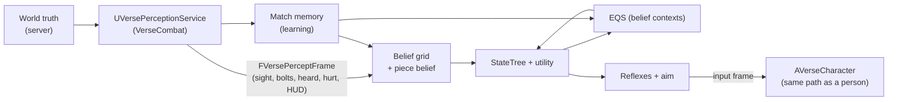

# Contract: the duel bot and the balance harness

Owner module: `VerseBot` (brain, belief, learning, aim, tiers at runtime) and
`VerseHarness` (headless runs, gates). Producers it codes against:
`VerseCombat` (perception service, input path, abilities), `VerseDestruction`
(`IVersePieceQuery`, `IVersePenetrationQuery`, navmesh, `contracts/destruction.md`
section 6), `VerseCore` (tier DataAsset schema, `FVerseNoiseEvent`).

Units: this file uses metres, seconds and degrees. Code uses Unreal
centimetres through the `VerseCore` conversion helpers. Facts about today's
three.js bot carry a file reference (paths relative to
`dodaios/ui/web/frontend/src/components/society/verse/combat/`); everything
else is a design decision.

## 1. Invariants

| # | Invariant | Checked by |
|---|---|---|
| B1 | The bot is a player. `AVerseBotController` possesses an ordinary `AVerseCharacter` and acts only through the same input frame a person produces (move, look delta, buttons), on the server (architecture 3.4) | Code review, `check_bot_isolation.py` |
| B2 | Fair perception. The bot knows only what a person at the screen could know: its own HUD, what is in its eye-level view cone with line of sight, what it hears (with error), and public rules. It never reads the opponent pawn, the opponent's health, ammo or controller, or a piece state it has not perceived (destruction DR6) | Fairness suite F1-F7 (section 10) |
| B3 | Wall shots only at heard or believed positions. A shot at a target not in sight needs a percept-backed belief (section 4.5) | F4 fire audit |
| B4 | Human limits. Every action that answers a stimulus waits a sampled reaction time; aim is speed-limited and noisy; decisions run a few times a second, not every tick | Unit tests on the aim model, harness reaction metrics |
| B5 | Deterministic core. Given the seed, the tier, the percept stream and the world-query answers, the brain's output is bit-identical. The engine around it may be non-deterministic; the brain may not | Replay test BR1 |
| B6 | Higher skill wins more often, never always. Each tier beats the one below it clearly, and still loses kills to it | Gates BG1-BG3 |
| B7 | No dominant trick. No one-trick strategy beats hard | Gate BG4 |
| B8 | Learning is per match. What the bot learns about the person lives in server memory for one match and is dropped at match end. Never persisted, never sent over the bridge | Test L1 (section 10), gate BG9 |

Concepts carried over from today (README "What carries over"), numbers not:
fair perception (`observe.ts`, `bot/bot.test.ts:32-46`), OU aim wander
(`bot/aim.ts`), utility selection with hysteresis +0.18 and U(0, 0.08) noise
(`bot/brain.ts:376-397`), tiers as data (`bot/tiers.ts`), harness gates
(`harness/balance.ts`, `harness/exploits.test.ts`). Dropped with their
mechanics: personal shield, parry, block, dodge roll, heat and vent, bait and
punish (`tiers.ts` fields `heatCap`, `ventTimingSdMs`, `parryChance`,
`parryTimingSdMs`, `blockChance`, `dodgeChance`, `baitPunish`; about 40 % of
`brain.ts`).

## 2. Process and timing

| Layer | Runs | Budget | Notes |
|---|---|---|---|
| Perception (Combat's service) | Every server tick, 60 Hz | in the 0.5 ms bot budget | Builds one `FVersePerceptFrame` per registered observer |
| Belief update | 10 Hz (every 6th tick) plus at once on a percept | 0.05 ms | Grid, section 4 |
| Reflexes and aim | Every server tick | 0.1 ms | Fire gate, ADS, stance, lean, reload interrupts, melee trigger |
| Decision (StateTree evaluation + utility) | Every `DecisionMs` x U(0.8, 1.2), plus forced re-decide on hit taken, sight gained or lost, magazine empty, own death/respawn | 0.1 ms | Section 5 |
| EQS | Async, at most 2 queries in flight, results used on the next decision | 0.2 ms amortised | Section 6 |
| Nav | Recast queries with the belief filter (6.1) | in EQS/decision budget | Server only, destruction 6.1 |

Total bot cost at most 0.5 ms server game thread per tick (architecture 7).

The arrow from world truth to the bot exists only through the perception
service. The service is the fairness boundary: it owns the observer's error
RNG stream and applies all perception error before a percept leaves it.

## 3. Perception inputs

### 3.1 Sight

| Rule | Value |
|---|---|
| Eye | The `Camera` bone of `SKEL_Verse_Human` (`contracts/art-pipeline.md` 12.1), the same bone the person's first-person camera uses. Moves with stance, lean, slide, mantle |
| View cone | Half-angle = half of the shipped default horizontal FOV (100 deg, so 50 deg) + 5 deg margin = 55 deg. ADS: half the ADS FOV + 3 deg. Vertical half-angle 40 deg (35 deg ADS) |
| Peripheral band | 55-80 deg off the view axis: only a target moving faster than 2 m/s or firing is noticed, with reaction x `PeripheralReactionMul` |
| Awareness radius | Within 2 m the opponent is noticed in any direction (felt, heard) |
| Line of sight | Up to 8 sample points on the target's hit-zone bodies: head, neck, upper torso, pelvis, both shoulders, both knees. Trace eye to point on `VerseSight` via `IVersePenetrationQuery::TestSight` (holes honoured, intact glass and grating see-through). Pawn capsules of the observer are ignored; the target's own body is the target |
| Exposure | `VisibleMask` (bit per sample point). 1-2 points visible = partial: acquire delay x `PartialExposureAcquireMul` |
| Range | No hard cap inside the arena (about 50 x 40 m); dark zones (arena data `VisibilityFactor` < 1) multiply acquire delay by 1 / factor |
| Bolts | An opponent bolt segment inside the cone with line of sight to any point of it is a bolt percept: position, direction. The bolt line is evidence for the shooter |
| Pieces | A piece with part of its bounds in the cone and line of sight is "seen": its true state enters the piece belief (destruction 6.2) |
| Not seen | Gore decals, the opponent's HUD, opponent's crosshair, nameplates (none exist) |

What a sighting carries (`FVerseSightPercept`): percept id, pelvis
location, velocity, facing yaw and pitch, stance, lean, ADS flag, held weapon
class, reloading flag (the animation is visible), spawn-protected flag (the
effect is visible), `VisibleMask`, peripheral flag. Never health, ammo count,
tier, controller type, or intent.

### 3.2 Hearing

One audibility table drives both the bot's hearing and the person's audio
attenuation (the sound designer tunes it in one place, `DA_Audibility` in
`VerseCore`). Error is applied by the perception service with the observer's
tier parameters.

| Noise | Tag (frozen) | Audible to | Position error sd |
|---|---|---|---|
| Weapon shot | `Noise.Shot` | Whole arena | base + per-metre x distance |
| Sprint footsteps | `Noise.Footstep.Sprint` | 20 m | as above x 1.3 |
| Run footsteps | `Noise.Footstep.Run` | 10 m | x 1.3 |
| Walk footsteps | `Noise.Footstep.Walk` | 4 m | x 1.5 |
| Crouch walk, prone crawl, still | none (no event is raised) | never | - |
| Slide, land from a jump or drop, mantle | `Noise.Move.Slide`, `Noise.Move.Land`, `Noise.Move.Mantle` | 12 m | x 1.2 |
| Reload (tactical, empty) | `Noise.Reload` | 7 m | x 1.0 |
| Bulwark deploy, Bulwark hum | `Noise.Gadget.BulwarkDeploy`, `Noise.Gadget.BulwarkHum` | 15 m / 5 m | x 1.0 |
| Breach charge plant / detonation | `Noise.Gadget.BreachPlant`, `Noise.Gadget.BreachDetonate` | 10 m / whole arena | x 1.0 / x 0.5 |
| Piece fracture (destruction 6.2 loudness) | `Noise.Fracture` | loudness x 40 m | x 1.0 |
| Repair drone flight and weld | `Noise.Drone` | 0.15 x 40 m = 6 m | x 1.0 |
| Knife strike, finisher | `Noise.Melee`, `Noise.Finisher` | 8 m | x 1.0 |
| Bolt impact near the bot (within 3 m) | `Noise.Impact` | always | 0 (impact point); shooter direction from the bolt line |
| Hit taken | none (a hurt percept, not a noise) | always | Direction of the incoming bolt, +-8 deg |

Error model: sd = `HearingErrorBaseM` + `HearingErrorPerM` x distance,
multiplied by 1.5 when no line of sight from the bot's eye to the source.
The level (floor, mid, upper) is reported correctly with probability 0.9
when the source is within 1 level, else 0.7; the rest is a neighbouring
level. An `FVerseHeardPercept` carries the noisy location, the sd used, the
level guess, the tag and the server time. It never carries the true location
or the instigator controller.

### 3.3 HUD and public rules

| Known | Source |
|---|---|
| Own health, armour, magazine, reserve, gadget charges, cooldowns, stance | Own pawn (it is on the HUD) |
| Kill feed: who died, by what (weapon, finisher, wall shot), and where the killer stood if the kill cam shows it | `FVerseHudEvent` |
| Hit markers on own hits (hit, headshot, kill) | `FVerseHudEvent` |
| Damage direction indicator | Hurt percept |
| Opponent respawned (the kill feed says so) and spawn rule (farthest from and out of sight of the opponent) | Ruleset |
| Arena layout, cover, zones, spawn points, piece materials | Static arena data (a person learns the map) |
| Opponent health | Not known. Estimated from confirmed own damage since the opponent's last full health (hit markers), plus the ruleset's regeneration if any |
| Opponent ammo | Not known. Estimated from heard shots since the last heard or seen reload |

## 4. Belief map

### 4.1 Grid

| Property | Value |
|---|---|
| Cells | 1 x 1 m columns over the arena zone, one cell per walkable navmesh level in that column (3 levels, README). About 2,000 x 3 = 6,000 cells at most; only nav-backed cells exist |
| Per cell | `P` (probability the opponent is here, sums to 1 while alive), `LastSupport` (time and kind of the last positive percept that touched it: seen, heard, inferred), `LastCleared` (last time the bot saw the cell empty) |
| Adjacency | 8-neighbour on the same level plus stair, ladder, mantle, jump and drop links from the navmesh; rebuilt for affected cells when nav tiles change and the change is in the piece belief |
| Opponent facing | A separate small estimate: last seen yaw, its time, and a heard-reload flag; used by flank and finisher queries |

### 4.2 Update rules

Applied in this order at every belief step (10 Hz) and at once for a
positive percept:

| Step | Rule |
|---|---|
| Predict | Diffuse mass to reachable neighbours: each cell keeps `1 - a`, spreads `a` over neighbours within `v dt`, with `v` = 4.5 m/s (typical speed) and the neighbour weight biased by the learned zone-transition prior (7.2). Links cost their traversal time |
| Clear | Each cell in the current view cone with line of sight from the eye to the cell at 1.0 m and 1.6 m (0.4 m for prone-capable cells) is multiplied by `1 - Pd`, `Pd` = 0.95 at up to 30 m falling to 0.7 at 50 m, x `VisibilityFactor`. Sets `LastCleared` |
| Sighting | Replace the grid with a Gaussian, sd 0.5 m, at the sighted position (level known). Facing estimate updated |
| Heard | Multiply by `eps + exp(-d^2 / 2 sd^2)` with the percept's sd and level weights (0.9 / 0.1 split), `eps` = 0.02. Sets `LastSupport = heard` within 2 sd |
| Hurt / bolt seen | Multiply by a wedge likelihood along the incoming bolt line traced back (+-8 deg, up to the first opaque piece in the bot's piece belief) |
| Kill feed | Opponent dead: grid cleared, belief "dead". Opponent respawned: prior over the spawn points ranked by the public rule from the bot's own position, top 3 weighted 0.5 / 0.3 / 0.2, sd 1.5 m |
| Normalise | Renormalise to 1; mix in 1 % of the learned heatmap prior (7.2) so no cell is ever exactly 0 |

### 4.3 Decay and confidence

Belief decays by diffusion; there is no separate timer. Derived values the
decision layer reads:

| Value | Definition |
|---|---|
| `TopCluster` | The 3 m radius disc with the highest mass; its centre, level and mass |
| `Confidence` | Mass of `TopCluster` (0-1) |
| `SupportAge` | Seconds since the newest seen or heard support inside `TopCluster` |
| `Spread` | Weighted sd of the top 90 % of mass, metres |
| States | Known (sighting now), Tracked (`Confidence` >= 0.5), Rough (0.2-0.5), Lost (< 0.2) |

### 4.4 Piece belief

A copy of piece states (destruction 6.2). Updated only on sight, on a heard
fracture (marks the piece "changed, state unknown" and rescores dependent
cover points) and on own actions. Reset on the destruction full reset, which
both players see.

### 4.5 Wall-shot authority

A shot at a point not in sight is allowed only if all hold:

| Condition | Value |
|---|---|
| Aim point | Inside `TopCluster`, or within 2 sd of a heard percept younger than `SupportAge` cap |
| Belief | Mass within 1.5 m of the aim point >= `WallbangMinBelief` (tier) and never below the contract floor 0.25 |
| Support | `SupportAge` <= `WallbangMaxSourceAgeS` (tier) and never above the contract cap 4 s; prior-only mass never authorises |
| Path | `IVersePenetrationQuery::TraceBolt` through the believed pieces leaves at least `WallbangMinDamageFrac` of the weapon's damage (and at most 3 pieces, destruction section 2) |

Suppression and prefire are the two other no-sight fire modes (section 8.4).

## 5. Decision layer

A StateTree (`ST_VerseDuelBot`, schema `UVerseBotStateTreeSchema`, evaluated
by `UStateTreeAIComponent` on the bot controller). Root children are picked
by utility (StateTree utility selection with per-state considerations); the
current state gets +0.18 hysteresis and every state gets U(0, `UtilityNoise`)
per decision. Each state has a minimum dwell of 0.4 s except for interrupts.
Reflexes (section 8) run outside the tree every tick.

### 5.1 States

| State | Utility (main terms) | Does | EQS |
|---|---|---|---|
| Attack | Known or seen < 0.5 s ago; + health lead; + `Aggression` | Holds a preferred range band, strafes (`StrafeMs`), fires; closes in only with a reason (opponent reloading, estimated low, out of range), as `brain.ts:621-633` | Cover (as fallback) |
| Hold | Tracked belief moving toward the bot, good cover with a sightline on `TopCluster`; + `CoverUse` | Go to cover, then Hide / Peek cycle (substates), pre-aims the believed entry angle | Cover, PeekCorner |
| Flank | Tracked or Rough belief, no sight 1.5-8 s; opponent holding still or behind a Bulwark; + `FlankUse` | Route that stays out of the believed sightlines to a point 90-130 deg off the opponent's believed facing | Cover (flank mode) |
| StalkForFinisher | Tracked, `Spread` < 2 m, opponent believed static or facing away (last seen facing < 2 s old, or heard reload); a hidden path to within 1.5 m of the rear arc exists; + `StalkUse` | Crouch-walks the approach (silent), aborts on being seen or on `Spread` growing; triggers the finisher ability through input when in range | FinisherApproach |
| Retreat | Own health low vs estimated opponent health, or both magazine and pistol low; + `CoverUse` | Breaks line of sight, goes to far cover, recovers (reload, regeneration if the ruleset has it) | Cover (far mode) |
| Reload | Magazine <= `TacticalReloadAtFrac`, no sight, `Confidence` of a near threat low or cover reached | Reloads in cover; tactical when a round is chambered | Cover (near) |
| DeployBulwark | Wants to Hold or Retreat but no cover within 6 m, or crossing open ground toward the belief; charge available; + `BulwarkUse` | Deploys facing `TopCluster`, then Holds behind it | Cover (Bulwark-able spots) |
| Breach | A breachable piece (piece belief Intact) whose breach shortens the path to `TopCluster` or opens a flank angle on it; + `BreachUse` | Plants out of the believed sightline, steps back, waits for detonation, then Attack through the opening | BreachSpot |
| Wallbang | Wall-shot authority (4.5) holds; bot is in cover or unseen; + `WallbangUse` | Fires bursts through the piece at the authorised point, re-checks authority every burst | WallbangSpot |
| Search | Belief Rough or Lost | Walks toward the highest mass per path metre, sweeping the view to clear cells (information gain), sound discipline by tier | Cover (route waypoints) |

Search is added to the asked list because Lost belief needs a state; it
replaces today's `hunt` (`brain.ts:61`).

### 5.2 Transitions and interrupts

| Trigger | Effect |
|---|---|
| Sighting acquired (after reaction) | Force a decision; Attack gains +0.4 for this decision |
| Sight lost | Attack keeps 0.35 s of suppression (8.4), then a decision |
| Hit taken | Force a decision; Retreat and Hold gain + (damage / max health) |
| Magazine empty with a target in sight | Reflex: switch to pistol with probability `PistolSwitchChance`, else to Retreat |
| Opponent within 2 m frontal | Reflex: knife if magazine empty or `KnifeChoice` roll; else shoot |
| Opponent within 1.5 m in the rear or flank arc and the finisher ability can activate | Reflex: finisher, in every state |
| Piece in a dependency set changed (belief) | Rescore dependent cover; re-decide if the current spot is affected |
| Own death | Tree stops; belief and plan cleared; match memory kept |
| Own respawn | Tree restarts in Search with the spawn prior; adaptive skill applied (9) |
| Spawn protection (own) | Bot may fire; firing ends protection (ruleset) |
| Spawn protection (opponent, visible) | Bot holds fire at that target, pre-aims instead |

Hold substates: `Go -> Hide -> Peek -> Hide`, with hide times
U(0.5, 1.1) s and peek times U(0.7, 1.5) s (from `brain.ts:575-590`), peek
only when magazine and health thresholds pass. The peek type (lean,
crouch-rise, step-out, jump-peek) comes from PeekCorner.

## 6. EQS queries

All queries run with belief contexts only: `UEnvQueryContext_BeliefTop`
(`TopCluster` centre and level), `UEnvQueryContext_BeliefCells` (top 8
cells by mass), `UEnvQueryContext_BeliefFacing`. No VerseBot context may
resolve to the opponent actor (F1). Sight tests use `TestSight` against the
piece belief, not truth. Every item score is `(1 - w) x base + w x learned`,
`w` from 7.3.

### 6.1 Navigation filter

`UVerseBeliefNavFilter`: nav polys created by a breach or destruction
(tagged by piece) are excluded while the piece belief says Intact; polys
of pieces believed intact but truly gone are used until the bot sees them
(it then re-plans). Link costs x `NavLinkCostMul`.

### 6.2 Queries

| Query | Generator | Tests (filter, score) |
|---|---|---|
| `EQS_Cover` | Authored and auto cover points (high 1.7 m, low 1.0 m, Bulwark-able) within 25 m path distance; modes near, far, flank | Filter: hidden from every `BeliefCells` item at 1.65 m and 1.1 m eye; piece belief not Holed/Breached/Destroyed. Score: path distance (-), path exposure to `BeliefCells` (-), distance to preferred range band (-), material penetration cost (+, thin sheet loses), peek option present (+), learned danger heat (-) |
| `EQS_PeekCorner` | From the current cover point: lean left/right at the edge, crouch-rise over low cover, step-out 1.2 / 2.0 / 2.8 m (from `brain.ts:416-425`), jump-peek | Filter: line of sight from the peek eye to `BeliefTop`. Score: exposed sample points to `BeliefCells` (-, lean exposes least), angle to pre-aim (-), learned "person holds this angle" (-), repeat of own last 3 peeks (- x `PeekRepeatPenalty`) |
| `EQS_WallbangSpot` | Points on the bot's side of penetrable pieces between it and `BeliefTop`, within 1 m of its position or reachable cover points | Filter: wall-shot authority (4.5). Score: belief mass in the 1.5 m disc behind the piece (+), damage left after penetration (+), own exposure at the firing spot (-) |
| `EQS_BreachSpot` | Breachable pieces (piece belief Intact) within 30 m path distance | Filter: plant point hidden from `BeliefCells`; not inside the charge's self-damage radius from the waiting point. Score: path shortening to `BeliefTop` (+), new angle on `BeliefTop` off its believed facing (+), plant noise heard by the believed opponent (-), fuse time vs `Spread` growth (-) |
| `EQS_FinisherApproach` | Points within 1.5 m of `BeliefTop` in the arc more than 100 deg from `BeliefFacing`, plus path waypoints | Filter: `Confidence` >= `FinisherCommitConfidence`; whole crouch path outside the believed view cone (55 deg); arrival time <= `MaxStalkS`. Score: path length (-), path exposure (-), noise along the path (-) |

## 7. Per-match learning

`UVerseBotMatchMemory`, one per bot per match. Inputs are percepts only:
the bot learns from what it saw and heard, never from truth.

### 7.1 What it records

| Model | Content | Update |
|---|---|---|
| Position heatmap | Belief-grid layer of counts: sighted positions weight 1, heard 0.3, first-contact positions 2 | Each percept; exponential decay with half-life `HabitHalfLifeS` of match time |
| Shooting spots | Heatmap layer of positions the person fired from (seen or heard shots) | Same |
| Peek habits | Per cover edge (arena data id) and peek type: how often the person appeared there, how fast they re-peeked (< 3 s), jump-peek and lean share | On each sighting that starts at a cover edge |
| Preferred ranges | Histogram of engagement ranges, bins 0-5, 5-10, 10-20, 20-35, 35+ m, with who won each engagement | Each engagement end (kill or contact lost 3 s) |
| Routes | Markov counts of zone-to-zone moves between percepts (about 20 zones, arena data) | Each new zone percept |
| Habits | After-kill reload, Bulwark placement spots, finisher attempts, slide and prone shares | Event-driven counters |

### 7.2 How it biases the bot

| Consumer | Bias |
|---|---|
| Belief predict | Neighbour weights x (1 + 0.5 x zone-transition probability); 1 % prior mix from the position heatmap (4.2) |
| `EQS_Cover` | Danger heat from shooting spots (-) |
| `EQS_PeekCorner` | Avoid angles the person holds; prefer peeks onto their frequent spots |
| Prefire | Pre-aims the person's top 2 peek edges near `TopCluster` |
| Range | Preferred range band moves toward the bin where the person's engagement win share is lowest (at most +-1 bin) |
| Breach / flank | Prefer targets that cut the person's most used route |

### 7.3 Bounds and reset

| Rule | Value |
|---|---|
| Weight | `w = LearnWeightMax x n / (n + LearnSamplesHalf)`, `n` = decayed samples behind the item; `LearnWeightMax` at most 0.35 by contract |
| Exploration | With probability `ExplorationRate` a decision ignores the learned term |
| Fairness | Learned terms never authorise a wall shot or a prefire on their own (4.5) |
| Reset | On match end: duel exit, hangar switches back from arena, tier or adaptive mode changed, `Verse.exe` exit. Never written to disk, never sent over the bridge (B8) |

## 8. Aim model and reflexes

### 8.1 Aim controller

Port of the concept in `bot/aim.ts`, in first person, on look input:

| Part | Rule |
|---|---|
| Reaction | Stimulus to first action: N(`ReactionMs`), floor 0.6 x mean (`brain.ts:144-147`); sound x 0.9, peripheral x `PeripheralReactionMul`, partial exposure x `PartialExposureAcquireMul` |
| Track latency | Aim follows the sighting `TrackLatencyMs` old, extrapolated with `LeadSkill` (`brain.ts:206-238`); `MotionWindowMs` averages strafing reversals |
| Acquire error | On a new target: random direction, magnitude abs(N(1, 0.35)) x `AcquireErrorDeg`, pitch x 0.5, fading with tau `AcquireMs` / 3 |
| OU wander | `x += -k x dt + sd sqrt(2 k dt) N(0,1)`, `k = AimNoiseRate`, `sd = AimNoiseDeg`, pitch x 0.6 |
| Turn rate | Look step capped at `TurnRateDegS`; settles with `1 - exp(-AimStiffness dt)`; floor 0.02 deg per tick |
| Lead | Bullet flight time (the weapon's muzzle velocity) x `LeadSkill` x (1 + N(0, `LeadNoise`)); no drop compensation, as a person does not hold over at hangar ranges |
| Aim point | Head with `HeadAimChance` per engagement, else upper torso; if only some sample points are visible, the visible one closest to the chosen point |
| Recoil | The weapon's pattern part is pulled down predictively by `RecoilPatternComp` (the bot "knows" the pattern as a practised person does); the random part (about 15 %, README) is corrected only after `TrackLatencyMs`, with gain `RecoilResidualGain`, through the normal aim controller |
| Fire tolerance | Fires when the aim error is within `FireTolerance` x the target's angular half-width (`brain.ts:878-882`) |

### 8.2 Fire discipline

| Rule | Value |
|---|---|
| Bursts | Beyond `BurstRangeM`: bursts of at most `MaxBurstShots`, then wait for recovery to settle |
| ADS | Beyond `AdsRangeM`, not while sprinting or sliding |
| First-shot | Elite taps (single shots) beyond 30 m |
| Spawn-protected target | No fire |

### 8.3 Stance and movement reflexes

Lean on peeks (`LeanUse`), crouch behind low cover when hit
(`CrouchPeekUse`), slide to cross open ground (`SlideUse`), prone only in
Hold at long range (`ProneUse`), walk or crouch-walk when `TopCluster` is
within 15 m (`SoundDiscipline`). All through the movement input of
`VerseMovement`; mantle and jumps follow nav links.

### 8.4 Fire modes without sight

| Mode | Allowed when |
|---|---|
| Suppression | Within 0.35 s after losing sight, aim within 2 m of the last seen position |
| Prefire | A heard percept within the last 2 s within 6 m of a peek edge, and belief mass at the edge >= `WallbangMinBelief`; with `PrefireChance` per approach |
| Wall shot | Authority 4.5 |

Any other shot is a contract violation (F4).

## 9. Tier data asset

### 9.1 Schema

`UVerseBotTier : UPrimaryDataAsset` in `VerseCore`, one asset per tier:
`/Game/Verse/Bot/Tiers/DA_BotTier_Normal`, `_Hard`, `_Elite`. Source of truth is
the text file `unreal/Verse/Data/bot/tiers.json` (diffable, patchable by the
harness like today's tuning patch in `harness/cli.ts`); the commandlet
`VerseImportBotTiers` writes the assets from it and CI fails if they
differ. Values below are starting values: anchors were re-chosen for first
person and the original 300 m/s bolts (bullets fly at 375 to 940 m/s since 2026-11-10), spacing keeps today's tier ratios (`tiers.ts:66-160`).
`tiers.ts` ratio column: hard/normal and elite/normal of the matching
today field, where one exists.

| Group | Field | Type | Normal | Hard | Elite | From `tiers.ts` |
|---|---|---|---|---|---|---|
| Perception | `ReactionMs` (mean, sd) | float2 | 320, 60 | 270, 50 | 225, 40 | 305/255/215: 0.84, 0.70 |
| | `PeripheralReactionMul` | float | 1.6 | 1.5 | 1.4 | new |
| | `PartialExposureAcquireMul` | float | 1.5 | 1.35 | 1.25 | new |
| | `TrackLatencyMs` | float | 150 | 120 | 95 | same |
| | `HearingErrorBaseM` | float | 3.0 | 1.9 | 1.1 | 4/2.5/1.5: 0.63, 0.38 |
| | `HearingErrorPerM` | float | 0.10 | 0.065 | 0.04 | same ratios |
| Aim | `AimNoiseDeg` | float | 1.4 | 1.0 | 0.8 | 1.6/1.15/0.92: 0.72, 0.58 |
| | `AimNoiseRate` (1/s) | float | 1.6 | 1.9 | 2.2 | same |
| | `AcquireErrorDeg` | float | 6.0 | 3.9 | 3.1 | 7/4.5/3.6: 0.64, 0.51 |
| | `AcquireMs` | float | 650 | 450 | 340 | same |
| | `TurnRateDegS` | float | 450 | 620 | 850 | 380/520/720: 1.37, 1.89 |
| | `AimStiffness` (1/s) | float | 8 | 12 | 17 | same |
| | `LeadSkill` | float | 0.6 | 0.8 | 0.9 | same |
| | `LeadNoise` | float | 0.35 | 0.22 | 0.14 | same |
| | `MotionWindowMs` | float | 0 | 200 | 300 | same |
| | `RecoilPatternComp` | float | 0.35 | 0.70 | 0.85 | `recoilComp` same |
| | `RecoilResidualGain` | float | 0.3 | 0.5 | 0.65 | new |
| | `FireTolerance` | float | 2.0 | 1.6 | 1.3 | same |
| | `HeadAimChance` | float | 0.05 | 0.20 | 0.35 | 0/0.15/0.25, shifted up for per-bone zones |
| | `AdsRangeM` | float | 12 | 9 | 7 | 13/10/9 |
| | `BurstRangeM` | float | 30 | 22 | 16 | new |
| | `MaxBurstShots` | int | 8 | 5 | 4 | new |
| Decision | `DecisionMs` | float | 320 | 220 | 160 | same |
| | `UtilityNoise` | float | 0.08 | 0.06 | 0.05 | 0.08 for all today |
| | `Aggression` | float | 0.5 | 0.6 | 0.7 | same |
| | `CoverUse` | float | 0.4 | 0.65 | 0.85 | same |
| | `FlankUse` | float | 0.2 | 0.45 | 0.7 | same |
| | `PreferredRangeM` | float | 14 | 12 | 11 | `15 - 7 x aggression` concept |
| | `StrafeMs` (min, max) | float2 | 700, 1500 | 450, 1050 | 300, 820 | same |
| Movement | `LeanUse` | float | 0.2 | 0.6 | 0.9 | new |
| | `CrouchPeekUse` | float | 0.2 | 0.5 | 0.7 | new |
| | `ProneUse` | float | 0.05 | 0.10 | 0.15 | new |
| | `SlideUse` | float | 0.1 | 0.3 | 0.45 | new |
| | `NavLinkCostMul` | float | 2.0 | 1.3 | 1.0 | new |
| | `SoundDiscipline` | float | 0.1 | 0.5 | 0.85 | new |
| | `PeekRepeatPenalty` | float | 0.1 | 0.4 | 0.7 | new |
| Gadgets and walls | `BulwarkUse` | float | 0.2 | 0.5 | 0.8 | new |
| | `BreachUse` | float | 0.1 | 0.4 | 0.7 | new |
| | `WallbangUse` | float | 0.15 | 0.5 | 0.8 | new |
| | `WallbangMinBelief` (floor 0.25) | float | 0.55 | 0.40 | 0.30 | new |
| | `WallbangMaxSourceAgeS` (cap 4) | float | 1.5 | 2.5 | 3.5 | new |
| | `WallbangMinDamageFrac` | float | 0.3 | 0.3 | 0.3 | new |
| | `PrefireChance` | float | 0.1 | 0.35 | 0.6 | new |
| Melee and reload | `StalkUse` | float | 0.1 | 0.35 | 0.6 | new |
| | `MaxStalkS` | float | 4 | 6 | 8 | new |
| | `FinisherCommitConfidence` | float | 0.8 | 0.7 | 0.6 | new |
| | `KnifeChoice` | float | 0.2 | 0.35 | 0.5 | new |
| | `TacticalReloadAtFrac` | float | 0.25 | 0.35 | 0.45 | new |
| | `ReloadOnlyWhenSafe` | float | 0.3 | 0.7 | 0.9 | new |
| | `PistolSwitchChance` | float | 0.2 | 0.6 | 0.85 | new |
| Learning | `LearnWeightMax` (cap 0.35) | float | 0.10 | 0.22 | 0.35 | new |
| | `LearnSamplesHalf` | float | 12 | 8 | 6 | new |
| | `HabitHalfLifeS` | float | 180 | 300 | 420 | new |
| | `ExplorationRate` | float | 0.25 | 0.15 | 0.10 | new |

Fixed for all tiers (physics, not skill): view cone, audibility ranges,
hysteresis 0.18, the contract floors and caps above.

### 9.2 Adaptive mode

`UVerseBotAdaptiveConfig` (`unreal/Verse/Data/bot/adaptive.json`, asset
`/Game/Verse/Bot/Tiers/DA_BotAdaptive`). A
continuous skill `s` in [0, 1]: `s` = 0 is normal, 0.5 hard, 1 elite. Every
numeric field is interpolated piecewise linearly (normal to hard on [0, 0.5],
hard to elite on [0.5, 1]); int fields round. Never below normal, never
above elite.

| Field | Start value | Meaning |
|---|---|---|
| `StartSkill` | 0.5 | Hard at match start |
| `WindowKills` | 10 | Rolling window of the last kills (either side) |
| `TargetPersonShare` | 0.5 | Person's share of kills in the window the controller aims for |
| `Deadband` | 0.08 | No change while the share is within 0.42-0.58 |
| `Gain` | 0.25 | `ds = Gain x (share - target)` |
| `MaxStepPerKill` | 0.05 | Bound on `abs(ds)` |
| `WarmupKills` | 4 | No adjustment before this many kills |
| `ApplyAt` | bot respawn | Never during an engagement |

Learning (section 7) keeps running in adaptive mode with the interpolated
learning fields. The service record shows the tier as "adaptive"; the
current `s` is visible in the duel's end screen. The bot writes its tier and
`s` into `AVersePlayerState::BotTier` and `BotEffectiveSkill`
(`contracts/combat-state.md` 2.1), which is how `VerseUI` reads them.

## 10. Fairness suite

| Test | Kind | Pass |
|---|---|---|
| F1 Isolation | `scripts/unreal/check_bot_isolation.py` in `unreal-static` | `Source/VerseBot/**` uses none of: `GetPlayerPawn`, `GetPlayerController`, `TActorIterator<AVerseCharacter>`, `GetAllActorsOfClass` on pawns, `GetPawn()` on a controller other than its own, attribute reads on a non-own ability component, `IVersePieceQuery::GetPieceState` outside `FVersePieceBelief`. No EQS context in VerseBot returns an `AVerseCharacter`. Sight traces the bot issues ignore pawn capsules |
| F2 Percept boundary | Automation tests in `VerseCombat` with fixture maps | Opponent behind an opaque piece, silent: no sighting, no heard percept. Behind a hole: seen only if `TestSight` passes. Crouch-walking at 3 m: not heard. Heard percepts never equal the true location (error sd > 0) |
| F3 Counterfactual invariance | Automation test on a dedicated `-nullrhi` server, 20 seeds | A silent, still opponent placed at hidden spot A vs hidden spot B: the bot's input frames are bit-identical up to the first tick at which the two percept streams differ. Requires B5 and F1 |
| F4 Fire audit | Every harness bout | Every bot shot is logged as `FVerseBotFireAudit` and classified Visible, Suppression, Prefire or WallShot (8.4). Unclassified shots: 0. Successor of `bot.test.ts:32-46` |
| F5 Hidden-bearing statistic | Nightly, at least 2,000 windows | Windows with no percept for >= 10 s: rate of facing within 15 deg of the opponent's true bearing minus the rate against a decoy (the opponent's own trajectory shifted by 60 s) <= 0.05 |
| F6 Symmetry | Static check | Person models in the harness and bots read the same `FVersePerceptFrame`; the bot's hearing ranges are read from `DA_Audibility`, the same asset the person's audio uses |
| F7 Piece truth | Harness scenario `wall_opened_unseen` | A wall breached out of sight and earshot of the bot: no bot plan uses the opening until it sees it (destruction 6.2, DR6) |
| BR1 Replay | Unit test, no world | Recorded percept stream + recorded world-query answers + seed fed to `FVerseBotBrainCore` twice: identical outputs |
| L1 No persistence | Harness scan after a 30-minute match | No file written under `Saved/` or the data dir holds match-memory content, and no bridge frame carries any field of `UVerseBotMatchMemory` (B8) |

## 11. Headless harness

### 11.1 How it runs

| Topic | Decision |
|---|---|
| Process | `UnrealEditor-Cmd.exe unreal/Verse/Verse.uproject /Game/Verse/Decks/Hangar/LV_Hangar -server -nullrhi -nosound -unattended -benchmark -fps=60 -VerseHarness=<scenario.json>` (fixed 60 Hz step run as fast as the CPU allows). Binary installs cannot build Server targets (architecture 3.1), so the editor runs as dedicated server |
| Players | Both slots possessed on the server: a bot (`AVerseBotController`) or a person model (`AVerseModelController`, the same brain with person parameters and optional trick overrides). No client connection |
| Network variant | Nightly small set: one model on a real `-game` client with `PktLag=60 PktLagVariance=10 PktLoss=1`, so lag compensation is in the loop |
| Controller | Gauntlet controller `UVerseBalanceGauntletController` in `VerseHarness`; scenario files in `unreal/Verse/Harness/balance/*.json` |
| Driver | `scripts/unreal/balance.py --set ladder|humans|tricks|elite|cross|learning|adaptive|fairness|all --bouts N --seed S --patch tiers_patch.json --jobs J`; takes the GPU-heavy lock (architecture 8.2); `--jobs` parallel processes, each pairing seeded as in a sequential run |
| Bout | Endless deathmatch cut into bouts: first to 15 kills or 10 minutes of match time. Slots alternate spawn sides per bout. Destruction resets between bouts |
| Output | `Saved/Harness/balance/<run>/report.json`, schema `verse.balance/1`, one record per pairing plus the run's gates, and the fire-audit log |
| Speed | Unknown until measured (architecture risk RK1). Target at least 20x real time per process. Bout counts per lane are set from the measured speed so the gates' 95 % intervals are no wider than +-0.06 |

### 11.2 Person models and tricks

Person models (`unreal/Verse/Data/bot/person_models.json`), like
`harness/strategies.ts:44-126`:

| Model | Character | Key numbers |
|---|---|---|
| `skilled` | A practised person: reaction 225 +- 18 ms, fast flicks, good recoil control, learns like the hard tier | Between hard and elite on paper; `TurnRateDegS` 1000, `RecoilPatternComp` 0.8, `HeadAimChance` 0.3 |
| `average` | Slower (270 +- 40 ms), looser aim, recoil control 0.5, little learning | Near normal |

Both are uncalibrated until the person plays (README Testing). After the
first playtest, local duel telemetry (reaction to first shot, accuracy,
TTK, engagement ranges) refits them; the telemetry stays on the machine.

Tricks (base hard unless named; `skilled+<trick>` for the elite set):

| Trick | Behaviour |
|---|---|
| `spray` | Holds the trigger on sight, never bursts, reloads only on empty |
| `camper` | Holds cover near its spawn |
| `rusher` | Runs straight at the belief |
| `slider` | Slides on every approach and every peek |
| `jumppeek` | Peeks only by jumping |
| `leanspam` | Flips lean every 150-300 ms while exposed |
| `prone` | Fights prone from long range |
| `wallspam` | Fires through every penetrable piece toward the belief, with authority off for the trick only (the bot under test keeps it) |
| `turtle` | Lives behind Bulwarks, redeploys on cooldown |
| `breacher` | Breaches every breachable piece on its route |
| `knife` | Closes in for knife strikes only |
| `finisher` | Only stalks for finishers |
| `kiter` | Keeps 30 m away |
| `watcher` | Holds a pre-aimed angle onto the bot's likely spawn |
| `silent` | Crouch-walks everywhere |
| `repeek` | Re-peeks the same angle within 2 s every time |
| `hider` | Avoids every fight |

### 11.3 Metrics per pairing

| Metric | Meaning |
|---|---|
| `boutWinRateA` | Share of bouts A won |
| `killShareA` | A's kills / all kills, with Wilson 95 % interval |
| `kd`, `ttkS`, `timeToContactS` | Per side |
| `accuracy`, `headshotShare`, `wallKillShare`, `finisherShare`, `knifeShare` | Per side |
| `bulwarkUses`, `breachUses`, `reloadsInFight` | Per side, per life |
| `engagementRangeHist` | Bins as 7.1 |
| `spawnKills` | Kills within 3 s of a respawn |
| `fireAudit` | Shots by mode; unclassified count |
| `learningDelta` | Bot's kill share in the second half of the match minus the first (habit models) |
| `adaptiveTrace` | `s` after every kill |
| `botMsP99`, `stuckEvents`, `navFailures` | Cost and health |

### 11.4 Gates

| Gate | Set | Pass |
|---|---|---|
| BG1 Ladder | hard vs normal | `boutWinRateA` >= 0.75 and `killShareA` lower bound >= 0.56 |
| BG2 Ladder | elite vs hard | `boutWinRateA` >= 0.75 and `killShareA` lower bound >= 0.56 |
| BG3 Never always | elite vs normal | `boutWinRateA` >= 0.90 and `killShareA` <= 0.85 (normal still kills); mirrors 0.5 +- 0.06 for same-tier pairings and spawn side 0.5 +- 0.06 |
| BG4 No single trick | every trick vs hard | Trick `boutWinRateA` <= 0.50 and `killShareA` upper bound <= 0.55 |
| BG5 Tricks vs elite | `skilled+<trick>` vs elite | Kill share no more than 0.05 above plain `skilled` vs elite |
| BG6 Skilled person | skilled vs elite | `killShareA` 0.40 +- 0.06 (README: about 40 %); skilled vs normal `killShareA` >= 0.70 |
| BG7 Average person | average vs normal | `killShareA` 0.45-0.65 |
| BG8 Learning | hard vs `repeek`, `watcher`, `camper` | `learningDelta` >= +0.05; and the same pairing with learning off is at least 0.03 worse for the bot |
| BG9 Reset | Two matches back to back, hard vs `repeek` | First 5 minutes of match 2 equal match 1 within the interval (nothing carried over) |
| BG10 Adaptive | adaptive vs skilled, adaptive vs average | Person kill share over kills 30-60 within 0.40-0.60; `s` stays within [0, 1]; no step above 0.05 |
| BG11 Fairness | F3, F4 every lane; F5, F7 and L1 nightly | As section 10 |
| BG12 Health | all | `timeToContactS` median <= 25 s (hider found); `stuckEvents` <= 1 per 10 min; `botMsP99` <= 0.5 |

Lanes (architecture 8.3): merge queue runs BG1, BG2, BG4 for `spray`,
`camper`, `rusher`, `wallspam`, BG11 (F3, F4) with the short bout count;
nightly runs everything. The `BG` prefix keeps these balance gates apart
from the phase gates G0-G3 of `orchestration.md`.

## Frozen interface

Other packages may rely on exactly these:

| Item | Where |
|---|---|
| `UVerseBotTier` field names, types and groups (9.1); `tiers.json` as source of truth; contract floors and caps (`WallbangMinBelief` >= 0.25, `WallbangMaxSourceAgeS` <= 4, `LearnWeightMax` <= 0.35) | `VerseCore` |
| `UVerseBotAdaptiveConfig` fields and the interpolation rule (9.2) | `VerseCore` |
| `FVersePerceptFrame { ServerTimeMs, Self, Sightings[], Bolts[], Heard[], Hurt?, Hud[] }`, `FVerseSightPercept`, `FVerseHeardPercept`, `FVerseBoltPercept`, `FVerseHurtPercept`, `FVerseHudEvent` with the fields in section 3; never a true location of anything unperceived | `VerseCore` structs, produced by `VerseCombat` |
| `UVersePerceptionService` (server world subsystem): `RegisterObserver(AController*, const FVersePerceptionProfile&)`, `UnregisterObserver`, delegate `OnPerceptFrame(AController*, const FVersePerceptFrame&)`; the profile carries the tier's hearing and acquisition fields and the RNG seed | `VerseCombat` |
| `DA_Audibility` rows (noise tag, range, error multiplier) feeding bot hearing and person audio | `VerseCore` |
| Gameplay tags `Noise.*` (3.2) and `Bot.State.*` (one per state in 5.1) | `VerseCore` |
| `AVerseBotController`: `SetTier(const UVerseBotTier*)`, `SetAdaptive(bool)`, `GetEffectiveSkill() -> float`, `GetPresentation() -> FVerseBotPresentation` (state, cover spot, peek point; presentation only) | `VerseBot` |
| `FVerseBotBrainCore::Think(const FVersePerceptFrame&, IVerseBotWorldQueries&) -> FVerseInputFrame` with determinism B5; `FVerseInputFrame` as defined in `contracts/combat-state.md` 11.1 | `VerseBot` |
| `FVerseBotFireAudit { ServerTimeMs, Mode, bTargetVisible, PerceptIds, BeliefMassAtAim, SupportAgeS }` and its log format | `VerseBot` |
| Match option `?BotTier=normal|hard|elite|adaptive`, read by the ruleset | `VerseCombat` passes, `VerseBot` applies |
| `AVerseModelController`, `person_models.json` and the trick ids in 11.2 | `VerseHarness` |
| `scripts/unreal/balance.py` arguments, scenario file schema, report schema `verse.balance/1`, gate ids BG1-BG12, fairness ids F1-F7, L1 and BR1 | `VerseHarness` |

Starting values in 9.1, 9.2, 11.2 and the thresholds of the belief and EQS
rules may be retuned; field names, types, structs, function shapes, tags,
floors and caps, gate and test ids may not.

## Change rule

Every change to this contract, including a retuned tier value, goes through
the integration owner only: a PR that edits this file and `tiers.json` (or
`adaptive.json`, `person_models.json`) together, with a green full
`unreal-gauntlet` nightly run (all of BG1-BG12) attached. A change that loosens
a fairness rule (B2, B3, F1-F7, L1, a floor or a cap) also needs the person's
approval. Packages that need something new ask the integration owner; they
never extend the structs, tags, interfaces or the percept frame themselves.
