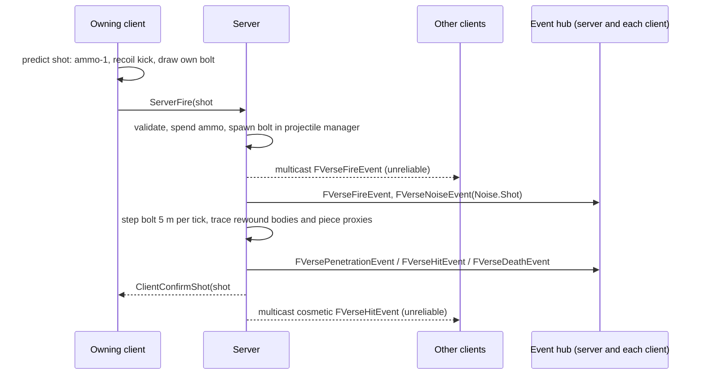
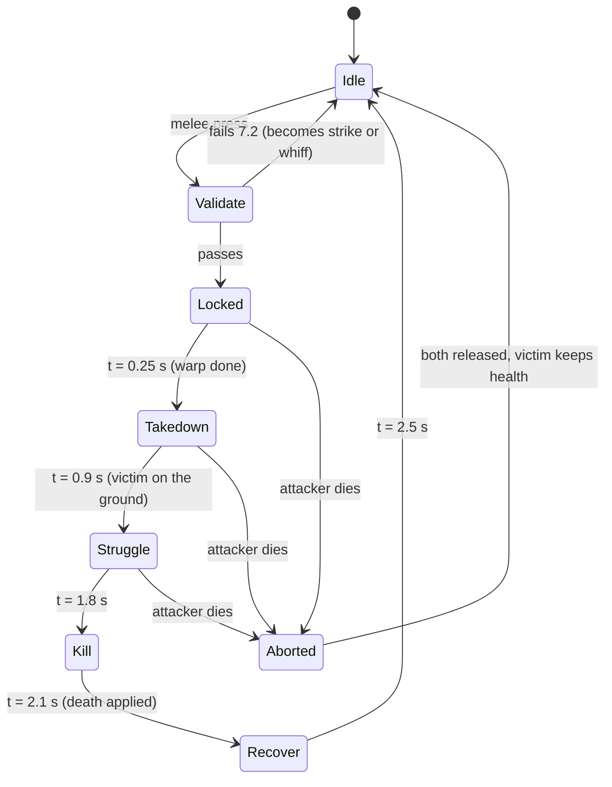

# Contract: combat state and events

Status: frozen before fan-out. Owner: integration owner (see `orchestration.md`).
Modules: types in `VerseCore` (shared, no dependencies), behaviour in
`VerseCombat`. Read by `VerseMovement`, `VerseDestruction`, `VerseBot`,
`VerseGore`, `VerseUI`, `VerseHarness`.

This contract fixes the shape of combat: what is replicated, what a weapon
is, how recoil, projectiles, penetration, melee, finishers, gore events and
the deathmatch rules behave, and the interface a future game mode plugs into.
Numbers in tables marked "start value" are tuning, owned by the balance
harness; the fields, units, formulas and invariants are frozen.

Units: data assets use metres, m/s, seconds and degrees (`meta=(Units=...)`).
Runtime code works in Unreal centimetres, Z-up; conversion goes only through
`VerseCore`'s coordinate module (`architecture.md` section 2). Server tick is
60 Hz (`architecture.md` 3.2); "tick" below means a server tick.

## 1. Authority and flow

| Rule | Decision |
|---|---|
| Authority | Every gameplay mutation (health, ammo, phase, score, spawn) runs behind `HasAuthority()` on the server. Clients predict only their own fire, ammo count, recoil and reload timing |
| Bot | `AVerseBotController` drives an ordinary `AVerseCharacter` through the same input path; it gets no state a player would not get (`architecture.md` 3.4, fair perception) |
| Event hub | All cross-module combat traffic goes through `UVerseEventHub` (Core world subsystem). Combat never includes Gore, UI or Bot; they subscribe |
| Prediction keys | Fire and reload carry a client shot counter (`uint16`, wraps) and client server-time estimate; the server answers with the authoritative result keyed by that counter |
| Lag compensation | Server rewinds per-bone hit bodies to the shooter's view time from a 1 s ring buffer, rewind capped at 250 ms (`architecture.md` 3.2). Melee and finisher checks use the same rewind |



## 2. Replicated player state

### 2.1 Where each value lives

| Value | Owner object | Type | Replicated to | Notes |
|---|---|---|---|---|
| Health, MaxHealth | `UVerseHealthSet` (GAS attribute set) on the character | float | Owner only | Opponent health is not shown; hit markers only. Start: 100 |
| Armor, MaxArmor | `UVerseHealthSet` | float | Owner only | Exists for future modes. Deathmatch sets MaxArmor = 0, so armor is inert |
| Stance | `UVerseCharacterMovement` (VerseMovement), read through `IVerseMovementQuery` | `EVerseStance` | All (saved moves) | Stand, Crouch, Prone, Slide. Combat never writes it |
| Sprinting, airborne, mantling, mantle height | `IVerseMovementQuery` (`IsSprinting`, `IsAirborne`, `IsMantling`, `IsMantleHigh`) | flags | All | Mantling and sprinting block firing. `IsMantleHigh` is true only during a high mantle (ledge above `MantleLowMaxHeight`, up to 2.0 m), decided by VerseMovement's ledge trace at move time; the animation layer (WP13) picks the low or high mantle clip from it and never traces the ledge itself |
| Lean | Movement custom move data | `int8` (-127..127 = -1..1) | All | The server uses the same value when it rewinds hit bodies |
| ADS | `UVerseWeaponComponent` | `uint8` 0..255 = 0..1 blend | All | Drives spread, recoil multiplier, speed |
| Active slot | `UVerseInventoryComponent` | `EVerseLoadoutSlot` | All | For third-person and kill-cam animation |
| Per-slot weapon state (definition id, magazine, chambered, reserve, reload phase) | `UVerseInventoryComponent::Slots` (`FFastArraySerializer`) | `FVerseWeaponSlotState` | Owner only | The opponent learns of a reload only through the reload noise event |
| Reloading (bool) | `UVerseInventoryComponent` | bool | All | Animation only; carries no round count |
| Combat phase | `UVerseCombatStateComponent` (VerseCombat) on the character | `EVerseCombatPhase` | All | Alive, Dead, FinisherAttacker, FinisherVictim. `AVerseCharacter` itself is a VerseMovement class (architecture 2), so combat state lives in this component |
| Spawn protection | `UVerseCombatStateComponent` | `float SpawnProtectedUntil` (server time) + `bool bSpawnProtected` | All | Ends early on the first own offensive action (section 9.3) |
| Score (kills, deaths, headshots, finishers, set score) | `AVersePlayerState` | `int32` each | All | Push model, `MARK_PROPERTY_DIRTY_FROM_NAME` |
| Bot tier and effective skill | `AVersePlayerState` | `FName BotTier` (`normal`, `hard`, `elite`, `adaptive`; `None` for a person), `float BotEffectiveSkill` (adaptive `s`, `-1` for a person) | All | Written by `VerseBot` on the server; read by the HUD and end screen (`VerseUI` never includes `VerseBot`). Public: the person chose the tier |
| Respawn at | `AVersePlayerState` | `float RespawnAt` (server time) | All | UI countdown and kill cam length |
| Recoil accumulator, bloom, shot index | `FVerseRecoilState` in `UVerseWeaponComponent` | struct | Not replicated | Simulated identically on server and owning client from the same seed (section 4) |

All properties use the push model (`architecture.md` 3.2).

### 2.2 Loadout

| Slot | Start item | Kind |
|---|---|---|
| Primary | Graveline (assault rifle) | Firearm |
| Secondary | Tallow (pistol) | Firearm |
| Melee | Hookbill (knife) | Melee, also used by the finisher |
| GadgetA | Bulwark (deployable energy barricade) | GAS ability, section 2.3 |
| GadgetB | Breach charge | GAS ability, section 2.3 |

Later firearms on the same schema: Skitter (SMG), Longsight (DMR). Names
are original by default and may follow real ones; all weapons are fully black
(README). Both players get the same loadout in deathmatch; the armoury may
offer a choice later through `UVerseRuleset::GetLoadout`. Gadget damage
reaches health through the same `FVerseHitEvent` with `Source = Gadget`.

### 2.3 Gadgets

`UVerseGadgetDefinition : UPrimaryDataAsset` in `VerseCore`, one asset per
gadget (`DA_Gadget_Bulwark`, `DA_Gadget_BreachCharge`), text surface
`unreal/Verse/Data/weapons/gadgets.json`. Abilities `UVerseGA_Bulwark` and
`UVerseGA_BreachCharge` (VerseCombat, GAS) run on the server; the owning
client predicts only the deploy or plant animation with a prediction key.
The spawned actors (`AVerseBulwark`, `AVerseBreachCharge`) exist on the server
and replicate to all.

| Field | Type / unit | Bulwark start value | Breach charge start value |
|---|---|---|---|
| `GadgetId` | `FName` | `bulwark` | `breach_charge` |
| `Charges` | int, per life | 1 | 2 |
| `Cooldown` | s, after the actor is gone | 20 | 0 (charges only) |
| `UseTime` | s, deploy or plant, interruptible by taking damage | 0.6 | 1.0 |
| `PlaceRange` | m from the eye | 1.5 (floor in front, needs 1.8 m free width) | 1.5 (on a piece whose material is breakable by breach, destruction 2) |
| `Lifetime` / `FuseTime` | s | 25 | 2.5 after the plant completes |
| `MaxHealth` | hp | 400 | n/a (cannot be shot or defused) |
| `Size` | m (w x h x d) | 1.8 x 1.4 x 0.1 | 0.3 x 0.3 x 0.1 |
| `PawnDamage` | hp at centre, linear falloff to 0 at `PawnRadius` | n/a | 120, `PawnRadius` 3.0 m |
| `PieceBreachRadius` | cm | n/a | 150 (destruction 3.2) |
| `bSelfDamage` | bool | n/a | true: the owner takes the same damage |

| Rule | Bulwark | Breach charge |
|---|---|---|
| Collision | Blocks pawns and the `VerseBolt` channel; ignores `VerseSight` (a translucent amber field: both sides see through it, nobody shoots through it) | No pawn collision; ignores bolts and sight |
| Bolts | Stop at the field; the bolt's damage after all factors goes to the Bulwark's health; never penetrates, no `TraceBolt` call | Not a bolt target |
| Damage to pawns | None | At detonation every pawn whose pelvis is within `PawnRadius` and in line of sight on `VerseBolt` from the charge (current proxies) takes `PawnDamage x (1 - r / PawnRadius)`, `Source = Gadget`, zone multiplier 1.0 |
| Damage to pieces | None | `IVersePieceDamage::ApplyPieceDamage` with `Cause = Breach` and `PieceBreachRadius` (destruction 3.2) |
| End | Health 0, `Lifetime` over, owner death, or a breach detonation within 3 m: actor removed, cooldown starts | After detonation |
| One active | A second deploy removes the first | Up to `Charges` planted at once |
| Spawn blocking | Counts as "Bulwark within 3 m" for spawn selection (9.2) | Counts as "armed breach charge within 3 m" until detonation |
| Noise (bot 3.2) | `Noise.Gadget.BulwarkDeploy` on deploy, `Noise.Gadget.BulwarkHum` while active | `Noise.Gadget.BreachPlant`, `Noise.Gadget.BreachDetonate` |
| Events | `FVerseGadgetEvent` (11.1) on the hub and as an unreliable multicast: `Deploy`, `Destroyed`, `Expired` | `Plant`, `Detonate` |

Invariants, each an automation test in `Verse.Combat.Gadget.*`: GD1 a
Bulwark stops 100 % of bolts until its health reaches 0, and 0 % of sight
traces; GD2 a breach charge detonates `FuseTime` after the plant within 1
tick; GD3 pawn damage at 0, 1.5 and 3.0 m equals the falloff formula to
1e-4 hp, including the owner; GD4 a planted charge always drives its target
piece to its breach result.

## 3. Weapon definition

`UVerseWeaponDefinition : UPrimaryDataAsset` in `VerseCore`, one asset per
weapon (`DA_Weapon_<Name>`). Text-diffable via the asset's JSON export in
`unreal/Verse/Data/weapons/*.json`, which is the merge surface.

| Field | Type / unit | Meaning |
|---|---|---|
| `WeaponId` | `FName` | Stable id, used in events and stats |
| `DisplayName` | `FText` | Display name, any text |
| `Slot` | `EVerseLoadoutSlot` | Primary or Secondary |
| `FireMode` | `EVerseFireMode` | Semi, Burst, Auto |
| `BurstCount` | int | Rounds per burst (Burst only) |
| `RPM` | rounds/min | Cyclic rate; `FireInterval = 60 / RPM` |
| `MagazineSize` | int | Rounds in a full magazine, not counting the chamber |
| `bClosedBolt` | bool | True: a tactical reload keeps one round chambered (magazine + 1) |
| `ReserveRounds` | int | Spare rounds at spawn |
| `ReloadTactical` | s | Reload with a round chambered |
| `ReloadEmpty` | s | Reload from empty (includes chambering) |
| `ReloadCommitFraction` | 0..1 | Point in the reload when the rounds move; cancelling earlier keeps the old magazine |
| `EquipTime`, `HolsterTime` | s | Slot switch |
| `BaseDamage` | hp | Body damage at full range |
| `ZoneMultipliers` | map `EVerseHitZone` to float | Head, Neck, UpperTorso, LowerTorso, Arm, Leg |
| `FalloffStart`, `FalloffEnd` | m | Full damage up to start, linear to `FalloffMinFraction` at end |
| `FalloffMinFraction` | 0..1 | Damage fraction beyond `FalloffEnd` |
| `ProjectileSpeed` | m/s | Muzzle velocity: pistol about 375, SMG about 400, rifle about 880, marksman about 940; gravity (9.81 m/s^2) drops the round |
| `MaxRange` | m | The round despawns after this much path |
| `PenetrationPower` | power units, 100 = the assault rifle (destruction 2) | Budget spent by pieces (section 6) |
| `MaxPenetrations` | int, at most 3 (destruction 2) | Pieces a bolt may pass |
| `PieceDamage` | piece hp | Damage applied to a destructible piece per hit; anchor 10 for the rifle (destruction 3.2) |
| `HoleRadiusMm` | mm | Radius of the bolt hole this weapon leaves (destruction 5); anchor 15 for the rifle |
| `RecoilPitchCurve`, `RecoilYawCurve` | `FRuntimeFloatCurve`, x = shot index, y = deg | The learnable pattern `P(n)` |
| `RecoilRandomFraction` | 0..1 | `f`, start 0.15 |
| `RecoilKickTime` | s | Time over which one kick is applied (`t_k`) |
| `RecoilRecoveryRate` | deg/s | `rho` |
| `RecoilRecoveryDelay` | s | `d_r`, time after a shot before recovery runs |
| `PatternResetTime` | s | Pause after which the shot index returns to 0 |
| `RecoilStanceMultiplier` | map `EVerseStance` to float | Stand 1.0, Crouch 0.85, Prone 0.65, Slide 1.3 (start values) |
| `RecoilAdsMultiplier` | float | Applied at full ADS blend |
| `ViewPunchScale` | float | Visual-only camera shake per shot; never moves the aim |
| `AdsTime` | s | Hip to full ADS |
| `AdsFov` | deg | First-person FOV at full ADS |
| `AdsMoveSpeedMultiplier` | float | Movement speed at full ADS |
| `SpreadBase` | map `EVerseStance` x {Hip, Ads} to deg | Cone half-angle at rest |
| `FirstShotSpread` | {Hip, Ads} deg | Spread of the first shot after `FirstShotRestTime` |
| `FirstShotRestTime` | s | Rest that restores first-shot accuracy |
| `SpreadMovePerMps` | deg per m/s | Added per m/s of horizontal speed |
| `SpreadAirborne` | deg | Added while airborne |
| `BloomPerShot`, `BloomMax` | deg | Spread growth per shot and cap |
| `BloomRecoveryRate`, `BloomRecoveryDelay` | deg/s, s | Bloom decay |
| `NoiseLoudness` | 0..1 | Used for the bot's hearing (`FVerseNoiseEvent`) |
| `BoltColorOwn`, `BoltColorFoe` | presentation tags | Legacy, unused since the ballistics decision: every tracer is yellow-white |
| `TracerInterval` | int | Every Nth shot counter is a tracer round; 0 = none (`IsTracerRound`) |
| `TracerLastRounds` | int | The last rounds of a magazine are tracers too |

### 3.1 Start values (tuning, not frozen)

| Field | Graveline (AR) | Tallow (pistol) |
|---|---|---|
| FireMode / RPM | Auto / 690 | Semi / 380 (cap) |
| MagazineSize / closed bolt | 30 / yes | 15 / yes |
| ReloadTactical / ReloadEmpty | 2.1 s / 2.8 s | 1.5 s / 1.9 s |
| BaseDamage | 28 | 34 |
| Zones (Head, Neck, Upper, Lower, Arm, Leg) | 2.5, 1.5, 1.0, 0.9, 0.75, 0.7 | 2.2, 1.4, 1.0, 0.9, 0.75, 0.7 |
| Falloff start / end / min | 25 m / 45 m / 0.75 | 12 m / 30 m / 0.6 |
| ProjectileSpeed / MaxRange | 880 m/s / 150 m | 375 m/s / 100 m |
| TracerInterval / TracerLastRounds | 4 / 3 | 0 / 2 |
| PenetrationPower / MaxPenetrations | 100 / 3 | 50 / 2 |
| PieceDamage / HoleRadiusMm | 10 / 15 | 6 / 12 |
| Recoil pitch `P_p(n)` | 0.45° rising to 0.62° by shot 8, hold | 1.2° |
| Recoil yaw `P_y(n)` | +0.10° drifting right to shot 10, then -0.15° left | ±0.15° alternating |
| f / t_k / rho / d_r | 0.15 / 0.035 s / 5°/s / 0.12 s | 0.15 / 0.04 s / 6°/s / 0.10 s |
| PatternResetTime | 0.35 s | 0.3 s |
| FirstShotSpread hip / ADS | 0.9° / 0.0° | 0.7° / 0.0° |

These values satisfy the invariants of section 4.3; the harness re-checks
them on every data change.

## 4. Recoil model

### 4.1 Per-shot kick

Shot index `n` counts from 0 within a spray and resets to 0 when no shot was
fired for `PatternResetTime`.

```
P(n)   = (P_p(n), P_y(n))                       pattern from the curves; beyond the curve end the last value holds
m      = RecoilStanceMultiplier[stance] * lerp(1, RecoilAdsMultiplier, ads)
u_n    = point uniformly sampled in the unit disk from VerseRng(seed, n)
k_n    = m * ( P(n) + f * |P(n)| * u_n )        f = RecoilRandomFraction (0.15)
```

The pattern part is identical every spray (learnable); the random part is
bounded by `f * |P(n)|`. `k_n` is added to the control rotation over
`RecoilKickTime` with an ease-out, so the camera follows the kick 1:1 and the
crosshair stays on the bolt's true direction. `ViewPunchScale` adds a
separate visual shake that never changes where bolts go.

### 4.2 Accumulator and recovery

`A = (A_p, A_y)` is recoil that has been applied and not yet recovered or
compensated.

```
on shot n:             A += k_n
on player look input:  if input pitch is downward: A_p = max(0, A_p - |input pitch|)   (pulling down compensates)
                       same rule for yaw against the sign of A_y
each tick, if now - t_last_shot >= d_r:
    step = min(|A|, rho * dt)
    A   -= step * A/|A|,  and the same step is removed from the control rotation
```

Recovery therefore never pulls the aim past where the player put it, and it
only returns what the weapon added.

### 4.3 Invariants (each is an automation test in `VerseHarness`)

| Id | Invariant | Test |
|---|---|---|
| R1 | **Recovery slower than kick, so sustained fire climbs.** For every shot index `n >= 1` up to `MagazineSize`: `rho * max(0, FireInterval - d_r) <= 0.5 * k_min_p`, where `k_min_p = min_n ( m_min * (P_p(n) - f * |P(n)|) )` and `m_min` is the smallest stance x ADS multiplier | `Verse.Combat.Recoil.RecoveryBelowKick`: evaluate the inequality for every weapon asset; then simulate a full-magazine spray at max RPM with no look input and assert `A_p` rises after every shot and ends `>= 0.5 * sum(k_n,p)` |
| R2 | Kick is fast, recovery is slow: `min_n |k_n| / RecoilKickTime >= 10 * rho` | `Verse.Combat.Recoil.KickRate` |
| R3 | Random part bounded: `|k_n - m * P(n)| <= f * m * |P(n)| + 1e-4` deg | `Verse.Combat.Recoil.RandomBound`, 10,000 seeded sprays |
| R4 | Pattern learnable: mean of `k_n` over 10,000 seeds is within 1 % of `m * P(n)` | `Verse.Combat.Recoil.PatternMean` |
| R5 | Deterministic: same seed, stance, ADS and inputs give the same `k_n` on server and owning client (tolerance 1e-4 deg) | `Verse.Combat.Recoil.ClientServerMatch` in the netcode test |
| R6 | First-shot accuracy: the first shot after `FirstShotRestTime` uses `FirstShotSpread` and `n = 0` | `Verse.Combat.Spread.FirstShot` |

**Today's bug, stated against R1.** The three.js blaster kicks 0.55° per hip
shot at 5 shots/s, and recovery runs at 9°/s from the 4th tick after a shot
(`combat/tuning.ts:239-242`, `combat/sim.ts:466`, `combat/sim.ts:667-670`).
So `FireInterval = 0.2 s`, `d_r = 4/60 s`, and recovery between shots is
`9 * (0.2 - 0.067) = 1.2°`, against a kick of 0.55°. The left side of R1 is
2.18 times the kick; R1 requires at most 0.5 times. Recovery outruns the
kick, `A_p` returns to zero before every shot, and the gun never climbs. With
the Graveline start values the left side is `5 * max(0, 0.087 - 0.12) = 0`:
no recovery at all during sustained fire.

### 4.4 Spread

```
sigma = SpreadBase[stance][hip/ads blend] + SpreadMovePerMps * horizontal_speed
      + (airborne ? SpreadAirborne : 0) + bloom
bloom = min(BloomMax, bloom + BloomPerShot) on each shot; decays at BloomRecoveryRate after BloomRecoveryDelay
first shot after FirstShotRestTime: sigma = FirstShotSpread[hip/ads blend], bloom = 0
dir   = sample uniformly in a cone of half-angle sigma around (control rotation forward), from VerseRng(seed, n, salt=Spread)
```

`seed` per shot is `Hash(shooter net id, shot counter, match seed)`; client
and server derive the same direction. The server rejects a fire request whose
origin is more than 30 cm from the rewound eye point or whose direction is
more than `sigma + 1.5°` off the server's control rotation at that time, and
answers the client with `Rejected`, which removes the predicted bolt.

## 5. Projectiles and hits

| Topic | Decision |
|---|---|
| Representation | Not actors. `UVerseProjectileManager` (server world subsystem) holds bullets and steps them each tick along their velocity with gravity: 880 m/s = 14.7 m per tick, one straight chord of the arc per tick (README "Projectiles") |
| Latency | A new bolt is advanced by the shooter's latency (capped 250 ms) in its first step; that segment traces rewound hit bodies. Later steps trace current bodies |
| Trace | Per step: piece proxies and world (channel `VerseBolt`), then per-bone hit bodies (channel `VerseHitBody`, frozen in `contracts/destruction.md`). Debris ignores both channels (`architecture.md` 4) |
| Zone | The physics body hit maps to `EVerseHitZone` through a bone table in the character's physics asset |
| Damage | `D = BaseDamage * ZoneMultipliers[zone] * falloff(distance) * penetration_factor`, falloff linear between `FalloffStart` and `FalloffEnd` down to `FalloffMinFraction`. Applied by a GAS damage effect on the server; armor (if MaxArmor > 0) absorbs first |
| Self and friendly | No self-damage from bolts; breach charge self-damage is the gadget contract's call |
| Client draw | Owner draws its own shot at fire time (predicted); others draw from `FVerseFireEvent`. Every shot: muzzle flash (the viewmodel's for the owner), smoke, an ejected casing; tracer rounds only: a thin yellow-white streak. Impact VFX (bullet hole by surface, sparks, dust, shards) play from the cosmetic hit event, never from the client's own trace; penetrations add holes on entry and exit |
| Hit confirm | `ClientConfirmShot` (reliable, owner): shot counter, result (`Miss`, `HitBody`, `HitPiece`, `Blocked`, `Rejected`), zone, killing blow |

### 5.1 Fire, hit and death events

| Event | Raised on | Transport to clients | Consumers |
|---|---|---|---|
| `FVerseFireEvent` | Server; owner predicts its own | Unreliable multicast (skip owner) | Bolt VFX, audio, Bot (via noise) |
| `FVerseNoiseEvent` | Server only | None | Bot hearing. One `Noise.*` gameplay tag per event; the frozen tag list and ranges are in `contracts/bot.md` 3.2 and `DA_Audibility` |
| `FVerseHitEvent` | Server | Unreliable multicast (cosmetic copy); reliable to victim (damage direction) | Gore, UI, Bot (own hits only, as hit confirm), stats |
| `FVersePenetrationEvent` | Server | Unreliable multicast | Exit-hole VFX, Bot (noise), Destruction already informed by the piece damage call |
| `FVerseDeathEvent` | Server | Reliable multicast | Score, kill cam, Gore, Bot, respawn timer |
| `FVerseReloadEvent` | Server; owner predicts | Owner only | UI; a `FVerseNoiseEvent` with `Noise.Reload` goes to the bot |
| `FVerseGadgetEvent` | Server | Unreliable multicast | VFX, audio, UI, Bot (via noise), kill feed |
| `FVerseSetSummary` | Server, at each set end and for the unfinished set when the person leaves | None (the listen-server host's `VerseBridge` reads it from the hub) | `duel.result` reporter (WP21), end-of-set screen |

## 6. Penetration

The table, its columns, the cost formula and the power scale are owned by
`contracts/destruction.md` section 2 (`DA_PenetrationTable`, Core). Combat
uses them as they are; this section only says how the projectile manager
calls them.

```
power  = PenetrationPower (100 = assault rifle), factor = 1, passes = 0
for each piece the step segment enters (IVersePenetrationQuery::TraceBolt, current-state proxies):
    cost = row.cost * clamp(traced_thickness / row.ref_thickness, 0.5, 3.0)
    ApplyPieceDamage(PieceDamage, Cause = Bolt)            always, pass or not (server)
    stop if power < cost or passes == min(MaxPenetrations, 3)
    power -= cost; factor *= row.damage_multiplier; passes += 1
```

A passing bolt raises `FVersePenetrationEvent` and continues at the same
speed with damage multiplied by `factor`. Non-destructible world geometry
(hall floor, concrete, armor steel) maps to table rows through physical
materials (`concrete` cost 400 and `armor_steel` 10000, so nothing passes);
the Bulwark is not a table row and always stops a bolt (2.3). The interface
names are `IVersePenetrationQuery` and `IVersePieceDamage` (destruction,
frozen interface). Penetration always uses the authored per-state proxy,
never debris, so server, clients and bot agree.

## 7. Melee and finisher

### 7.1 Angles

All on the horizontal plane, using rewound transforms at the attacker's view
time.

| Symbol | Definition |
|---|---|
| `d` | Unit vector from victim to attacker (Z removed) |
| `theta` | Angle between the victim's facing (pawn yaw) and `d`, 0..180°. 0 = attacker straight in front |
| Front | `theta <= 60°` |
| Flank | `60° < theta <= 120°` |
| Back | `theta > 120°` |
| `phi` | Angle between the attacker's facing and `-d`, 0..180° (attacker looks at the victim when small) |
| `r` | Horizontal distance between capsule centres |
| `dz` | Height difference between capsule bases |

### 7.2 Which action a melee press becomes

The server decides; the client only predicts the swing animation.

| Condition (all must hold) | Result |
|---|---|
| Flank or back, `r <= 1.5 m`, `phi <= 45°`, `|dz| <= 0.6 m`, clear capsule sweep between them, victim Alive, not spawn protected, not prone, not mantling, attacker grounded and not prone | Finisher |
| Otherwise, a target within 2.0 m and inside the attacker's ±30° strike cone | Front strike |
| Otherwise | Whiff |

### 7.3 Front strike

| Field (`UVerseMeleeDefinition`, Core) | Start value |
|---|---|
| `StrikeDamage` | 55 (not a one-shot: two strikes kill) |
| `StrikeHitDelay` | 0.15 s from press to damage |
| `StrikeRange`, `StrikeConeHalfAngle` | 2.0 m, 30° |
| `StrikeCooldown` | 0.7 s |
| `StrikeZone` | Damage uses zone multiplier 1.0 regardless of bone |

The strike is a hit (`FVerseHitEvent`, `Source = Melee`). Whiffs and strikes
raise `FVerseNoiseEvent` with `Noise.Melee`.

### 7.4 Finisher state machine

Paired, server-driven, 2.5 s. Both pawns switch to third person (README).
Motion warping aligns the attacker to the victim's `Warp_Finisher` target.



| Phase | Attacker | Victim |
|---|---|---|
| Locked to Recover | Phase `FinisherAttacker`, no input except look-free camera, cannot fire, **can take damage** (bolts already in flight, a placed breach charge, future teammates) | Phase `FinisherVictim`, no input, cannot fire, takes no other damage, cannot be hit by a second finisher |
| Struggle | Animation only, no input decides anything | Animation only |
| Kill (t = 2.1 s) | Gets the kill (`Finisher` flag, counts in stats) | Dies; `FVerseDeathEvent` with `Cause = Finisher`. Guaranteed once Locked unless the attacker died first |
| Recover | Returns to first person at 2.5 s with the active weapon re-equipped | Respawn timer started at death |

Server time stamps every phase in `FVerseFinisherEvent` (reliable multicast)
so clients play the paired clips in sync; the victim's client snaps to the
paired pose on `Locked`. `FVerseNoiseEvent` with `Noise.Finisher` is raised at Takedown.
With gore set to Reduced, the client cuts away to black from Takedown to
Recover (section 8).

## 8. Gore events

Gore is client cosmetic and decoupled from gameplay.

| Rule | Decision |
|---|---|
| Source | `VerseGore` subscribes on the hub to `FVerseHitEvent`, `FVerseDeathEvent`, `FVerseFinisherEvent`. It includes only Core, never Combat (`architecture.md` 2) |
| Direction | One way. Gore never changes health, phase, collision, line of sight or navigation, and gameplay never waits for gore. Blood decals and pools have no collision and are invisible to traces and to the bot |
| Where it runs | Every client with a viewport; a dedicated server and `-nullrhi` harness runs skip the module's work |
| Data it gets | Bone, zone, impact point in bone space, bolt direction, damage, killing blow, finisher phase. Spatter traces onto walls and floor are done by Gore itself, on the visibility channel |
| Setting | `EVerseGoreLevel` in `UVerseSettings` (local per viewer, never replicated): `Full` (default) or `Reduced` |
| Full | Blood bursts, wall and floor spatter, wound masks at the hit location, pools under bodies, bloody finisher. No dismemberment at any level (README) |
| Reduced | No blood, spatter, wounds or pools; hits show a neutral impact flash; finishers cut to black from Takedown to Recover |
| Budget | Decals and pools capped and recycled (oldest first); counts reported to the harness |
| Live switch | `UVerseGoreSubsystem::ReloadLevelFromSettings` is a `UFUNCTION()`: `VerseUI` (which never includes `VerseGore`) writes `GoreLevel` and then calls it by reflection, so a change applies at once |

**View settings on `UVerseSettings`.** The same per-viewer object (local
`GameUserSettings.ini`, section `[/Script/Verse.VerseSettings]`, never
replicated) carries the view settings of the Esc menu. `VerseUI` writes them
as it writes `GoreLevel`: into GameUserSettings and into the class default
object. Readers use `GetDefault<UVerseSettings>()`.

| Field | Type | Default | Range | Read by |
|---|---|---|---|---|
| `DuelFovDeg` | float, degrees (horizontal) | 100 | 80-110 | Person camera (WP01); the bot's view cone (bot.md 3.1, WP07) |
| `LookSensitivity` | float multiplier | 1 | 0.05-5 | Person input (WP01) |
| `bInvertLookY` | bool | false | | Person input (WP01) |
| `DeckFovThirdDeg` | float, degrees | 70 | 50-120 | Deck camera |
| `DeckFovFirstDeg` | float, degrees | 85 | 50-120 | Deck camera |
| `MasterVolume` | float | 0.7 | 0-1 | Audio (WP19) |
| `bReducedMotion` | bool | false | | Camera shake and full-screen effects |

## 9. Deathmatch rules

### 9.1 Loop

| Rule | Value |
|---|---|
| Players | 2 (person and bot, or two people later) |
| Length | Endless while the duel is open; a hidden or paused stage pauses the match (`architecture.md` 1.2) |
| Score | Kill +1. A finisher and a headshot kill count +1 and are tracked separately |
| Sets | Score is counted in sets of first to 10 kills (start value). Each finished set raises `FVerseSetSummary` on the hub and sends one `duel.result` (`outcome` `won` or `lost`, `contracts/bridge-protocol.md` §10) with that set's numbers, then the set score resets. The match itself never ends |
| Health regeneration | Off (ruleset field, start 0 hp/s) |
| Respawn delay | 3.0 s from death; the kill cam fills it |
| Respawn loadout | Full loadout, full magazines and reserve |
| Leaving | Leaving mid-set (or Verse quitting) sends the unfinished set as `outcome: "unfinished"`: it counts in the duel statistics and pays no XP |

### 9.2 Spawn selection

Spawn points are `AVerseSpawnPoint` actors in the arena data layer.

```
candidates = spawn points not blocked (no pawn, Bulwark or armed breach charge within 3 m)
for each candidate c:
    visible(c) = any line from the opponent's current eye point to c's probe points
                 (0.3 m, 1.0 m, 1.65 m above the floor) is clear on the VerseBolt channel
                 (current piece proxies, so a broken wall counts as open)
    dist(c)    = navmesh path length from the opponent to c (Euclidean if no path)
pool = candidates with !visible(c); if empty, pool = candidates
pick = argmax dist(c) over pool; ties within 1 m broken by VerseRng(match seed, death count)
```

The opponent is the only other player in 1v1; with more players a ruleset
uses the nearest enemy. Spawn selection runs at respawn time, not at death.

### 9.3 Spawn protection

| Rule | Value |
|---|---|
| Starts | On spawn |
| Ends | At `SpawnProtectionMax` (start 2.0 s) or at the first own offensive action: a fire request, melee press, or gadget activation. Reload, ADS, movement and slot switches do not end it |
| Effect | Incoming damage is ignored; the hit event is still raised with `bBlockedBySpawnProtection` so the shooter sees a "blocked" marker. Cannot be a finisher target |
| Visible | `bSpawnProtected` replicated to all; presentation shows it |

### 9.4 Invariants (harness tests)

| Id | Invariant |
|---|---|
| D1 | Respawn happens 3.0 s (±1 tick) after death |
| D2 | The chosen spawn is out of the opponent's sight whenever any candidate is |
| D3 | Among out-of-sight candidates the chosen one has the largest path distance |
| D4 | A protected player takes zero damage; the first own shot ends protection on that tick |
| D5 | Once `Locked`, a finisher kills the victim unless the attacker dies before t = 2.1 s |
| D6 | No gore event, setting or decal changes any replicated gameplay value (run the same seeded bot-vs-bot match with Full and Reduced; replicated state hashes match per tick) |

## 10. Swappable game mode

`AVerseGameMode` is thin and owns no rules. It instantiates one
`UVerseRuleset` from `UVerseRulesetConfig` (data asset) at match start and
forwards every rule question to it. Deathmatch is `UVerseRuleset_Deathmatch`.
A new mode is a new ruleset subclass plus a config asset; no other module
changes.

| Call | Asked when | Deathmatch answer |
|---|---|---|
| `OnMatchStart` | Arena switched on (`FVerseArenaSwitchEvent` on the hub) | Reset scores, spawn both |
| `GetLoadout(Player)` | Spawn | The fixed loadout of 2.2 |
| `CanDamage(Ctx)` | Before any damage | False when the victim is spawn protected or `FinisherVictim` (except the finisher's own kill) |
| `ModifyDamage(Ctx, Damage)` | After the formula | Unchanged |
| `OnPlayerAction(Player, Action)` | Fire, melee, gadget | Ends spawn protection on offensive actions |
| `OnKill(DeathEvent)` | Death | Score, start respawn timer, check set end |
| `GetRespawnDelay(Player)` | Death | 3.0 s |
| `ChooseSpawn(Player)` | Respawn | Section 9.2 |
| `GetSpawnProtection(Player)` | Spawn | 2.0 s, ends on first offensive action |
| `IsSetOver(OutWinner)` | After each kill | First to 10 |
| `BuildSetSummary(Out)` | Set end, and on leave for the unfinished set | Fills `FVerseSetSummary` (11.1) |

## 11. C++ type sketches

### 11.1 VerseCore

```cpp
// VerseCore/Public/Combat/VerseCombatTypes.h
UENUM(BlueprintType) enum class EVerseStance : uint8 { Stand, Crouch, Prone, Slide };
UENUM(BlueprintType) enum class EVerseHitZone : uint8 { None, Head, Neck, UpperTorso, LowerTorso, Arm, Leg };
UENUM(BlueprintType) enum class EVerseFireMode : uint8 { Semi, Burst, Auto };
UENUM(BlueprintType) enum class EVerseLoadoutSlot : uint8 { Primary, Secondary, Melee, GadgetA, GadgetB };
UENUM(BlueprintType) enum class EVerseCombatPhase : uint8 { Alive, Dead, FinisherAttacker, FinisherVictim };
UENUM(BlueprintType) enum class EVerseDamageSource : uint8 { Bolt, Melee, Finisher, Gadget, World };
UENUM(BlueprintType) enum class EVerseShotResult : uint8 { Miss, HitBody, HitPiece, Blocked, Rejected };
UENUM(BlueprintType) enum class EVerseFinisherPhase : uint8 { Locked, Takedown, Struggle, Kill, Recover, Aborted };
UENUM(BlueprintType) enum class EVerseGoreLevel : uint8 { Full, Reduced };
UENUM(BlueprintType) enum class EVerseGadgetEventKind : uint8 { Deploy, Destroyed, Expired, Plant, Detonate };
UENUM(BlueprintType) enum class EVerseSetOutcome : uint8 { Won, Lost, Unfinished };
UENUM(BlueprintType) enum class EVerseInputButton : uint32 {   // bit flags in FVerseInputFrame::Buttons
  None = 0, Fire = 1 << 0, Ads = 1 << 1, Reload = 1 << 2, Melee = 1 << 3, Jump = 1 << 4,
  Crouch = 1 << 5, Prone = 1 << 6, Sprint = 1 << 7, LeanLeft = 1 << 8, LeanRight = 1 << 9,
  GadgetA = 1 << 10, GadgetB = 1 << 11, SlotPrimary = 1 << 12, SlotSecondary = 1 << 13,
  SlotMelee = 1 << 14, Interact = 1 << 15 };

// The one input path for persons, bots and harness models (bot.md B1).
USTRUCT(BlueprintType) struct FVerseInputFrame {
  GENERATED_BODY()
  UPROPERTY() FVector2f Move = FVector2f::ZeroVector;       // -1..1, X forward, Y right (pawn space)
  UPROPERTY() FVector2f LookDeltaDeg = FVector2f::ZeroVector; // pitch, yaw added this tick
  UPROPERTY() uint32 Buttons = 0;                           // EVerseInputButton bits held this tick
  UPROPERTY() uint32 Pressed = 0;                           // bits that went down this tick
  UPROPERTY() uint32 ServerTimeMs = 0;
};

USTRUCT(BlueprintType) struct FVerseFireEvent {
  GENERATED_BODY()
  UPROPERTY() int32 ShooterId = 0;          // player state id
  UPROPERTY() FName WeaponId;
  UPROPERTY() uint16 ShotCounter = 0;
  UPROPERTY() uint32 Seed = 0;
  UPROPERTY() FVector_NetQuantize10 Origin; // cm
  UPROPERTY() FVector_NetQuantizeNormal Direction;
  UPROPERTY() float ServerTime = 0.f;
};

USTRUCT(BlueprintType) struct FVerseHitEvent {
  GENERATED_BODY()
  UPROPERTY() int32 InstigatorId = 0;
  UPROPERTY() int32 VictimId = 0;
  UPROPERTY() FName WeaponId;
  UPROPERTY() EVerseDamageSource Source = EVerseDamageSource::Bolt;
  UPROPERTY() uint16 ShotCounter = 0;
  UPROPERTY() EVerseHitZone Zone = EVerseHitZone::None;
  UPROPERTY() FName Bone;
  UPROPERTY() FVector_NetQuantize10 ImpactWorld;   // cm
  UPROPERTY() FVector_NetQuantize10 ImpactBoneLocal;
  UPROPERTY() FVector_NetQuantizeNormal Direction;
  UPROPERTY() float DistanceM = 0.f;
  UPROPERTY() float Damage = 0.f;                  // after all factors
  UPROPERTY() uint8 PenetrationCount = 0;
  UPROPERTY() uint8 bHeadshot : 1;
  UPROPERTY() uint8 bKillingBlow : 1;
  UPROPERTY() uint8 bBlockedBySpawnProtection : 1;
  UPROPERTY() float ServerTime = 0.f;
};

USTRUCT(BlueprintType) struct FVersePenetrationEvent {
  GENERATED_BODY()
  UPROPERTY() int32 ShooterId = 0;
  UPROPERTY() uint16 ShotCounter = 0;
  UPROPERTY() uint16 PieceIndex = 0;               // DA_PieceManifest index (destruction 8)
  UPROPERTY() uint8 MaterialWireId = 0;            // DA_PenetrationTable wire id (destruction 2)
  UPROPERTY() FVector_NetQuantize10 Entry;
  UPROPERTY() FVector_NetQuantize10 Exit;
  UPROPERTY() float ThicknessCm = 0.f;
  UPROPERTY() float PowerBefore = 0.f, PowerAfter = 0.f, DamageFactorAfter = 1.f;
  UPROPERTY() bool bPassed = false;
};

USTRUCT(BlueprintType) struct FVerseDeathEvent {
  GENERATED_BODY()
  UPROPERTY() int32 VictimId = 0;
  UPROPERTY() int32 KillerId = 0;
  UPROPERTY() EVerseDamageSource Cause = EVerseDamageSource::Bolt;
  UPROPERTY() FName WeaponId;
  UPROPERTY() EVerseHitZone LastZone = EVerseHitZone::None;
  UPROPERTY() float ServerTime = 0.f;
  UPROPERTY() float RespawnAt = 0.f;
};

USTRUCT(BlueprintType) struct FVerseFinisherEvent {
  GENERATED_BODY()
  UPROPERTY() int32 AttackerId = 0;
  UPROPERTY() int32 VictimId = 0;
  UPROPERTY() EVerseFinisherPhase Phase = EVerseFinisherPhase::Locked;
  UPROPERTY() float SequenceStartServerTime = 0.f;  // phases derive from this + fixed offsets
  UPROPERTY() FTransform WarpTarget;
};

USTRUCT(BlueprintType) struct FVerseNoiseEvent {   // declared in architecture.md; fields frozen here for combat
  GENERATED_BODY()
  UPROPERTY() FGameplayTag Noise;                  // one Noise.* tag of bot.md 3.2, the DA_Audibility row key
  UPROPERTY() int32 SourceId = 0;                  // player state id, -1 = world (pieces, drones)
  UPROPERTY() FVector Location;                    // true position; the bot's perception adds error
  UPROPERTY() float Loudness = 1.f;                // destruction 6.2 loudness for Noise.Fracture, else 1
  UPROPERTY() float ServerTime = 0.f;
};

USTRUCT(BlueprintType) struct FVerseReloadEvent {
  GENERATED_BODY()
  UPROPERTY() int32 PlayerId = 0;
  UPROPERTY() FName WeaponId;
  UPROPERTY() bool bTactical = true;               // a round was chambered
  UPROPERTY() float StartServerTime = 0.f, EndServerTime = 0.f;
  UPROPERTY() bool bCancelled = false;
};

USTRUCT(BlueprintType) struct FVerseGadgetEvent {
  GENERATED_BODY()
  UPROPERTY() EVerseGadgetEventKind Kind = EVerseGadgetEventKind::Deploy;
  UPROPERTY() FName GadgetId;
  UPROPERTY() int32 OwnerId = 0;
  UPROPERTY() FVector_NetQuantize10 Location;
  UPROPERTY() float ServerTime = 0.f;
};

USTRUCT(BlueprintType) struct FVerseArenaSwitchEvent {   // raised by VerseDecks (hangar switch)
  GENERATED_BODY()
  UPROPERTY() bool bArenaOn = false;
  UPROPERTY() FName Deck;                                // "hangar"
  UPROPERTY() float ServerTime = 0.f;
};

USTRUCT(BlueprintType) struct FVerseStationUsedEvent {   // raised by VerseDecks stations; VerseUI opens the matching view
  GENERATED_BODY()
  UPROPERTY() FName StationId;
  UPROPERTY() FName Kind;                                // station kind (parity S-01), e.g. "armoury"
  UPROPERTY() int32 UserId = 0;                          // player state id
};

USTRUCT(BlueprintType) struct FVerseSetLine {            // one player's numbers in one set
  GENERATED_BODY()
  UPROPERTY() int32 PlayerId = 0;
  UPROPERTY() bool bIsBot = false;
  UPROPERTY() int32 Kills = 0, Deaths = 0, Headshots = 0, Finishers = 0, MeleeKills = 0;
  UPROPERTY() int32 ShotsFired = 0, ShotsHit = 0, DamageDealt = 0, DamageTaken = 0;
  UPROPERTY() int32 WallsBreached = 0, BulwarksPlaced = 0, BestStreak = 0;
  UPROPERTY() TMap<FName, FIntVector4> PerWeapon;          // weapon id -> (kills, headshots, shots fired, shots hit)
};

USTRUCT(BlueprintType) struct FVerseSetSummary {         // payload of duel.result (bridge-protocol 10)
  GENERATED_BODY()
  UPROPERTY() FString MatchId;                           // unique per set result, idempotency key
  UPROPERTY() FString SessionId;                         // one arena session
  UPROPERTY() int32 SetIndex = 0;
  UPROPERTY() FName RulesetId;                           // "endless/1"
  UPROPERTY() FName BotTier;                             // as AVersePlayerState::BotTier
  UPROPERTY() EVerseSetOutcome Outcome = EVerseSetOutcome::Unfinished;   // from the person's side
  UPROPERTY() double StartedAtUnix = 0.0, EndedAtUnix = 0.0;
  UPROPERTY() float MatchTimeS = 0.f;                    // paused time excluded
  UPROPERTY() FVerseSetLine Person, Opponent;
};

UCLASS() class VERSECORE_API UVerseWeaponDefinition : public UPrimaryDataAsset {
  GENERATED_BODY()
public:
  UPROPERTY(EditDefaultsOnly) FName WeaponId;
  UPROPERTY(EditDefaultsOnly) FText DisplayName;
  UPROPERTY(EditDefaultsOnly) EVerseLoadoutSlot Slot;
  UPROPERTY(EditDefaultsOnly) EVerseFireMode FireMode;
  UPROPERTY(EditDefaultsOnly) int32 BurstCount = 3;
  UPROPERTY(EditDefaultsOnly) float RPM = 600.f;
  UPROPERTY(EditDefaultsOnly) int32 MagazineSize = 30;
  UPROPERTY(EditDefaultsOnly) bool bClosedBolt = true;
  UPROPERTY(EditDefaultsOnly) int32 ReserveRounds = 90;
  UPROPERTY(EditDefaultsOnly, meta=(Units="s")) float ReloadTactical = 2.f, ReloadEmpty = 2.7f;
  UPROPERTY(EditDefaultsOnly) float ReloadCommitFraction = 0.6f;
  UPROPERTY(EditDefaultsOnly, meta=(Units="s")) float EquipTime = 0.5f, HolsterTime = 0.3f;
  UPROPERTY(EditDefaultsOnly) float BaseDamage = 25.f;
  UPROPERTY(EditDefaultsOnly) TMap<EVerseHitZone, float> ZoneMultipliers;
  UPROPERTY(EditDefaultsOnly, meta=(Units="m")) float FalloffStart = 20.f, FalloffEnd = 40.f;
  UPROPERTY(EditDefaultsOnly) float FalloffMinFraction = 0.7f;
  UPROPERTY(EditDefaultsOnly, meta=(Units="m/s")) float ProjectileSpeed = 880.f;  // muzzle velocity, gravity drop
  UPROPERTY(EditDefaultsOnly, meta=(Units="m")) float MaxRange = 150.f;
  UPROPERTY(EditDefaultsOnly) float PenetrationPower = 100.f;   // 100 = assault rifle (destruction 2)
  UPROPERTY(EditDefaultsOnly) int32 MaxPenetrations = 3;         // clamped to 3
  UPROPERTY(EditDefaultsOnly) float PieceDamage = 10.f;
  UPROPERTY(EditDefaultsOnly) uint8 HoleRadiusMm = 15;
  UPROPERTY(EditDefaultsOnly) FRuntimeFloatCurve RecoilPitchCurve, RecoilYawCurve;
  UPROPERTY(EditDefaultsOnly) float RecoilRandomFraction = 0.15f;
  UPROPERTY(EditDefaultsOnly, meta=(Units="s")) float RecoilKickTime = 0.035f;
  UPROPERTY(EditDefaultsOnly) float RecoilRecoveryRate = 5.f;          // deg/s
  UPROPERTY(EditDefaultsOnly, meta=(Units="s")) float RecoilRecoveryDelay = 0.12f;
  UPROPERTY(EditDefaultsOnly, meta=(Units="s")) float PatternResetTime = 0.35f;
  UPROPERTY(EditDefaultsOnly) TMap<EVerseStance, float> RecoilStanceMultiplier;
  UPROPERTY(EditDefaultsOnly) float RecoilAdsMultiplier = 0.8f;
  UPROPERTY(EditDefaultsOnly) float ViewPunchScale = 1.f;
  UPROPERTY(EditDefaultsOnly, meta=(Units="s")) float AdsTime = 0.25f;
  UPROPERTY(EditDefaultsOnly) float AdsFov = 60.f, AdsMoveSpeedMultiplier = 0.6f;
  UPROPERTY(EditDefaultsOnly) TMap<EVerseStance, FVector2f> SpreadBase;   // X = hip, Y = ADS, deg
  UPROPERTY(EditDefaultsOnly) FVector2f FirstShotSpread;                    // hip, ADS
  UPROPERTY(EditDefaultsOnly, meta=(Units="s")) float FirstShotRestTime = 0.3f;
  UPROPERTY(EditDefaultsOnly) float SpreadMovePerMps = 0.2f, SpreadAirborne = 3.f;
  UPROPERTY(EditDefaultsOnly) float BloomPerShot = 0.15f, BloomMax = 2.f;
  UPROPERTY(EditDefaultsOnly) float BloomRecoveryRate = 4.f, BloomRecoveryDelay = 0.1f;
  UPROPERTY(EditDefaultsOnly) float NoiseLoudness = 1.f;

  float FireInterval() const { return 60.f / RPM; }
  // R1 as code; the harness calls it for every asset.
  bool SatisfiesRecoveryBelowKick(float MinMultiplier, int32 MaxShot) const;
};

UCLASS() class VERSECORE_API UVerseMeleeDefinition : public UPrimaryDataAsset {
  GENERATED_BODY()
public:
  UPROPERTY(EditDefaultsOnly) float StrikeDamage = 55.f;
  UPROPERTY(EditDefaultsOnly, meta=(Units="s")) float StrikeHitDelay = 0.15f, StrikeCooldown = 0.7f;
  UPROPERTY(EditDefaultsOnly, meta=(Units="m")) float StrikeRange = 2.f;
  UPROPERTY(EditDefaultsOnly) float StrikeConeHalfAngle = 30.f;
  UPROPERTY(EditDefaultsOnly, meta=(Units="m")) float FinisherRange = 1.5f, FinisherMaxHeightDelta = 0.6f;
  UPROPERTY(EditDefaultsOnly) float FrontHalfAngle = 60.f, AttackerFacingMax = 45.f;
  UPROPERTY(EditDefaultsOnly, meta=(Units="s")) float FinisherDuration = 2.5f, FinisherKillTime = 2.1f;
};

UCLASS() class VERSECORE_API UVerseGadgetDefinition : public UPrimaryDataAsset {
  GENERATED_BODY()
public:
  UPROPERTY(EditDefaultsOnly) FName GadgetId;
  UPROPERTY(EditDefaultsOnly) FText DisplayName;
  UPROPERTY(EditDefaultsOnly) int32 Charges = 1;
  UPROPERTY(EditDefaultsOnly, meta=(Units="s")) float Cooldown = 20.f, UseTime = 0.6f, Lifetime = 25.f;
  UPROPERTY(EditDefaultsOnly, meta=(Units="m")) float PlaceRange = 1.5f;
  UPROPERTY(EditDefaultsOnly) float MaxHealth = 400.f;
  UPROPERTY(EditDefaultsOnly, meta=(Units="m")) FVector3f Size = FVector3f(1.8f, 1.4f, 0.1f);
  UPROPERTY(EditDefaultsOnly) float PawnDamage = 0.f;
  UPROPERTY(EditDefaultsOnly, meta=(Units="m")) float PawnRadius = 0.f;
  UPROPERTY(EditDefaultsOnly, meta=(Units="cm")) float PieceBreachRadius = 0.f;
  UPROPERTY(EditDefaultsOnly) bool bSelfDamage = false;
};

DECLARE_MULTICAST_DELEGATE_OneParam(FOnVerseFire, const FVerseFireEvent&);
DECLARE_MULTICAST_DELEGATE_OneParam(FOnVerseHit, const FVerseHitEvent&);
DECLARE_MULTICAST_DELEGATE_OneParam(FOnVersePenetration, const FVersePenetrationEvent&);
DECLARE_MULTICAST_DELEGATE_OneParam(FOnVerseDeath, const FVerseDeathEvent&);
DECLARE_MULTICAST_DELEGATE_OneParam(FOnVerseFinisher, const FVerseFinisherEvent&);
DECLARE_MULTICAST_DELEGATE_OneParam(FOnVerseNoise, const FVerseNoiseEvent&);
DECLARE_MULTICAST_DELEGATE_OneParam(FOnVerseReload, const FVerseReloadEvent&);
DECLARE_MULTICAST_DELEGATE_OneParam(FOnVerseGadget, const FVerseGadgetEvent&);
DECLARE_MULTICAST_DELEGATE_OneParam(FOnVerseFracture, const FVerseFractureEvent&);    // destruction 4
DECLARE_MULTICAST_DELEGATE_OneParam(FOnVerseArenaSwitch, const FVerseArenaSwitchEvent&);
DECLARE_MULTICAST_DELEGATE_OneParam(FOnVerseSetEnded, const FVerseSetSummary&);
DECLARE_MULTICAST_DELEGATE_OneParam(FOnVerseStationUsed, const FVerseStationUsedEvent&);

UCLASS() class VERSECORE_API UVerseEventHub : public UWorldSubsystem {
  GENERATED_BODY()
public:
  FOnVerseFire OnFire; FOnVerseHit OnHit; FOnVersePenetration OnPenetration;
  FOnVerseDeath OnDeath; FOnVerseFinisher OnFinisher;
  FOnVerseNoise OnNoise;              // server only; Bot listens
  FOnVerseReload OnReload; FOnVerseGadget OnGadget;
  FOnVerseFracture OnFracture;        // server and clients
  FOnVerseArenaSwitch OnArenaSwitch;  // Decks raises; Combat rules, Destruction reset, Crew, Bot listen
  FOnVerseSetEnded OnSetEnded;        // server; the Bridge duel reporter and the UI listen
  FOnVerseStationUsed OnStationUsed;  // local; Decks raises, UI and Screens listen (no Decks -> UI include)
};
```

### 11.2 VerseCombat

```cpp
// GAS attributes
UCLASS() class VERSECOMBAT_API UVerseHealthSet : public UAttributeSet {
  GENERATED_BODY()
public:
  UPROPERTY(ReplicatedUsing=OnRep_Health) FGameplayAttributeData Health;     // COND_OwnerOnly
  UPROPERTY(Replicated) FGameplayAttributeData MaxHealth;
  UPROPERTY(Replicated) FGameplayAttributeData Armor;                         // 0 in deathmatch
  UPROPERTY(Replicated) FGameplayAttributeData MaxArmor;
  UPROPERTY() FGameplayAttributeData IncomingDamage;                          // meta, server only
};

UENUM() enum class EVerseReloadPhase : uint8 { None, Tactical, Empty };

USTRUCT() struct FVerseWeaponSlotState : public FFastArraySerializerItem {
  GENERATED_BODY()
  UPROPERTY() EVerseLoadoutSlot Slot;
  UPROPERTY() TObjectPtr<const UVerseWeaponDefinition> Definition;
  UPROPERTY() uint8 Magazine = 0;
  UPROPERTY() bool bChambered = false;
  UPROPERTY() uint16 Reserve = 0;
  UPROPERTY() EVerseReloadPhase Reload = EVerseReloadPhase::None;
  UPROPERTY() float ReloadEndsAt = 0.f;   // server time
};

USTRUCT() struct FVerseWeaponSlotArray : public FFastArraySerializer {
  GENERATED_BODY()
  UPROPERTY() TArray<FVerseWeaponSlotState> Items;
  bool NetDeltaSerialize(FNetDeltaSerializeInfo& P) {
    return FastArrayDeltaSerialize<FVerseWeaponSlotState, FVerseWeaponSlotArray>(Items, P, *this);
  }
};

UCLASS() class VERSECOMBAT_API UVerseInventoryComponent : public UActorComponent {
  GENERATED_BODY()
public:
  UPROPERTY(Replicated) FVerseWeaponSlotArray Slots;     // COND_OwnerOnly
  UPROPERTY(Replicated) EVerseLoadoutSlot ActiveSlot;    // all
  UPROPERTY(Replicated) bool bReloading = false;         // all, animation only
  UFUNCTION(Server, Reliable) void ServerReload(uint16 ClientCounter);
  UFUNCTION(Server, Reliable) void ServerSwitchSlot(EVerseLoadoutSlot NewSlot);
};

struct FVerseRecoilState {               // not replicated; simulated on server and owner
  int32 ShotIndex = 0;
  float LastShotTime = -1000.f;
  FVector2f Accumulated = FVector2f::ZeroVector;   // A, degrees (pitch, yaw)
  float Bloom = 0.f;
  FVector2f KickFor(const UVerseWeaponDefinition& W, float Multiplier, uint32 Seed) const;   // k_n
  void OnShot(const FVector2f& Kick, float Now);
  void OnLookInput(FVector2f& InOutDelta);         // compensation rule of 4.2
  FVector2f TickRecovery(const UVerseWeaponDefinition& W, float Now, float Dt); // returns rotation to remove
};

UCLASS() class VERSECOMBAT_API UVerseWeaponComponent : public UActorComponent {
  GENERATED_BODY()
public:
  UPROPERTY(Replicated) uint8 AdsBlend = 0;
  UFUNCTION(Server, Unreliable) void ServerFire(uint16 ShotCounter, uint32 Seed,
      FVector_NetQuantize10 Origin, FVector_NetQuantizeNormal Dir, float ClientServerTime);
  UFUNCTION(Client, Reliable) void ClientConfirmShot(uint16 ShotCounter, EVerseShotResult Result,
      EVerseHitZone Zone, bool bKillingBlow);
  UFUNCTION(NetMulticast, Unreliable) void MulticastFire(const FVerseFireEvent& E);
  UFUNCTION(NetMulticast, Unreliable) void MulticastHitCosmetic(const FVerseHitEvent& E);
private:
  FVerseRecoilState Recoil;
};

UCLASS() class VERSECOMBAT_API UVerseProjectileManager : public UTickableWorldSubsystem {
  GENERATED_BODY()   // server: steps bolts 5 m per tick, traces, applies damage, raises hub events
public:
  void SpawnBolt(const FVerseFireEvent& Fire, const UVerseWeaponDefinition& Weapon, float LatencyS);
};

UENUM() enum class EVerseMeleeOutcome : uint8 { Whiff, Strike, Finisher };

UCLASS() class VERSECOMBAT_API UVerseMeleeComponent : public UActorComponent {
  GENERATED_BODY()
public:
  UFUNCTION(Server, Reliable) void ServerMelee(float ClientServerTime);
  UFUNCTION(NetMulticast, Reliable) void MulticastFinisher(const FVerseFinisherEvent& E);
  static EVerseMeleeOutcome Classify(const FTransform& Attacker, const FTransform& Victim,
      const UVerseMeleeDefinition& Def, bool bVictimEligible, bool bSweepClear);   // 7.2, pure, unit-tested
};

UCLASS() class VERSECOMBAT_API AVersePlayerState : public APlayerState {
  GENERATED_BODY()
public:
  UPROPERTY(Replicated) int32 Kills = 0, Deaths = 0, Headshots = 0, Finishers = 0;
  UPROPERTY(Replicated) int32 SetKills = 0, SetsWon = 0;
  UPROPERTY(Replicated) float RespawnAt = 0.f;
  UPROPERTY(Replicated) FName BotTier;                 // None for a person
  UPROPERTY(Replicated) float BotEffectiveSkill = -1.f; // adaptive s; -1 for a person
};

// Combat state on the pawn. AVerseCharacter is a VerseMovement class; the primary
// module's default pawn adds this component (architecture 2).
UCLASS() class VERSECOMBAT_API UVerseCombatStateComponent : public UActorComponent {
  GENERATED_BODY()
public:
  UPROPERTY(Replicated) EVerseCombatPhase Phase = EVerseCombatPhase::Alive;
  UPROPERTY(Replicated) bool bSpawnProtected = false;
  UPROPERTY(Replicated) float SpawnProtectedUntil = 0.f;
};

UCLASS() class VERSECOMBAT_API AVerseSpawnPoint : public APlayerStart {
  GENERATED_BODY()
public:
  UPROPERTY(EditInstanceOnly) TArray<float> ProbeHeightsM = {0.3f, 1.0f, 1.65f};
};

USTRUCT() struct FVerseDamageContext {
  GENERATED_BODY()
  UPROPERTY() TObjectPtr<AController> Instigator;
  UPROPERTY() TObjectPtr<APawn> Victim;
  UPROPERTY() EVerseDamageSource Source;
  UPROPERTY() EVerseHitZone Zone;
};

UENUM() enum class EVersePlayerAction : uint8 { Fire, Melee, Gadget, Reload, Ads, SwitchSlot };

UCLASS() class VERSECOMBAT_API UVerseRulesetConfig : public UPrimaryDataAsset {
  GENERATED_BODY()
public:
  UPROPERTY(EditDefaultsOnly) TSubclassOf<class UVerseRuleset> RulesetClass;
  UPROPERTY(EditDefaultsOnly, meta=(Units="s")) float RespawnDelay = 3.f;
  UPROPERTY(EditDefaultsOnly, meta=(Units="s")) float SpawnProtectionMax = 2.f;
  UPROPERTY(EditDefaultsOnly) int32 KillsPerSet = 10;
  UPROPERTY(EditDefaultsOnly) float HealthRegenPerSec = 0.f;
  UPROPERTY(EditDefaultsOnly) float MaxArmor = 0.f;
  UPROPERTY(EditDefaultsOnly) TMap<EVerseLoadoutSlot, TSoftObjectPtr<UPrimaryDataAsset>> Loadout;
};

UCLASS(Abstract) class VERSECOMBAT_API UVerseRuleset : public UObject {
  GENERATED_BODY()
public:
  virtual void Init(class AVerseGameMode* Mode, const UVerseRulesetConfig* Config);
  virtual void OnMatchStart() PURE_VIRTUAL(UVerseRuleset::OnMatchStart, );
  virtual void GetLoadout(const AVersePlayerState* P, TMap<EVerseLoadoutSlot, const UPrimaryDataAsset*>& Out) const;
  virtual bool CanDamage(const FVerseDamageContext& Ctx) const { return true; }
  virtual float ModifyDamage(const FVerseDamageContext& Ctx, float Damage) const { return Damage; }
  virtual void OnPlayerAction(AVersePlayerState* P, EVersePlayerAction Action) {}
  virtual void OnKill(const FVerseDeathEvent& E) PURE_VIRTUAL(UVerseRuleset::OnKill, );
  virtual float GetRespawnDelay(const AVersePlayerState* P) const;
  virtual AVerseSpawnPoint* ChooseSpawn(const AVersePlayerState* P) PURE_VIRTUAL(UVerseRuleset::ChooseSpawn, return nullptr; );
  virtual float GetSpawnProtection(const AVersePlayerState* P) const;
  virtual bool IsSetOver(AVersePlayerState*& OutWinner) const { return false; }
  virtual void BuildSetSummary(FVerseSetSummary& Out) const {}
};

UCLASS() class VERSECOMBAT_API UVerseRuleset_Deathmatch : public UVerseRuleset { GENERATED_BODY() /* sections 9.1-9.3 */ };

UCLASS() class VERSECOMBAT_API AVerseGameMode : public AGameModeBase {
  GENERATED_BODY()   // thin: owns the ruleset instance, forwards rule questions, never decides itself
public:
  UPROPERTY(EditDefaultsOnly) TObjectPtr<UVerseRulesetConfig> RulesetConfig;
  UPROPERTY(Transient) TObjectPtr<UVerseRuleset> Ruleset;
};
```

`FVerseSetSummary` and `FVerseSetLine` (Core) are the payload the bridge
maps field for field onto `duel.result` (`contracts/bridge-protocol.md` §10);
`VerseBridge` reads them from `UVerseEventHub::OnSetEnded` and never includes
`VerseCombat`.

## 12. Acceptance tests owned by this contract

| Test | Lane |
|---|---|
| `Verse.Combat.Recoil.*` (R1-R6) | `unreal-build`, `-nullrhi` |
| `Verse.Combat.Spread.FirstShot` | `unreal-build` |
| `Verse.Combat.Damage.ZonesAndFalloff`: table-driven, every weapon and zone at 0, start, mid, end, beyond | `unreal-build` |
| `Verse.Combat.Penetration.Budget`: power and factor per surface and thickness; floor never passes | `unreal-build` |
| `Verse.Combat.Melee.Classify`: angle grid 0-180° x distance 0-2.5 m x height, against 7.2 | `unreal-build` |
| `Verse.Combat.Finisher.Timeline`: phases at 0.25/0.9/1.8/2.1/2.5 s, abort on attacker death, D5 | netcode test |
| `Verse.Combat.Deathmatch.*` (D1-D4) | `unreal-build` |
| `Verse.Gore.NoGameplayEffect` (D6) | `unreal-gauntlet` |
| `Verse.Combat.Prediction.FireReconcile`: lagged client, predicted bolts reconcile, rejected shots removed | netcode test |
| `Verse.Combat.Gadget.*` (GD1 to GD4, section 2.3) | `unreal-build` |
| Weapon assets and JSON exports validate against their schemas | `unreal-static` |

## Frozen interface

Other packages may rely on these without asking:

- The enums, event structs and their fields in 11.1, the `UVerseEventHub`
  delegates, and which side raises each event and how it travels (5.1).
- The `UVerseWeaponDefinition`, `UVerseMeleeDefinition` and
  `UVerseGadgetDefinition` field names, types and units (sections 3, 7.3,
  2.3), the gadget rules of 2.3, `FVerseInputFrame` and its button bits, and
  the formulas for recoil (4.1-4.2), spread (4.4), damage (5), the
  penetration call order (6, on top of destruction 2) and spawn selection
  (9.2).
- The recoil invariants R1-R6 and the deathmatch invariants D1-D6 as tests
  that must stay green.
- The replication table in 2.1: which object holds a value and who receives
  it (owner only vs all), including `UVerseCombatStateComponent` and the bot
  fields on `AVersePlayerState`.
- `FVerseSetSummary` / `FVerseSetLine` and the per-set result rule of 9.1.
- The melee angle definitions (7.1), the classification rules (7.2), the
  finisher phases, their offsets and who is vulnerable (7.4).
- The gore rules of section 8: one-way, Core-only includes, the two levels,
  `Full` as default; the `UVerseSettings` view fields of section 8 (names,
  units, defaults) and the reflection call `ReloadLevelFromSettings`.
- The `UVerseRuleset` virtual interface and `UVerseRulesetConfig` fields
  (section 10); `AVerseGameMode` stays a forwarder.

Not frozen: every start value in tables marked as such, the curve shapes,
and the set size; the balance harness owns them, changes land as data-asset
edits that keep R1-R6 green.

## Change rule

Any change to the frozen interface goes through the integration owner only:
a pull request that edits this file first, names every package affected,
and updates the tests in section 12 in the same change. Work-package agents
never change a frozen type, field, formula or invariant on their own; they
open a request to the integration owner and code against the current
contract until it lands. Tuning values change through data assets and the
harness, not through this file.
